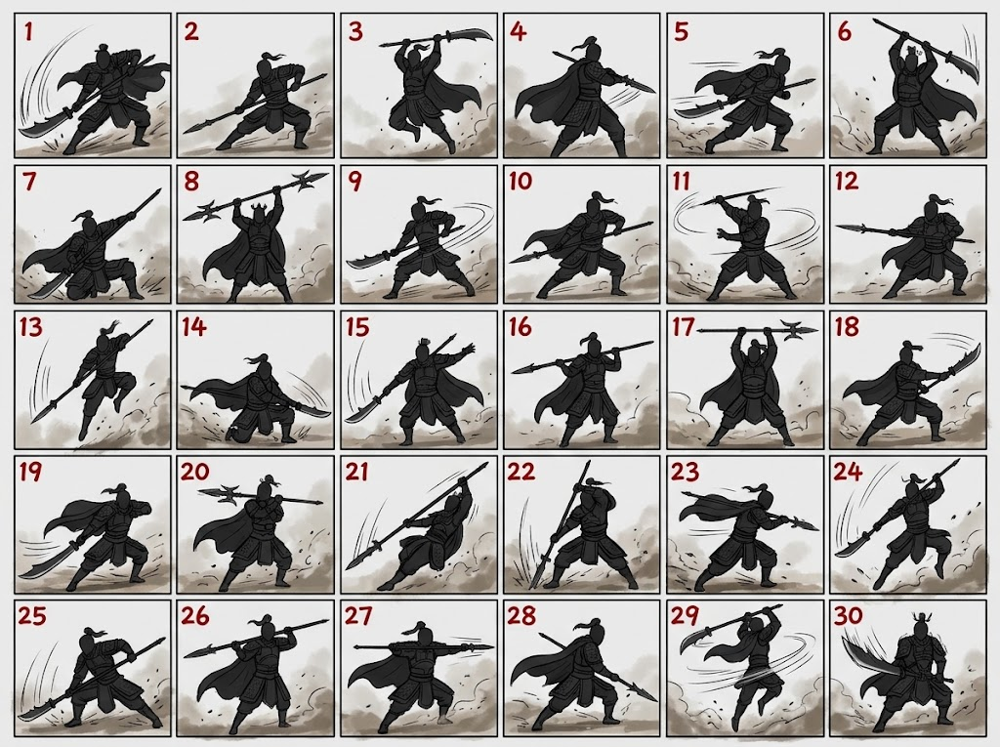
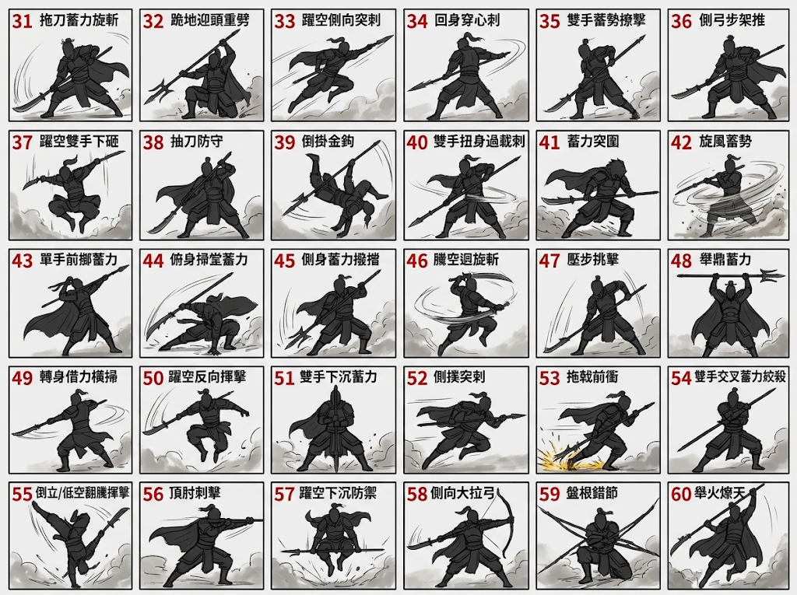

# 武將戰鬥姿勢庫索引

目的：用可檢視、可編號的中性人物草稿，讓每次新角色先選姿，再進入細化；以重心、關節、握持與武器方向傳達蓄力及發力。姿勢草稿不代表動畫已完成或武器已驗收。

## 共用姿勢系列

| 姿勢系列 | 首批數量 | 可共用範圍 | 狀態 |
|---|---:|---|---|
| 長柄武器 | 90 | 長槍、長矛、長大刀、長戟、長棍等雙手長柄武器 | 使用者提供 001–090；061–090 圖檔待收錄至 repo |
| 刀劍 | 60 | 刀、劍；依單手、雙手、雙持與刃口方向修正握姿 | 使用者提供 001–060；附件原圖待收錄至 repo |
| 拳腳 | 50 | 拳、掌、肘、膝、踢擊、閃避與近身格擋 | 待製 |
| 弓弩 | 50 | 弓與弩的站姿、瞄準、發射及重心；手部操作依器械調整 | 待製 |
| 短兵 | 50 | 匕首、短刀、飛刀等單手短兵器 | 待製 |
| 特殊道具 | 每種先 20 | 畫卷、樂器、棋盤、羽扇、籌策尺、流星錘等無法共用操作的道具 | 個別建立 |

## 編號與去重

- 長柄武器依使用者圖片標示 1–60，任務紀錄補成三位數系列碼 LH-001–LH-060；其他系列各自編號，避免不同系列相同號碼混淆。
- 每位武將選定後，把姿勢 ID 與角色、武器、動作方向記入使用紀錄；在同一名冊的同系列中不重複使用。
- 使用者已補充長柄姿勢 061–090，現有可選範圍擴為 001–090；尚未提供的 091–100 不自行編造。其他共用系列依各自張數規劃；特殊道具以道具系列代碼獨立編號，每種先建立 20 個。
- 刀劍姿勢依使用者最新規格共 60 個，號碼為 SW-001–SW-060；刀、劍依單手／雙手／雙持操作調整握法，不把人體骨架共用誤當成武器操作相同。兩張 001–030、031–060 編號圖已由使用者提供，附件原圖待收錄至 repo。
- 保留角色獨有的持握方式與道具；「共用姿勢」只共用人體受力骨架，不強迫替換角色兵器或改變器械操作。
- 每個草稿以蓄力到爆發前的明確瞬間為主，檢查支撐腳、軀幹扭轉、雙手握點、攻擊方向與輪廓；若身體受力與兵器路徑不一致，該姿勢不入庫。

## 當前批次與選姿紀錄

- 依使用者最新排程：先完成女性長柄武器武將，再處理其他男性長柄武器武將。五虎將與呂布已完成選姿，不重開選擇。
- 關銀屏為女性長柄批次首位，現有立繪持長柄大刀；色彩採深蜀綠、亮銀與古金。使用者已選 A：LH-035「雙手蓄勢橫擊」；姿勢已核定，正式立繪待完成。草稿圖：`guan-yin-ping-battle-poses-abc.png`。
- 祝融夫人：《三國演義》描述其持丈八長標並攜飛刀。色彩採銅橘、赤紅與少量孔雀青，區隔蜀將綠銀系。使用者已選 B：LH-033「躍空側向突刺」；姿勢已核定，正式立繪待完成。草稿圖：`zhu-rong-furen-battle-poses-abc.png`。
- 馬雲騄：正式站姿圖可見長槍；角色屬演義／遊戲擴充設定，不作史實武器宣稱。色彩採銀白、深松綠與少量灰紫。使用者已選 A：LH-034「回身穿心刺」；姿勢已核定，正式立繪待完成。草稿圖：`ma-yun-lu-battle-poses-abc.png`。
- 呂玲綺：正式站姿圖可見長柄月刃兵器，屬後世遊戲形象設定。色彩採冷銀、酒紅與炭黑，避開呂布紫黑配色。使用者已選 B：LH-046「腰空迴旋斬」；姿勢已核定，正式立繪待完成。草稿圖：`lu-ling-qi-battle-poses-abc.png`。
- 鮑三娘：正式站姿圖為長柄單月刃；「三板刀法」未明示兵器型制，按本作既有立繪設計，不宣稱史實。色彩採玉綠、暖象牙、珊瑚紅與柔金。使用者已選 B：LH-042「旋風蓄勢」；戰鬥立繪已匯入 `assets/resources/sprites/generals/bao_san_niang_battle.png`；正式 Cocos 畫面顯示仍待在正確工作樹刷新驗證。草稿圖：`bao-san-niang-battle-poses-abc.png`。
- 女性批次目前已核定五位姿勢：關銀屏 LH-035、祝融夫人 LH-033、馬雲騄 LH-034、呂玲綺 LH-046、鮑三娘 LH-042，彼此無重複。正式製作前仍需與既有男將選姿記錄交叉核對；五虎將與呂布只做紀錄比對，不重選其姿勢。

## 全名冊立繪覆蓋基準

- 2026-11-12 盤點 `generals.json` 共 235 位 Active 武將：正式站姿資產 235/235 齊全；正式戰鬥立繪檔案 3/235（關羽、張飛、鮑三娘），尚缺 232 張。鮑三娘戰鬥圖已在正式資源目錄，Cocos 畫面顯示仍待正確工作樹驗證。
- 此數量只代表檔案存在，不代表 235 張站姿都已完成畫風、臉型、比例與配色一致性審查；候選姿勢稿不計入正式戰鬥資產。

### 女性站姿配色相似度初篩

- 2026-11-11 對 35 位女性站姿做透明區排除後的 RGB 粗量化色彩直方圖比對；高相似只代表配色需人工複查，不直接判定角色重複。
- 相似度較高的待複查組：張春華／董白 0.988、郭女王／曹節 0.985、花鬘／蔡氏 0.971、樊氏／夏侯氏 0.966、孫尚香／趙娥 0.955。
- 下一步按 125px 縮圖逐組核對服裝主副色和人物辨識；如果相似色來自同色系但臉、髮型和裝備輪廓有清楚差異，保留，不為降低數值而任意改色。
- 張春華／董白已完成 125px 與 250px 縮圖複核：原兩圖都以紫黑裙甲、護肩及長靴為主，需拉開辨識。董白候選 v2 保留高束長髮與鈴鏈，改為孔雀青、象牙白、暖金與少量朱紅；透明 1024×1536。粗色彩直方圖相似度由原圖 0.988 降至候選 0.926，僅供排序參考，不是自動驗收分數。候選尚未覆蓋正式資源；版本：`dong-bai-portrait-style-candidate-v1.png`、`dong-bai-portrait-style-candidate-v2.png`。
- 郭女王／曹節已完成 125px 與 250px 縮圖複核：原圖相似度 0.985，兩人都有藍紫長裙與高髻直身輪廓。曹節候選改為象牙白、朱紅禮服搭魏藍邊飾，改編髮鳳簪並保留白羽扇；透明 1024×1536。粗色彩直方圖相似度降至 0.431，僅作配色參考；候選尚未覆蓋正式資源：`cao-jie-portrait-style-candidate.png`。
- 花鬘／蔡氏已完成 125px 縮圖複核：色彩直方圖相似度雖為 0.971，但短髮戰裝、雙刀與長袍持物的輪廓明顯不同；暫不改色。此組列為「演算法相似、人工辨識通過」。
- 樊氏／夏侯氏已完成 125px 與 250px 複核：原圖同為低髻、高領綠裙與直身長裙輪廓，原色彩相似度 0.966。樊氏候選改成梅紫、暖象牙、古金，低側盤髮並持銅框小鏡；透明 1024×1536，與夏侯氏原圖粗色彩相似度降至 0.422。候選未覆蓋正式資源：`fan-shi-portrait-style-candidate.png`。
- 張春華／蔡氏已完成 125px 縮圖複核：色彩直方圖相似度 0.958，但張春華的短髮護甲、短刃與蔡氏的長袍低髻、持物輪廓清楚不同；保留原圖，不因紫黑色塊相似而改色。

### 其他武器／待釐清項

- 孫尚香：資料提到習騎射，排入弓弩姿勢系列，不混入長柄批次。花鬘資料記載雙刀，排入刀劍系列。

## 使用者提供的長柄武器姿勢 001–090

001–060 的兩張圖由使用者先前提供；061–090 於 2026-11-11 由使用者補充。各號碼以原圖為準；061–090 目前是無文字標籤的人形剪影，索引只記號碼、不猜測動作名稱。後續角色選姿只使用使用者提供的範圍；先前自製的長柄 001–050 草稿已作廢並移除。061–090 原圖目前仍在本對話附件，尚未複製到 repo。

使用者另提供長柄武器姿勢 061–090；repo 圖檔待收錄。

## 使用者提供的刀劍姿勢 001–060

刀劍共 60 個編號姿勢，分為 001–030 與 031–060 兩張使用者提供的編號圖。姿勢庫代碼為 SW-001–SW-060；附件原圖尚未複製到 repo，未收錄前依本對話附件核對圖號。刀劍選姿與長柄系列分開去重。

姿勢選定後仍須依角色武器校準握點、受力方向與武器結構；編號共用不代表不同長柄兵器可不經校正直接套用動畫。
