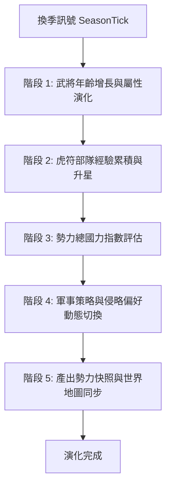

# AI勢力季度全軍強度重算與國力演化狀態機規格書

<!-- doc_id: doc_spec_0612 -->

> 本規格書依據 WBS `AIS-13`（回合結束 AI 全軍強度重算 AI_TurnEndRecalculate：年齡/虎符升星/戰力/國力指數/策略調整）制定，為天下大局演進與勢力動態成長之單一真相來源（Single Source of Truth）。
> 核心約束：無副作用純邏輯架構、季度五階段演化流水線、年齡自然生長衰老曲線、國力指數動態牽引外交策略、全繁體中文台灣慣用術語。

---

## 1. 業務情境與季度演化狀態機

遊戲大世界並非靜態。每當遊戲時間推進至季度換季節點（`SeasonTick`，春／夏／秋／冬），總控引擎依序執行五階段 AI 強度重算流水線，模擬天下諸侯之軍事與內政動態演進。



---

## 2. 五階段演化詳細規則

### 2.1 階段 1：武將年齡增長與屬性曲線
- **年齡推進**：春季換季點時，全天下所有武將年齡 $+1$ 歲。
- **成長期（$<25$ 歲）**：朝氣蓬勃，五維基礎屬性每年自然增長 $+2\%$。
- **鼎盛期（$25 \sim 50$ 歲）**：戰鬥力達到巔峰，五維保持穩定不變。
- **衰退期（$>55$ 歲）**：年老體衰，武力 STR 與統領 LEA 每年遞減 $-1.5\%$（智力與政治不衰退）。

### 2.2 階段 2：虎符部隊經驗累積與升星
各勢力依據其控制之「主城兵營等級（Lv 1~5）」，每季向主力虎符注入部隊經驗：

$$\Delta \text{TallyEXP} = \text{BarracksLevel} \times 50 + \lfloor \text{CityGold} \times 0.05 \rfloor$$

當經驗累積達標且星級 $<3$ 星時，自動升星提升兵種基礎倍率。

### 2.3 階段 3：總國力指數評估（National Power Index）
國力指數（NPI）精算公式：

$$\text{NPI} = \text{CityCount} \times 1,000 + \lfloor \text{TotalTroops} \times 0.5 \rfloor + \lfloor \text{Top5GeneralsCP} \times 0.2 \rfloor$$

### 2.4 階段 4：軍事侵略策略動態切換
依據本勢力 NPI 與全地圖平均國力之比率，動態切換策略姿態：
- **`EXPANSION`（霸權擴張）**：NPI 超過全圖平均 $130\%$，主動出征率提升至 $80\%$。
- **`BALANCED`（割據平衡）**：NPI 處於全圖平均 $80\% \sim 130\%$，維持邊境守備與伺機而動。
- **`DEFENSIVE`（修養築城）**：NPI 低於全圖平均 $80\%$，暫停向外擴張，全數資源投入築城與募兵。

---

## 3. 資料模型與狀態演進純函式

```typescript
export interface IAIGeneralState {
    readonly id: string;
    readonly age: number;
    readonly str: number;
    readonly lea: number;
    readonly int: number;
    readonly pol: number;
}

export interface IAIFactionEvolutionState {
    readonly factionId: string;
    readonly cityCount: number;
    readonly totalTroops: number;
    readonly barracksLevel: number;
    readonly generals: readonly IAIGeneralState[];
    readonly currentNPI: number;
    readonly strategy: 'EXPANSION' | 'BALANCED' | 'DEFENSIVE';
}

export function evolveFactionQuarter(
    state: IAIFactionEvolutionState,
    isSpringSeason: boolean,
    worldAverageNPI: number
): IAIFactionEvolutionState {
    // 階段 1: 武將年齡與屬性演進
    const nextGenerals = state.generals.map(g => {
        const nextAge = isSpringSeason ? g.age + 1 : g.age;
        let strMod = 1.0;
        let leaMod = 1.0;
        if (isSpringSeason) {
            if (nextAge < 25) { strMod = 1.02; leaMod = 1.02; }
            else if (nextAge > 55) { strMod = 0.985; leaMod = 0.985; }
        }
        return {
            ...g,
            age: nextAge,
            str: Math.floor(g.str * strMod),
            lea: Math.floor(g.lea * leaMod),
        };
    });

    // 階段 2 & 3: 國力指數重算
    const topGeneralsSum = nextGenerals
        .slice(0, 5)
        .reduce((sum, g) => sum + (g.str + g.lea + g.int) * 2, 0);

    const nextNPI = state.cityCount * 1000 +
        Math.floor(state.totalTroops * 0.5) +
        Math.floor(topGeneralsSum * 0.2);

    // 階段 4: 策略動態調整
    let nextStrategy: IAIFactionEvolutionState['strategy'] = 'BALANCED';
    const npiRatio = nextNPI / Math.max(1, worldAverageNPI);

    if (npiRatio >= 1.30) {
        nextStrategy = 'EXPANSION';
    } else if (npiRatio < 0.80) {
        nextStrategy = 'DEFENSIVE';
    }

    return {
        factionId: state.factionId,
        cityCount: state.cityCount,
        totalTroops: state.totalTroops,
        barracksLevel: state.barracksLevel,
        generals: nextGenerals,
        currentNPI: nextNPI,
        strategy: nextStrategy,
    };
}
```

---

## 4. 驗收測試案例（Test Cases）

| 測試編號 | 測試情境 | 輸入條件 | 預期輸出 |
|---|---|---|---|
| `TC-NAT-01` | 春季年輕武將自然成長 | 20 歲武將 STR 80，春季換季點 | 年齡增為 21，STR 成長為 81 (+2%) |
| `TC-NAT-02` | 老年武將武力自然衰退 | 60 歲武將 STR 90，春季換季點 | 年齡增為 61，STR 衰退至 88 (-1.5%) |
| `TC-NAT-03` | 國力遙遙領先切換為擴張 | NPI 8,000，全圖平均 5,000（比率 1.60） | 策略切換為 `EXPANSION` |
| `TC-NAT-04` | 國力衰頹切換為修養防禦 | NPI 3,000，全圖平均 5,000（比率 0.60） | 策略切換為 `DEFENSIVE` |
