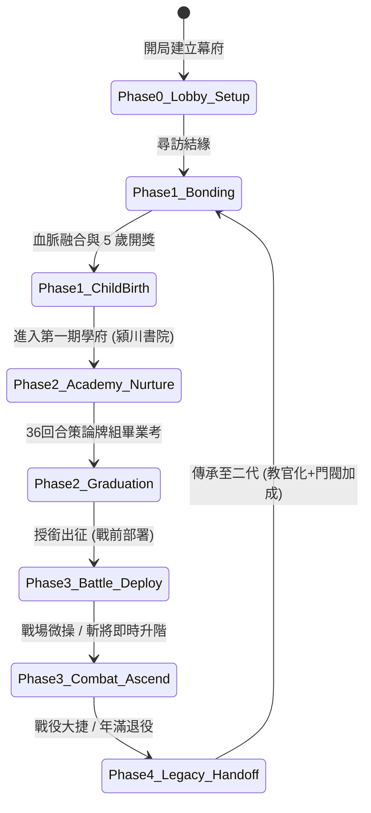

<!-- doc_id: doc_spec_0308 -->
# MVP 核心循環貫通與遊玩動線功能規格書 (Playable Core Loop Vertical Slice)

> **所屬分類**：系統規格書 (System Spec)  
> **關聯總目錄**：[`docs/cross-ref/cross-ref-進度.md (doc_index_0017)`](file:///c:/Users/User/3KLife/docs/cross-ref/cross-ref-進度.md)、[`docs/cross-ref/wbs-progress-inventory-matrix.md (doc_index_1054)`](file:///c:/Users/User/3KLife/docs/cross-ref/wbs-progress-inventory-matrix.md)  
> **關聯母規格**：[`MVP遊戲驗證規格書.md (doc_spec_0045)`](file:///c:/Users/User/3KLife/docs/遊戲規格文件/系統規格書/MVP遊戲驗證規格書.md)、[`培育系統.md (doc_spec_0026)`](file:///c:/Users/User/3KLife/docs/遊戲規格文件/系統規格書/培育系統.md)、[`官職系統.md (doc_spec_0014)`](file:///c:/Users/User/3KLife/docs/遊戲規格文件/系統規格書/官職系統.md)、[`戰場部署系統.md (doc_spec_0040)`](file:///c:/Users/User/3KLife/docs/遊戲規格文件/系統規格書/戰場部署系統.md)、[`ACAD_01_潁川書院_名士清談與策論牌組規格書.md (doc_spec_0303)`](file:///c:/Users/User/3KLife/docs/遊戲規格文件/系統規格書/血統與家系-R5/academies/ACAD_01_潁川書院_名士清談與策論牌組規格書.md)  
> **制定版本**：v1.0 (MVP Playable Milestone)

---

## 1. 系統願景與設計核心理念

### 1.1 核心體驗目標
本規格書為遊戲提供「**首個端到端可玩一遍的垂直切片（Vertical Slice）**」。核心目的在於：
1. **證明玩法極具樂趣且有策略深度**：透過「名門結緣 → 賽馬娘式學府培育（潁川書院）→ 戰場動態相剋驗證 → 戰中斬將即時晉升 → 功成退役傳承」五大環節，展現完整的遊戲性魅力。
2. **緊湊且滿足的單局時長**：
   - **單代體驗（Single Generation）**：約 **15 ～ 20 分鐘**（36 回合學府培育 + 3 場關鍵戰役 + 1 次將階受封與退役）。
   - **跨代傳承（Three Generations）**：跑通「初代（開拓創派）→ 二代（功業純化）→ 三代（神將出世）」的三代完整迴圈，親身體驗數值與血脈的質變。
3. **消除數值灌水，強調策略抉擇**：每一次培育都面臨防 SL 的真實風險，每一次戰鬥都需要兵種剋制與戰法連攜，老將退役更能化身為傳奇教官卡，形成正向反饋閉環。

---

## 2. MVP 五階段核心狀態機 (5-Phase Core State Machine)

---

### Phase 0: 幕府起手與資源盤點 (Lobby Setup)
- **玩家身分**：初入亂世的漢末義勇軍領袖（如自建領主、或引導名將趙雲/劉備）。
- **初始資源包**：
  - 金錢：`1,000`
  - 糧草：`2,000`
  - 虎符兵力：基礎輕步兵符 $\times 1$（帶兵上限 500）、輕騎兵符 $\times 1$（帶兵上限 500）。
  - 將階：雜號將軍（Rank 0，名聲 0）。
- **關鍵操作**：
  1. 檢視幕府大廳（Lobby Hall），確認家族狀態與待辦任務。
  2. 領取開局【初入世家招募令】，解鎖第一位可結緣女性與首發教官卡。

---

### Phase 1: 尋訪結緣與血脈顯化 (Bonding & Child Epiphany)
- **核心機制**：
  1. **尋訪名媛**：消耗精力點數（體力散）前往探訪世家女性（如樊氏、糜貞或士族名媛）。
  2. **天命與血脈契合（EP 計算）**：
     $$EP = 50 + \text{血統共鳴} + \text{異脈因子} + \text{相性加成}$$
  3. **子嗣誕生與 5 歲開獎**：
     - 生成 14 人血統矩陣（若無前代則由虛擬祖先自動補齊）。
     - 揭曉基礎五維（武力、智力、統率、政治、魅力）。
     - 顯化基礎天賦因子（藍/粉/綠初階因子）。
  4. **入學資格**：獲發【潁川書院入學金券】，准予送入第一期賽季學府。

---

### Phase 2: 第一期學府培育——潁川書院篇 (Academy Nurture: Yingchuan)
- **對標機制**：賽馬娘式 36 回合鏡像時空育才，嚴格落實**「防 SL 確定性隨機種子」**。
- **學期劃分**：
  - **初階開蒙（Turn 1 ~ 12）**：基礎五維訓練，初步抽取策論手牌。
  - **策論專精（Turn 13 ~ 24）**：教官羈絆加速，天時/地利/人和三系牌組構築。
  - **經世大成（Turn 25 ~ 36）**：潁川名士大考（司馬徽、荀爽會考），衝刺最終戰力 Prowess。
- **三大核心策略深度**：
  1. **策論手牌構築（Deck Building）**：
     - 每回合自天時（SKY/智謀）、地利（EARTH/農政）、人和（PEOPLE/德操）三系抽取策論牌。
     - 清談大會打出 **【同氣相求】**（三同系，單項爆發 $+100\%$）或 **【天人合一】**（天地人各一，特級大彩圈爆發 $\times 2.5$）。
  2. **體力與風險博弈（Risk & Reward）**：
     - 體力 $>50\%$：清談發揮完美；
     - 體力 $<30\%$：強行苦讀有 $35\%$ 機率「名士駁斥受挫」，心情下滑且暫時得負面特質；但若成功則大機率迸發稀有【靈感戰法】。
  3. **防 SL 確定性引擎**：
     - 入學瞬間以 `PRNG_Seed = Hash(Child_UID + Season_ID + Device_Salt)` 鎖定偽隨機序列。
     - 任何重開、強制關閉應用程式皆只會回到當前決策點，數值完全確定，杜絕刷檔。
- **畢業審定（Graduation Milestone）**：
  - 達成 36 回合結算，產出定型武將卡（五維數值鎖定，獲得專屬評級 S/A/B/C）。
  - 解鎖潁川專屬戰法：**【料敵機先】**（奇謀規避）或 **【十勝十敗】**（開局削弱敵軍士氣）。

---

### Phase 3: 戰場出征與策略博弈 (Battle Deployment & Active Ascendancy)
- **戰場驗收情境**：討伐潁川周邊黃巾叛軍或董卓西涼鐵騎據點。
- **戰前決策**：
  1. **部署半透明部隊預覽 (Ghost Preview)**：拖曳單位時顯示半透明投影，佔用/受阻即時亮紅框，可部署格亮綠框。
  2. **兵籍卡長按檢視 (500ms / 卡高 219px)**：長按即時查閱兵種特攻與適性。
  3. **環境加成**：戰前偵察夜戰/山地加成（純攻擊 $+15\%$）。
- **局內戰術深度（動態相剋）**：
  - **槍克騎**：前排精銳步兵結成【拒馬槍陣】，西涼騎兵衝鋒撞上遭受反傷停滯。
  - **騎破弓**：高速騎兵繞側突襲敵方弓手後排，造成毀滅性穿透打擊。
  - **特種兵突襲**：南蠻部隊於林地釋放【林地疾襲】，規避遠程並伏擊敵陣。
- **爽快感核心：戰場即時升階 (Just-In-Time Rank Up)**：
  - 戰鬥中達成：
    - 斬敵主將：**名聲 $+20$**
    - 單挑勝出：**名聲 $+15$**
  - **即時晉升震撼特效**：當場名聲突破門檻（如 0 $\to$ 100 偏將軍，或 300 裨將軍）：
    - 戰場畫面暫停特寫，彈出**【將階晉升：裨將軍】**！
    - 該將領帶兵上限即時解鎖擴增，**全軍士氣即時拉滿至 100**，全面觸發衝鋒追擊！

---

### Phase 4: 功成身退與世代傳承 (Generational Legacy & Handoff)
- **核心閉環**：
  1. **年齡與退役機制**：
     - 武將每過 4 季增加 1 歲，達 60 歲步入暮年（或達 16 季戰役週期功成身退）。
  2. **一代化身為「傳奇教官卡」**：
     - 一代名將退役後不消失，化為自帶【一生精華】的專屬金色教官卡。
     - 其在戰場與潁川學會的獨門戰法（如【料敵機先】、【神速突擊】），以及六色因子，直接作為二代子嗣的培育支援卡！
  3. **門閥底蘊與祠堂榮譽**：
     - 一代所獲之官職、斬將數轉化為【家族門閥聲望】。
     - 二代子嗣出生時：
       - 初始五維基底加成 $+10\%$。
       - 解鎖高階家族祠堂爵位。
  4. **二代/三代血脈質變**：
     - 二代子嗣迎娶另一名門望族之女，三代開出跨名將血脈共鳴，戰場可釋放雙奧義連鎖，完成「祖→父→子」跨代經營大圓滿。

---

## 3. 端到端可玩驗收檢查點 (Playable Walkthrough Checkpoints)

開發與測試團隊依據以下 10 個標準 Checkpoints 進行端到端貫通驗收：

| 關卡代號 | 階段節點 | 核心驗收行為 | 成功判斷標準 | 失敗/阻塞防線 |
|:---|:---|:---|:---|:---|
| **CP-01** | 幕府開局 | 進入 LobbyScene，點擊領取開局資源 | 金錢 1000、糧草 2000、步騎兵符入庫 | 資源未初始或 UI 報錯 |
| **CP-02** | 尋訪結緣 | 點擊尋訪，選定第一位世家名媛結緣 | 消耗精力，成功觸發結緣動畫 | 精力扣除異常或死循環 |
| **CP-03** | 五歲開獎 | 畫面彈出子嗣 5 歲開獎面板 | 顯示五維雷達圖、14人樹狀圖、初始因子 | 祖先缺失未補虛擬祖先 |
| **CP-04** | 學府入學 | 選擇【潁川書院】，載入 36 回合培育 | 成功生成鏡像快照，PRNG 種子固定 | 破壞本體數據或種子未固化 |
| **CP-05** | 策論手牌 | 執行訓練抽取天/地/人策論卡 | 手牌庫正常累加（上限 5 張） | 抽卡為空或類型溢出 |
| **CP-06** | 清談辯難 | 第 6 回合清談大會，出 3 張牌判定 | 成功識別【同氣相求】或【天人合一】爆發 | Combo 判斷錯誤 |
| **CP-07** | 畢業考核 | 完成 36 回合，通過荀爽考評 | 寫回本體，解鎖戰法【料敵機先】 | 戰法未解鎖或數值丟失 |
| **CP-08** | 戰前部署 | 進入 BattleScene，拖曳該武將至戰場 | 出現半透明 Ghost Preview，綠框吸附 | 部署卡死或無預覽 |
| **CP-09** | 斬將升階 | 戰場內擊殺敵將，名聲跨越門檻 | 畫面跳出【將階晉升】特寫，士氣拉滿 | 名聲未累計或無特寫 |
| **CP-10** | 退役傳承 | 結算後武將退役，檢視教官庫 | 產生該武將之教官卡，二代可借用入學 | 教官庫未入庫或遺失戰法 |

---

## 4. 玩法趣味度與策略深度度量標準 (Fun & Depth Metrics)

1. **決策維度多樣性（Meaningful Choices）**：
   - 玩家在培育階段不是點同一按鈕，而是需要依據手牌顏色平衡體力，每回合都有「賭或穩」的心態波動。
2. **戰鬥策略非數值輾壓（Tactical Counterplay）**：
   - 即使數值略低，依靠「拒馬槍陣反騎」與「料敵機先奇謀」，仍能以弱勝強。
3. **長線傳承情感寄託（Generational Continuity）**：
   - 讓玩家覺得「一代退役不是失去，而是為二代奠定無敵基石」，建立強烈的家族門閥代入感。
