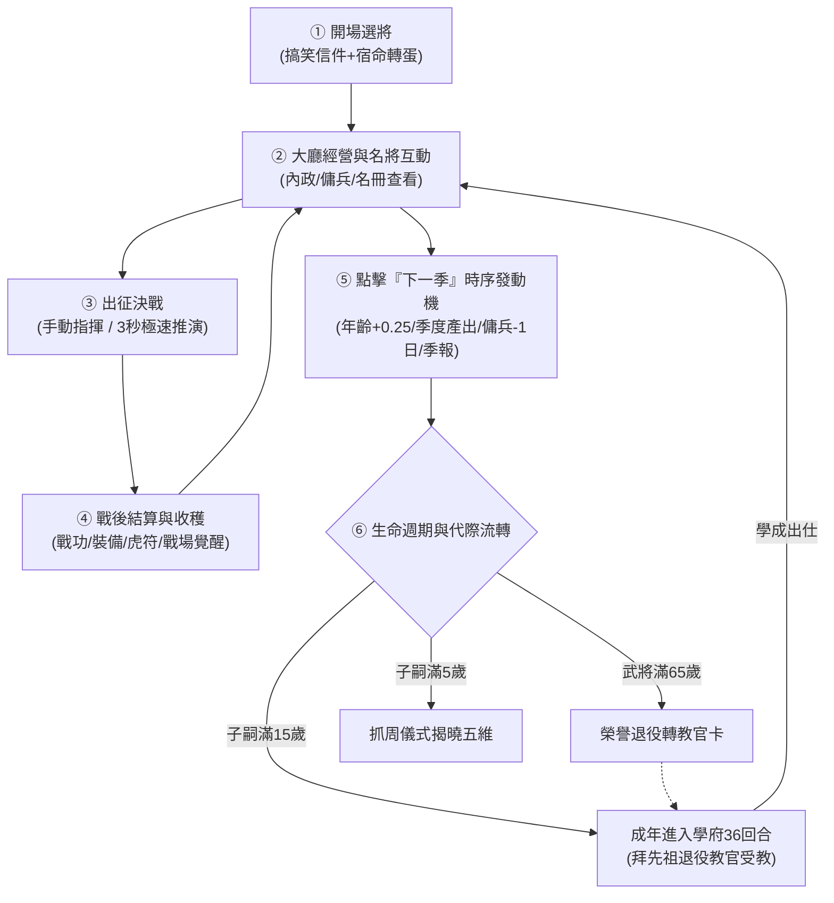

# 三國人生MVP閉環全流程串接與時間發動機總綱規格書

<!-- doc_id: doc_spec_1168 -->

## 一、 核心定位與單一真相來源（SSOT）

本規格書為《三國志·漢末霸業》（3KLife）**MVP「玩一圈」完整遊戲性閉環**之最高總綱規格。
目前系統具備 235 位名將與豐富子系統，但因缺乏推動時間前進的「大廳時序發動機」、戰鬥缺乏極速結算、日報彈窗打斷心流、二代培育與退役孤立，導致玩家無法流暢體驗完整人生循環。
本規格以**最簡、最具視覺反饋、最強名將個性**的方式，將六大核心環節貫穿為流暢運轉的單一遊戲性閉環（Core Game Loop）。

---

## 二、 六大核心環節串接契約與規格參照

### 環節 1：開場選將與新局啟動（Onboarding）
- **關聯規格**：`doc_spec_0586`（宿命轉蛋）、`doc_spec_0622`（初始信件）、`PROG-2-1996`。
- **串接行為**：
  1. 顯示搞笑版開場信件，一鍵進入宿命轉蛋。
  2. 轉蛋池提供六大名將（關羽/張飛/趙雲/諸葛亮/周瑜/曹操），支援無限免費重抽。
  3. 確認後發放名將與裝備進駐大廳，**跳過 Win95 全息分鏡**。

### 環節 2：大廳經營與武將個性展示（Lobby Management）
- **關聯規格**：`doc_ui_0012`（武將人物介面）、`doc_spec_0029`（傭兵試用）、`doc_spec_0638`（低效內政）。
- **串接行為**：
  1. 人物頁（CharacterDs3）呈現五維、六格逸事故事條、裝備與血脈命鏡。
  2. 客卿酒館：招募 6 日試用傭兵（戰力 100%，戰場免俘虜）。
  3. 領地治理：可分派成年武將或未滿 15 歲子嗣（低效內政收益折半）負責農商。

### 環節 3：出征與極速決戰演算法（Sortie & Auto-Resolve）
- **關聯規格**：`doc_ui_0001`（主戰場UI）、`doc_spec_0370`（戰法判定）、`PROG-2-2202`。
- **串接行為**：
  1. 出征介面提供**「親自指揮（棋盤戰場）」**與**「極速決戰（3秒推演）」**雙軌。
  2. **極速推演個性事件**：
     - 武力 $\ge 90$（關/張/呂）：40% 觸發【陣前斬將】，勝率 $+25\%$。
     - 智力 $\ge 90$（諸葛/周瑜）：40% 觸發【奇計伏兵】，戰損降低 $50\%$。
  3. **戰場覺醒（Q52 / checkAwakeningQuota）**：戰鬥大捷時主力檢核潛力，每場上限覺醒 1 因子並破鎖。

### 環節 4：戰後結算與三國季報（Settlement & Chronicles）
- **關聯規格**：`doc_ui_0045`（結算彈窗）、`doc_spec_0351`（虎符跳轉）、`PROG-2-2203`。
- **串接行為**：
  1. 戰後彈出 ResultPopup，發放經驗、銅錢、裝備與虎符。
  2. **重要邊界**：戰後返回大廳**絕對不彈晨報**（杜絕心流打斷）。
  3. 《三國季報》僅在點擊「下一季」或換日首次進大廳時彈出，整合【天下大勢】、【世家軼事】與【市井奇遇微抉擇】。

### 環節 5：大廳時間發動機（The Engine: Next Quarter）
- **關聯規格**：`doc_spec_0642`（四季連動）、`PROG-2-2201`。
- **串接行為**：
  1. 大廳設「下一季」主按鈕，點擊時序推進（春➔夏➔秋➔冬），每 4 季年號 $+1$。
  2. 全員年齡 $+0.25$ 歲；領地自動結算季度產出；傭兵天數 $-1$。
  3. 隨機觸發 1~2 位武將之自發個性事件（如張飛索酒、諸葛亮防汛）。

### 環節 6：退役傳承與二代培育（Retirement & Lineage Loop）
- **關聯規格**：`doc_spec_0653`（退役轉教官）、`doc_spec_1127`/`1130`/`1150`（學府培育）、`PROG-2-2148`/`2152`。
- **串接行為**：
  1. 武將滿 65 歲退役轉「教官卡」，保留被動減免與傳家戰法。
  2. 子嗣滿 5 歲觸發【抓周儀式】（木劍/竹簡/玉珮），定型五維傾向。
  3. 子嗣滿 15 歲成年提示【及冠入學】，進入學府 36 回合，拜退役名將為導師，畢業成為新一代名將出征！

---

## 三、 模組職責與任務卡（PROG）關聯矩陣

| 階段 | 責任任務卡 | 核心負責模組 | 交付產出與驗收標準 |
| :--- | :--- | :--- | :--- |
| **時序引擎** | `PROG-2-2201` | `NextQuarterController` | 換季按鈕運轉，年齡/產出/傭兵天數連動更新 |
| **極速出征** | `PROG-2-2202` | `BattleAutoResolve` | 3 秒極速推演戰報，猛將單挑特寫，Q52 戰場覺醒 |
| **季報奇遇** | `PROG-2-2203` | `DailyReportController` | 戰後禁彈晨報；換季彈季報與市井奇遇微抉擇 |
| **代際傳承** | `PROG-2-2204` | `NurtureFlowController` | 5 歲抓周、15 歲直通學府、65 歲教官傳承接通 |

---

## 四、 驗收測試案例（TC）

- **TC-CORE-LOOP-01（完整一生端到端驗收）**：
  - *前置條件*：新局開場，宿命轉蛋獲得關羽。
  - *操作步驟*：大廳指派關羽出征 ➔ 選「極速決戰」獲勝 ➔ 回大廳點「下一季」連推 4 季 ➔ 觸發季報與關羽事件 ➔ 觸發新生子嗣 5 歲抓周 ➔ 推進至關羽滿 65 歲轉教官卡 ➔ 子嗣滿 15 歲入學府拜關羽為師完成 36 回合 ➔ 二代關平出仕出征。
  - *預期輸出*：全程無黑畫面、無邏輯死鎖、無重複彈窗打斷，六大環節順暢銜接。
