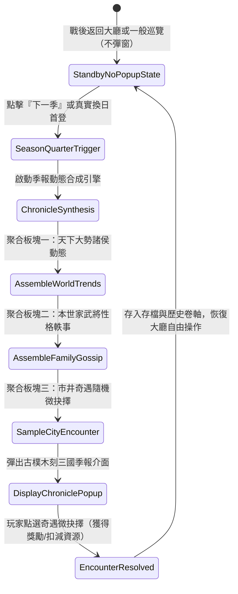

# 三國季報動態合成與市井奇遇微抉擇狀態機規格書

<!-- doc_id: doc_spec_1171 -->

## 一、 核心概念與單一真相來源（SSOT）

本規格書定義《三國志·漢末霸業》（3KLife）**《三國季報》（Three Kingdoms Chronicle）動態合成系統**與**市井奇遇微抉擇狀態機**。
徹底解決過去晨報「每次進出大廳皆重複彈出、打斷操作心流、枯燥如系統Log」之弊病。
本系統正式拍板定案：**出征戰後返回大廳絕對不彈晨報**；季報僅在玩家點擊「下一季」換季或真實每日首次登入時聚合呈現。

---

## 二、 三大板塊資料結構與動態合成規則

### 1. 板塊一：【天下大勢】（全域勢力動態 1 則）
從勢力事件庫根據當前年份與天下格局自動映射：
- `TREND_CAO_CAO_MOVE`：「曹操於許昌厲兵秣馬，廣發招賢令，中原豪傑景從。」
- `TREND_LIU_BEI_STATION`：「劉備率部暫駐新野，秋毫不犯，江夏民望歸心。」
- `TREND_SUN_CE_CONQUER`：「孫策橫掃江東六郡，所向披靡，江東士庶皆呼小霸王。」

### 2. 板塊二：【世家風雲】（名冊武將軼事 1~2 則）
根據名冊持有武將與其性格標籤合成幽默生活軼事：
- **張飛（豪爽/猛將）**：「三將軍昨夜在酒肆豪飲，與市井壯士角力，連震碎三張石几，圍觀者無不讚嘆。」
- **諸葛亮（沉穩/軍師）**：「軍師於清溪畔推演八陣圖，夜引流螢入帳，百姓傳言有仙人之姿。」
- **糜夫人（內助/淑德）**：「夫人親督府內織造錦緞，分賜傷殘士卒家室，全城皆贊主公有賢內助。」

### 3. 板塊三：【市井奇遇微抉擇】（隨機 1 則）
每次換季隨機抽樣一則微抉擇，提供輕度的隨機性與資源博弈樂趣：

| 奇遇事件 | 事件情境與描述 | 選項 A（積極行動） | 選項 B（穩健放棄） |
| :--- | :--- | :--- | :--- |
| **西域胡商** | 牽引一匹汗血寶馬進城，馬蹄如雷，索要重金。 | 消耗 `100` 銅錢 ➔ 獲得【西域良駒（騎兵適性+1階）】 | 婉言謝絕 ➔ 無事發生 |
| **落魄鐵匠** | 鐵匠自稱歐冶子後裔，攜帶半截古劍請求資助。 | 消耗 `50` 銅錢、`50` 木材 ➔ 獲得【淬火重劍（STR+3）】 | 打發離去 ➔ 無事發生 |
| **古道逢醫** | 行腳醫者背負藥囊，願為府中老將調治舊傷。 | 消耗 `30` 糧草 ➔ 全軍體力上限 $+5$，老將壽命 $+1$ 歲 | 禮貌辭退 ➔ 無事發生 |
| **避世道人** | 終南山道者過府，指點府中風水陰陽。 | 消耗 `20` 銅錢 ➔ 主公世家聲望 $+30$，家族氣運提升 | 斥為荒謬 ➔ 無事發生 |

---

## 三、 防呆規範與紅點契約

1. **入口紅點機制**：
   - 換季或首登產生新季報時，大廳「政廳」或「季報」圖示右上角顯示紅點「●」。
   - **紅點熄滅規則**：玩家只要**完整打開季報介面一次**，即標記 `hasReadCurrentSeasonReport = true`，紅點立刻熄滅（修復原先看過仍不熄滅之缺陷）。
2. **戰後回大廳無干擾保證**：
   - 戰鬥結束回到大廳時，`LobbyScene` 的 `onEnter()` 嚴格跳過晨報彈出檢核。
3. **存檔持久化**：
   - 當季奇遇僅允許抉擇一次，選擇後將狀態寫入存檔，防止利用重啟遊戲刷奇遇獎勵。

---

## 四、 驗收測試案例（TC）

- **TC-CHRONICLE-01（戰後返回大廳零彈窗心流驗收）**：
  - *前置條件*：出征戰鬥獲勝。
  - *操作步驟*：點擊結算確認返回大廳。
  - *預期輸出*：大廳乾淨顯示，絕對不自動彈出季報或晨報。
- **TC-CHRONICLE-02（換季季報與市井奇遇獎勵發放）**：
  - *前置條件*：在大廳點擊「下一季」。
  - *操作步驟*：季報彈出，在市井奇遇點選【西域胡商·購買良駒】。
  - *預期輸出*：銅錢扣減 100，背包新增良駒道具，紅點隨即熄滅。
