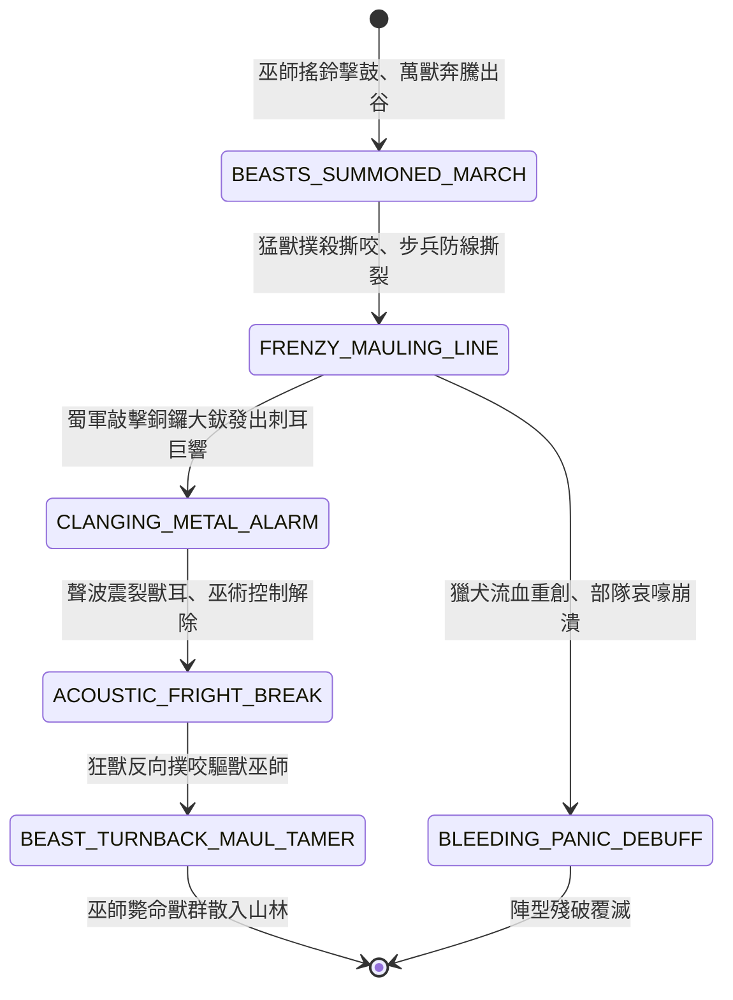

<!-- doc_id: doc_spec_0820 -->
# 3KLife 三國戰場驅使虎豹豺狼猛獸撕咬與金鐵巨響破法狀態機規格書

## 模組基本資訊
- **模組代號**：`BEAST-TAMER-ASSAULT01`
- **系統定位**：三國南蠻奇術驅獸戰法與聲波破除系統，負責神鼓號角群獸召喚、虎豹豺狼撕咬撲殺、狂犬流血恐慌與金鐵巨響破法逆噬之完整狀態流。
- **架構依賴**：`BattleGridSystem`、`TroopTypeMovement`、`SoundAcousticGridEngine`、`VFXBlockRegistry`。

---

## 核心設計概念
三國時期八納洞主木鹿大王之「驅獸邪法」。木鹿身騎白象，手搖蒂鐘，腰懸神鼓與引獸角號。口中唸唸有詞之時，狂風大作，飛沙走石，山中深谷無數猛獸——白額惡虎、斑斕花豹、成群豺狼、毒蟒巨蠍齊出。群獸受神鼓催動，悍不畏死撲入陣列撕咬士卒咽喉，使嚴整方陣瞬間崩塌。孔明識破其「獸性終歸本能」之弱點，命軍士鑄造巨大生鐵面具，點燃松脂火球，同時猛敲銅鑼大鈸發出尖銳「金鐵震天巨響」。猛獸受聲波與火光刺耳驚嚇，獸性失控轉身撕咬驅獸巫師。



---

## 狀態機定義與轉換條件

### 1. `BEASTS_SUMMONED_MARCH`（群獸驅馳狀態）
- **進入條件**：驅獸巫師消耗 80 點氣力，於戰場側翼或森林地格召喚「猛獸軍團」。
- **行為表現**：
  - 生成 20 隻惡虎與群狼實體，移動力高達 5 格/回合，無視草叢灌木地形懲罰。
  - 伴隨虎嘯狼嚎聲場，周遭敵軍士氣每回合 -10 點。
- **轉換**：接觸敵前排防線 -> 轉移至 `FRENZY_MAULING_LINE`。

### 2. `FRENZY_MAULING_LINE`（瘋狂撲咬狀態）
- **行為表現**：
  - 猛獸躍過大盾，直撲步兵喉嚨與面部。
  - 造成無視護甲之 450 點純撕裂真實傷害，直接擊破步兵盾陣維持。
- **轉換**：
  - 撕裂命中 -> 轉移至 `BLEEDING_PANIC_DEBUFF`。
  - 敵軍施展「金鐵巨響」戰術（敲擊銅鑼大鈸超過 85 分貝） -> 轉移至 `CLANGING_METAL_ALARM`。

### 3. `BLEEDING_PANIC_DEBUFF`（流血恐慌狀態）
- **行為表現**：
  - 受創部隊附加「猛獸撕裂」減益（每回合流血損血 8%，持續 3 回合）。
  - 部隊無法結陣反擊，處於恐慌混亂逃竄。
- **轉換**：持續失血至潰滅 -> 結束退出。

### 4. `CLANGING_METAL_ALARM`（金鐵巨響震懾狀態）
- **行為表現**：
  - 己方軍士高舉鐵具猛烈敲擊，發出高頻尖銳金屬爆響。
  - 金鐵聲波以 6 格半徑迅速擴散。
- **轉換**：聲波覆蓋猛獸群 -> 轉移至 `ACOUSTIC_FRIGHT_BREAK`。

### 5. `ACOUSTIC_FRIGHT_BREAK`（獸性驚駭破法狀態）
- **行為表現**：
  - 猛獸耳朵受到高頻劇痛刺痛，神鼓催眠法術徹底失效。
  - 獸瞳由狂暴血紅轉為驚恐恐慌，野性失控狂吠。
- **轉換**：掉頭逆轉（延遲 0.2 秒） -> 轉移至 `BEAST_TURNBACK_MAUL_TAMER`。

### 6. `BEAST_TURNBACK_MAUL_TAMER`（反噬撲殺巫師狀態）
- **行為表現**：
  - 猛獸逆向撲向後排木鹿大王與驅獸蠻兵，將巫師直接拖落馬下咬死。
  - 殘存獸群奪路逃奔竄入無人深山。
- **轉換**：巫師陣亡結算完畢 -> 結束退出。

---

## 數值公式與配置契約

```typescript
export interface BeastTamerConfig {
  spellId: string;
  beastPackCount: number;         // 召喚猛獸單位數
  tearBleedRatePercent: number;   // 撕咬流血扣血比
  soundAcousticDisruptDb: number; // 破解所需金鐵聲學分貝
  turnbackMaulDamageMultiplier: number; // 反噬巫師傷害倍率
  forestSpeedBonusGrids: number;  // 密林移速加成
}

export const BEAST_PRESETS: Record<string, BeastTamerConfig> = {
  MULUK_BEAST_PACK: {
    spellId: 'SPELL_BEAST_01',
    beastPackCount: 20,
    tearBleedRatePercent: 0.08,
    soundAcousticDisruptDb: 85,
    turnbackMaulDamageMultiplier: 3.0,
    forestSpeedBonusGrids: 2,
  }
};
```

---

## 單元測試與驗收標準
1. **密林高速撲咬破盾**：猛獸穿行林地時移動力達 5 格且直接無視大盾格擋，對步兵造成 450 點純真實撕裂傷害。
2. **金鐵聲波精確破法**：金屬鑼聲半徑覆蓋猛獸時，100% 驅散神鼓巫術，猛獸狀態轉移至 `ACOUSTIC_FRIGHT_BREAK`。
3. **反噬巫師致命暴擊**：失控獸群反撲驅獸巫師時，依 3.0 倍暴擊傷害結算，巫師防護脆弱直接被秒殺。
