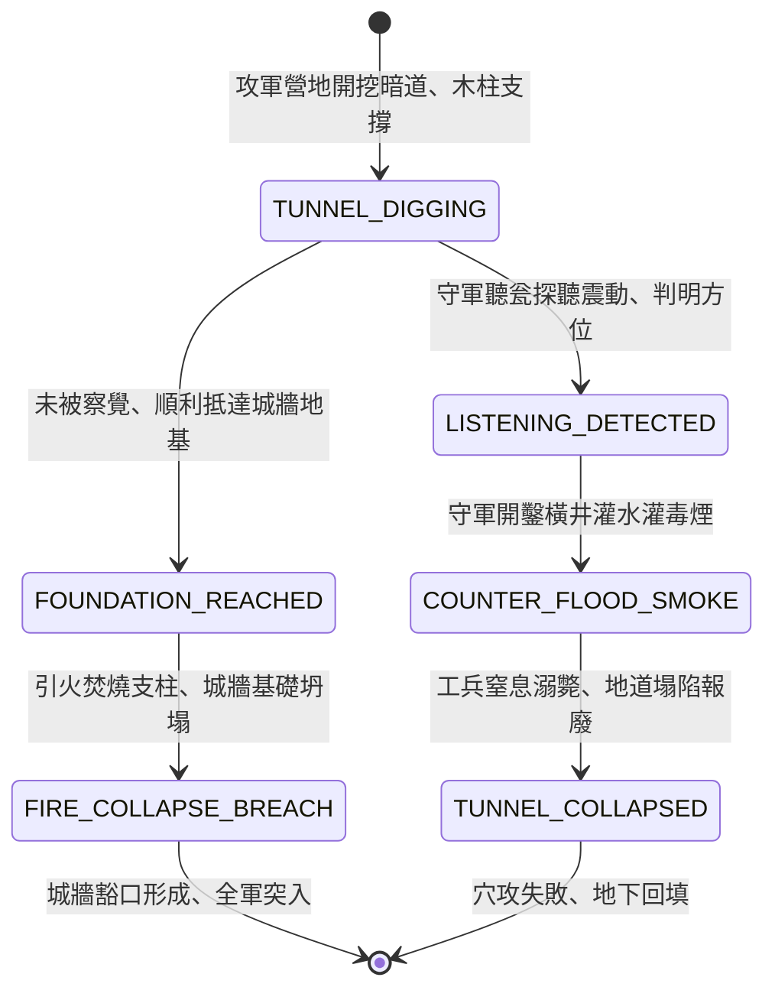

<!-- doc_id: doc_spec_0801 -->
# 3KLife 三國野戰掘地道穴攻爆破城牆與守軍聽瓮探聽地道狀態機規格書

## 模組基本資訊
- **模組代號**：`TUNNELING-MINING-SIEGE01`
- **系統定位**：三國圍城戰地下掘穴坑道攻防系統，負責攻城方隱蔽開鑿地道、坑木支撐、地底縱火爆破城基，以及守軍埋瓮伏聽、灌水灌煙反地道之完整狀態流。
- **架構依賴**：`SiegeCombatController`、`BattleGridSystem`、`PioneerEngineering`、`VFXBlockRegistry`。

---

## 核心設計概念
三國攻堅戰中（如曹操圍冀州、郝昭守陳倉），若城高池深強攻不下，攻軍常指派工兵自營盤後方挖掘暗道直插城牆底部，以粗木立柱支撐頂土，抵達城基後塞滿油脂乾柴，引火焚柱使城牆地基沉陷崩塌。守軍則沿城牆內側每隔五十步埋設一口大陶瓮（聽瓮），令靈敏盲人伏於瓮口聆聽地底掘土震動，判明方向後鑿開橫井灌入沸水、毒煙或糞水，於地道中悶殺敵軍工兵。



---

## 狀態機定義與轉換條件

### 1. `TUNNEL_DIGGING`（掘穴開鑿狀態）
- **進入條件**：攻方在城外 4 格以上安全營地設立坑道口，指派工兵隊開挖。
- **行為表現**：
  - 每回合地道向目標城牆前進 1 格，消耗木材儲備作為支撐頂柱。
  - 施工產生微弱地下震動值（每回合 +10 點震動頻率）。
- **轉換**：
  - 地底震動被守軍聽瓮探測捕捉 -> 轉移至 `LISTENING_DETECTED`。
  - 工兵順利抵達城牆正下方地格 -> 轉移至 `FOUNDATION_REACHED`。

### 2. `LISTENING_DETECTED`（聽瓮察覺預警狀態）
- **行為表現**：
  - 守方城牆哨塔彈出「地底異響」警報，並精確標記出地道行進軌跡地格。
  - 守軍可指派城內工兵隊於城腳挖掘「反制截擊橫井」。
- **轉換**：反制橫井挖掘貫通 -> 轉移至 `COUNTER_FLOOD_SMOKE`。

### 3. `COUNTER_FLOOD_SMOKE`（灌水熏煙反制狀態）
- **行為表現**：
  - 守軍朝地道內灌入大量江水或點燃狼煙、艾草硫磺以皮橐（風箱）鼓吹毒煙。
  - 地道內部攻軍工兵陷入窒息溺斃，每回合造成 300 點持續傷害。
- **轉換**：工兵全滅且地道浸水軟化 -> 轉移至 `TUNNEL_COLLAPSED`。

### 4. `FOUNDATION_REACHED`（進抵地基布薪狀態）
- **行為表現**：
  - 工兵於城基下方掏空泥土，架設承重木柱並堆放易燃油脂與乾柴。
  - 填裝耗時 1 回合，準備引火機關。
- **轉換**：引火點燃 -> 轉移至 `FIRE_COLLAPSE_BREACH`。

### 5. `FIRE_COLLAPSE_BREACH`（焚柱塌陷城破狀態）
- **行為表現**：
  - 烈火焚斷承重木柱，上方城牆失去支撐，發生「地基坍塌轟落」。
  - 目標城牆段耐久直接歸零，轉變為「瓦礫斜坡」豁口（所有部隊可自由通行）。
  - 城頭守軍受到墜落摔傷與士氣 -40 點震撼打擊。
- **轉換**：豁口地貌生成完成 -> 結束退出。

### 6. `TUNNEL_COLLAPSED`（地道報廢狀態）
- **行為表現**：
  - 地道土層坍塌，地表微微下陷，攻方坑道口封閉失效。
- **轉換**：地貌回填 -> 結束退出。

---

## 數值公式與配置契約

```typescript
export interface TunnelMiningConfig {
  tunnelId: string;
  digSpeedPerTurn: number;        // 每回合掘進格數
  vibrationAcousticLevel: number; // 掘土聲響震動值 (0 ~ 100)
  timberPillarCostPerGrid: number;// 每格消耗木材
  wallBreachCollapseDamage: number;// 城牆塌陷真實破甲傷害
  listeningJarDetectThreshold: number; // 聽瓮識破閾值
  smokeSuffocationDamage: number; // 反制毒煙每秒傷害
}

export const TUNNEL_PRESETS: Record<string, TunnelMiningConfig> = {
  HEAVY_TIMBER_MINE: {
    tunnelId: 'MINE_TUNNEL_01',
    digSpeedPerTurn: 1.0,
    vibrationAcousticLevel: 45,
    timberPillarCostPerGrid: 50,
    wallBreachCollapseDamage: 2500,
    listeningJarDetectThreshold: 60,
    smokeSuffocationDamage: 300,
  }
};
```

---

## 單元測試與驗收標準
1. **聽瓮聽音精準捕捉**：當累積震動值達到 60 時，守方地圖介面精準顯示地道位置，並啟動橫井防禦選項。
2. **城基塌陷豁口生成**：成功執行 `FIRE_COLLAPSE_BREACH` 後，目標城牆阻擋判定消失，轉變為坡度通行的平整瓦礫地形。
3. **毒煙反制阻斷**：守軍灌入硫磺毒煙 2 回合後，坑內攻方工兵全滅，狀態轉入 `TUNNEL_COLLAPSED`，城牆耐久無損。
