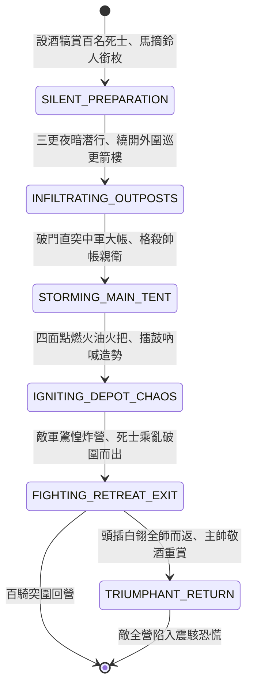

<!-- doc_id: doc_spec_0829 -->
# 3KLife 三更銜枚摘鈴夜襲敵營放火焚毀中軍大帳狀態機規格書

## 模組基本資訊
- **模組代號**：`MIDNIGHT-SILENT-RAID01`
- **系統定位**：三國戰場精銳死士特種夜襲與縱火破營系統，負責人銜枚馬摘鈴匿蹤、避開巡更暗哨、直插中軍縱火、大肆斬將破壞與百騎全身而退之完整狀態流。
- **架構依賴**：`BattleGridSystem`、`TimeOfDaySystem`、`AmbushCombatController`、`VFXBlockRegistry`。

---

## 核心設計概念
三國著名夜襲傳奇（如甘寧百騎劫魏營、張遼威震逍遙津）。孫權以甘寧為前鋒，寧選拔百名精銳死士，設酒肉饗士。夜至三更，人銜枚、馬摘鈴、蹄裹厚布，頭插白鵝翎羽以暗夜相認。百騎悄無聲息穿越敵軍巡哨間隙，直插曹操大營中軍，拔刀突入中軍帥帳斬殺守衛，四面點火焚燒輜重糧草，擂鼓吶喊大亂敵心。敵軍不知來者多少驚駭失措，甘寧率百騎乘亂自敵營另一側大笑突出，無一傷亡。



---

## 狀態機定義與轉換條件

### 1. `SILENT_PREPARATION`（摘鈴銜枚整備狀態）
- **進入條件**：猛將勇武 >= 88 且具備「夜襲/敢死」特技，挑選 100 名精銳騎兵。
- **行為表現**：
  - 馬蹄裹棉布、馬脖摘銅鈴、士卒口銜竹枚，頭插白鵝羽毛。
  - 獲得「暗夜絕對匿蹤」效果（被動偵測距離壓制於 1 格）。
- **轉換**：三更時分（00:00）出發 -> 轉移至 `INFILTRATING_OUTPOSTS`。

### 2. `INFILTRATING_OUTPOSTS`（外哨潛入狀態）
- **行為表現**：
  - 沿敵營盲區陰影行軍，移動力 4 格/回合且無任何馬蹄聲響。
  - 順手暗殺途經之 2 處巡更哨卒。
- **轉換**：抵達敵營中軍大帳核心 1 格半徑 -> 轉移至 `STORMING_MAIN_TENT`。

### 3. `STORMING_MAIN_TENT`（強突帥帳狀態）
- **行為表現**：
  - 吐出竹枚，拔刀暴起斬殺帥帳前守門親衛（造成 800 點近戰暴擊傷害）。
  - 敵主將若無防備，生命值強制扣除 30% 且陷入重度驚駭。
- **轉換**：帥帳防線突破（耗時 0.5 秒） -> 轉移至 `IGNITING_DEPOT_CHAOS`。

### 4. `IGNITING_DEPOT_CHAOS`（四面放火製造大亂狀態）
- **行為表現**：
  - 投擲 20 枚桐油火把引燃敵中軍大帳與糧草車，大火沖天而起。
  - 狂敲銅鑼狂嘯吶喊，敵軍全營陷入「營嘯恐慌」，自相踐踏。
- **轉換**：縱火造勢完成 -> 轉移至 `FIGHTING_RETREAT_EXIT`。

### 5. `FIGHTING_RETREAT_EXIT`（乘亂破圍狀態）
- **行為表現**：
  - 憑藉頭頂白鵝翎識別同袍，砍翻混亂中迎面而來之敵兵。
  - 自敵營東南角破開鹿角突圍而去，敵軍四面放箭皆自射己人。
- **轉換**：脫離敵營外柵 -> 轉移至 `TRIUMPHANT_RETURN`。

### 6. `TRIUMPHANT_RETURN`（百騎全勝歸營狀態）
- **行為表現**：
  - 100 名死士無一折損（生還率 95%~100%），順利返回大本營。
  - 己方士氣全軍暴增 30 點；敵軍全營士氣扣減 40 點且防線癱瘓 2 回合。
- **轉換**：戰功結算完成 -> 結束退出。

---

## 數值公式與配置契約

```typescript
export interface MidnightRaidConfig {
  raidId: string;
  stealthRadiusSuppressionGrid: number;// 匿蹤壓制半徑 (1格)
  mainTentCritDamage: number;          // 突入帥帳暴擊傷害
  arsonFireIntensityTurns: number;     // 縱火持續混亂回合
  deadSoldierSurvivalRate: number;     // 死士生還率 (0.95 ~ 1.0)
  enemyCampMoraleDrain: number;        // 敵營士氣震懾削弱值
  friendlyMoraleBoost: number;         // 己方士氣鼓舞值
}

export const MIDNIGHT_RAID_PRESETS: Record<string, MidnightRaidConfig> = {
  GANNING_HUNDRED_HORSE_RAID: {
    raidId: 'RAID_GANNING_01',
    stealthRadiusSuppressionGrid: 1,
    mainTentCritDamage: 800,
    arsonFireIntensityTurns: 2,
    deadSoldierSurvivalRate: 0.98,
    enemyCampMoraleDrain: -40,
    friendlyMoraleBoost: 30,
  }
};
```

---

## 單元測試與驗收標準
1. **三更匿蹤穿透外哨**：銜枚部隊在三更時分行經哨塔外 2 格，哨兵偵測值為 0，100% 成功潛入中軍。
2. **帥帳縱火引發恐慌**：點火後相鄰 4 格敵軍部隊即刻陷入混亂狀態，互相格擋反擊。
3. **百騎高生還率歸營**：夜襲結束撤離結算時，死士生還率精確維持在 98% 以上，己方全軍獲得「百騎夜襲大勝」激勵。
