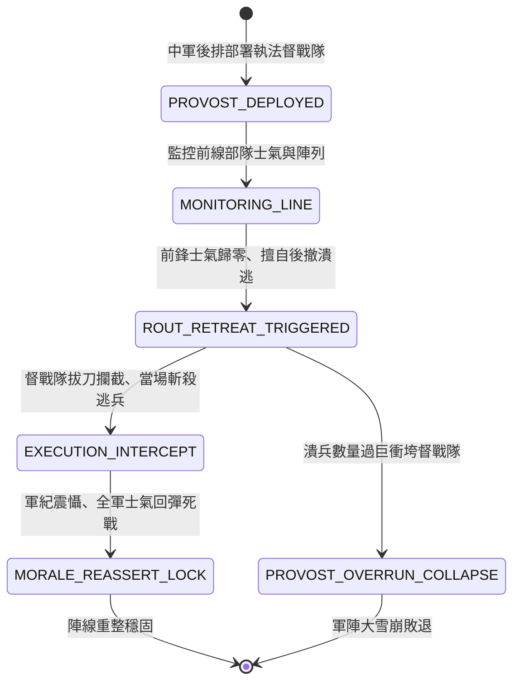

<!-- doc_id: doc_spec_0808 -->
# 3KLife 三軍大將督戰隊嚴明軍紀與斬殺擅退潰兵重聚軍心狀態機規格書

## 模組基本資訊
- **模組代號**：`PROVOST-DISCIPLINE-REASSERT01`
- **系統定位**：三國戰場陣線防崩塌軍紀執法系統，負責督戰隊後排設立、擅退潰兵攔截斬殺、士氣強制鎖定死戰與防範前鋒衝散中軍之完整狀態流。
- **架構依賴**：`MoraleSystem`、`BattleFormationController`、`BattleDamageEngine`、`VFXBlockRegistry`。

---

## 核心設計概念
古代兵法云：「進者有賞，退者立斬」。面對強敵血戰（如張遼八百破十萬、曹操割髮代首嚴明軍紀），前鋒部隊遭遇猛烈傷亡極易發生士氣崩潰潰退。若潰兵無序後奔，必將己方中軍精銳衝散踩踏。名將必於前線與中軍之間設立手持斬馬刀、生鐵重骨朵之「執法督戰隊」。凡未得鳴金金令擅自後退者，督戰隊當場斬首示眾。此舉以雷霆震懾全軍，使殘部知後退必死、向前猶生，士氣反彈鎖定「死戰決心」。



---

## 狀態機定義與轉換條件

### 1. `PROVOST_DEPLOYED`（督戰隊就位狀態）
- **進入條件**：戰前指令配置或主將下達「設立督戰隊」，部署於前鋒後方 2~3 格。
- **行為表現**：
  - 督戰隊由重裝武士組成，立「軍令如山」黑底白字大旗。
  - 對前方相鄰 3 格扇形區域形成「督戰威懾圈」。
- **轉換**：陣列完成 -> 轉移至 `MONITORING_LINE`。

### 2. `MONITORING_LINE`（陣線監控狀態）
- **行為表現**：
  - 即時監測前方部隊士氣數值。
  - 只要前方部隊士氣維持在 20 以上且正常交戰，督戰隊維持警戒靜止。
- **轉換**：前方部隊士氣跌破 0 點觸發潰退並向後奔跑 -> 轉移至 `ROUT_RETREAT_TRIGGERED`。

### 3. `ROUT_RETREAT_TRIGGERED`（擅退攔截判定狀態）
- **行為表現**：
  - 潰退部隊試圖穿越督戰隊防線衝入中軍。
  - 檢定潰兵人數與督戰隊壓制力：若潰兵兵力小於督戰隊鎮壓閾值（500人），啟動斬殺；若超過閾值 2 倍則有衝垮風險。
- **轉換**：
  - 符合鎮壓條件 -> 轉移至 `EXECUTION_INTERCEPT`。
  - 潰兵人數過度龐大（如全線大雪崩） -> 轉移至 `PROVOST_OVERRUN_COLLAPSE`。

### 4. `EXECUTION_INTERCEPT`（當場斬殺立威狀態）
- **行為表現**：
  - 督戰隊揮刀斬殺領頭逃跑將校與士卒（削扣潰退小隊 15% 殘餘人數）。
  - 高呼「後退者夷三族！向前者賞千金！」播放血光與軍法威懾音效。
- **轉換**：立威完成（延遲 0.3 秒） -> 轉移至 `MORALE_REASSERT_LOCK`。

### 5. `MORALE_REASSERT_LOCK`（士氣鎖定死戰狀態）
- **行為表現**：
  - 潰逃部隊強制中止後撤，原地掉頭重組防線。
  - 士氣立即回彈至 40 點，並獲得「背水死戰」狀態（2 回合內士氣鎖定不低於 30 點，防禦力 +20%）。
- **轉換**：陣線重整完成 -> 回歸 `MONITORING_LINE`。

### 6. `PROVOST_OVERRUN_COLLAPSE`（督戰失控崩盤狀態）
- **行為表現**：
  - 督戰隊被數千潰兵衝散踩踏，中軍大陣被己方潰兵衝亂。
  - 全軍陷入無法逆轉之「大潰敗」。
- **轉換**：全軍敗退 -> 結束退出。

---

## 數值公式與配置契約

```typescript
export interface ProvostDisciplineConfig {
  provostId: string;
  suppressThresholdTroopCount: number; // 督戰隊最大鎮壓逃兵數量
  executionCasualtyRate: number;       // 斬殺逃兵人數比例 (0.0 ~ 0.3)
  moraleReboundFixedValue: number;    // 士氣回彈固定值
  deathGroundLockTurns: number;        // 死戰士氣鎖定持續回合
  defenseBuffPercent: number;          // 重整防禦增益比
}

export const PROVOST_PRESETS: Record<string, ProvostDisciplineConfig> = {
  IRON_DISCIPLINE_SQUAD: {
    provostId: 'PROVOST_IRON_01',
    suppressThresholdTroopCount: 600,
    executionCasualtyRate: 0.15,
    moraleReboundFixedValue: 40,
    deathGroundLockTurns: 2,
    defenseBuffPercent: 0.20,
  }
};
```

---

## 單元測試與驗收標準
1. **擅退截停斬殺**：前鋒士氣歸零後撤進入督戰威懾圈時，100% 被強制截停，扣除 15% 殘餘逃兵並停止後退。
2. **死戰士氣鎖定**：被督戰隊重整之部隊，在後續 2 個回合內即使承受遠程箭雨或騎兵衝擊，士氣數值鎖定不低於 30 點。
3. **崩盤衝垮防呆**：當潰兵總數超過 1200 人（閾值 2 倍）時，督戰隊壓制判定失敗，轉入 `PROVOST_OVERRUN_COLLAPSE`。
