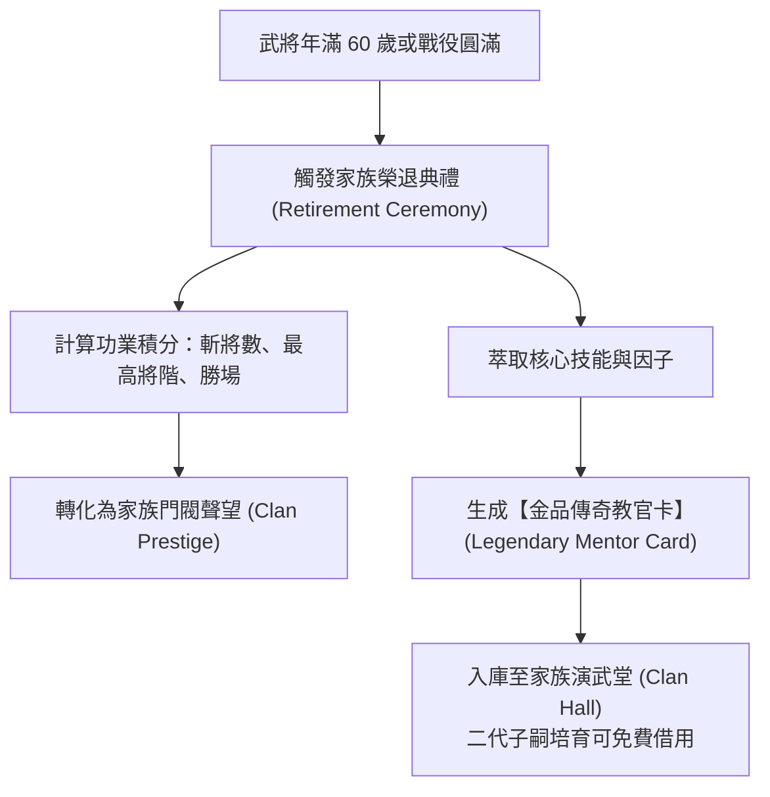

<!-- doc_id: doc_spec_0310 -->
# 世代功業傳承與退役教官轉化功能規格書 (Generational Legacy & Mentor Transformation)

> **所屬分類**：系統規格書 (System Spec)  
> **關聯總目錄**：[`docs/cross-ref/cross-ref-進度.md (doc_index_0017)`](file:///c:/Users/User/3KLife/docs/cross-ref/cross-ref-進度.md)、[`docs/cross-ref/wbs-progress-inventory-matrix.md (doc_index_1054)`](file:///c:/Users/User/3KLife/docs/cross-ref/wbs-progress-inventory-matrix.md)  
> **關聯母規格**：[`MVP核心循環貫通與遊玩動線功能規格書.md (doc_spec_0308)`](file:///c:/Users/User/3KLife/docs/遊戲規格文件/系統規格書/MVP核心循環貫通與遊玩動線功能規格書.md)、[`教官系統（支援卡）.md (doc_spec_0027)`](file:///c:/Users/User/3KLife/docs/遊戲規格文件/系統規格書/教官系統（支援卡）.md)、[`武將壽命系統.md (doc_spec_0018)`](file:///c:/Users/User/3KLife/docs/遊戲規格文件/系統規格書/武將壽命系統.md)、[`血統理論系統.md (doc_spec_0011)`](file:///c:/Users/User/3KLife/docs/遊戲規格文件/系統規格書/血統理論系統.md)  
> **制定版本**：v1.0 (MVP Generational Legacy Milestone)

---

## 1. 系統目標與設計哲學

跨世代血統經營是《3KLife》有別於一般 Roguelike 或普通 SLG 的靈魂所在。本規格書旨在消除「武將老去退役即歸零」的失落感，確立**「一代奠基、二代開花、三代稱霸」**的長線價值：
1. **老將化身傳奇教官卡**：一代名將（如趙雲、關羽、或玩家親手培育之初代）年滿 60 歲退役時，其一生所學之專屬戰法、門風特質與六色因子，自動濃縮為**永久存在的金色傳奇教官卡**，直接插在二代子嗣的入學卡槽中。
2. **門閥家族祠堂與郡望聲望**：武將一生的斬將、官職、勝場轉化為【家族門閥聲望】，永久提升家族階層（寒門 $\to$ 郡望 $\to$ 世家），子嗣出生即享有更高的五維基底與天賦起點。
3. **跨名將血脈純化與雙奧義質變**：二代繼承初代教官卡，並迎娶另一名門望族之女，三代子嗣在 5 歲開獎時觸發【雙柱血脈共鳴】，解鎖跨名將複合雙奧義（如「七星龍膽破」），展現不可思議的戰略爆發力。

---

## 2. 武將退役與傳奇教官卡轉化演算法 (Mentor Card Factory)



### 2.1 傳奇教官卡萃取規則（Extraction Protocol）
當武將步入 60 歲退役時，系統調用 `MentorCardFactory` 生成不可銷毀之傳承卡片：

| 萃取模組 | 來源資料 | 轉化為教官卡屬性 | 培育中的支援效果 |
|:---|:---|:---|:---|
| **核心傳授戰法** | 該武將一生使用頻率最高、或學府結業之稀有戰法 | **固有靈感戰法（Inspired Tactic）** | 子嗣在學府中打出相應策論牌或羈絆達 100 時，**$100\%$ 領悟此戰法**。 |
| **門風特質傳承** | 結業或戰功解鎖之特質（如【潁水清流】） | **特質傳授種子（Trait Seed）** | 期中考評或弱冠禮時，有 $60\%$ 機率將此特質列入候選清單。 |
| **五維加成盤** | 武將退役時之五維最高兩項 | **屬性支援倍率（Stat Bonus %）** | 對應屬性訓練時，額外提供 $+20\%$ 基礎點數加成。 |
| **初始羈絆優勢** | 嫡系子嗣血脈認證 | **先祖血緣共鳴（Ancestral Bond）** | 入學時起始好感度直接設定為 **$50$ 點**（常態為 0），極快觸發【七日頓悟】。 |

---

## 3. 門閥家族祠堂與郡望階層 (Clan Hall & Prestige)

武將一生功業轉化為門閥聲望，計算公式如下：
$$\text{PrestigeGain} = (\text{FinalRank} \times 500) + (\text{TotalKills} \times 50) + (\text{TotalWins} \times 100)$$

### 3.1 家族階層晉升與世代福祉

| 門閥階層 | 聲望門檻 | 階層稱號 | 世代子嗣福祉（一代傳一代） |
|:---:|:---:|:---|:---|
| **Lv. 1** | $0$ | **鄉野寒門** | 基礎狀態，無額外加成。 |
| **Lv. 2** | $1,500$ | **鄉梓郡望** | 子嗣出生五維基礎 $+5\%$；開局自帶 Rank 1（裨將軍）起點。 |
| **Lv. 3** | $4,500$ | **州郡望族** | 子嗣出生五維基礎 $+10\%$；入學精力上限提升至 $110$ 點。 |
| **Lv. 4** | $10,000$ | **名門世家** | 子嗣出生五維基礎 $+15\%$；$100\%$ 帶有 1 個紫色稀有因子；入學解鎖額外第 4 個教官插槽。 |
| **Lv. 5** | $25,000$ | **百年門閥** | 子嗣五維突破天限 $+20\%$；開局自帶 Rank 2（偏將軍）；祠堂每日提供免費靈丹供奉。 |

---

## 4. 跨名將血脈純化與雙奧義共鳴 (Dual Ultimate Resonance)

三代循環的核心高潮在於「名將基因交融帶來的奧義質變」：

### 4.1 雙柱血脈合成條件
1. **父系**：繼承初代名將 A（如趙雲系）之傳奇教官卡與核心因子【龍膽】。
2. **母系**：迎娶名門女性 B（如諸葛氏名媛），帶有先祖核心因子【神算】。
3. **三代子嗣 5 歲開獎**：若子嗣在 14 人血統矩陣中，雙親家族親密度皆 $\ge 80$，且天命 $EP \ge 85$：
   - 觸發震撼動畫：**【雙柱血脈共鳴】**！
   - 戰法槽位自動解鎖專屬複合雙奧義：

| 融合前主因子 A | 融合前主因子 B | 融合誕生之複合雙奧義 | 戰場具體威力與效果 |
|:---|:---|:---|:---|
| **龍膽**（趙雲系） | **神算**（諸葛系） | **【七星龍膽破】** | 消耗 100 怒氣。召喚七星星芒陣籠罩戰場，全屏引發雷霆衝鋒突刺。敵全體造成 $280\%$ 智力與武力雙加成混傷，並強制陷入【癱瘓動搖】2 回合。 |
| **武聖**（關羽系） | **王佐**（荀彧系） | **【青龍鎮國策】** | 消耗 100 怒氣。正面劈出巨大青龍刀氣，造成 $320\%$ 暴擊傷害；同時我方全體士氣拉滿至 100，所屬城池治安民忠直升 100。 |
| **霸王**（孫策系） | **周郎火攻**（周瑜系）| **【赤壁霸王烈焰】** | 消耗 100 怒氣。敵全場化為熊熊火海，無視 $50\%$ 防禦，每回合承受灼燒最大生命值 $15\%$ 傷害。 |

---

## 5. TypeScript 介面契約與轉化架構

```typescript
export interface ILegendaryMentorCard {
  mentorId: string;
  sourceGeneralUid: string;
  generalName: string;
  finalRank: number;
  inherentTacticId: string;      // 固有靈感戰法
  inherentTraitId: string;       // 門風特質
  statBonusPct: { [stat: string]: number }; // 五維支援加成
  initialAffinity: number;       // 起始好感（血親默認 50）
}

export class MentorCardFactory {
  /**
   * 武將退役轉化為傳奇教官卡
   */
  public static createFromRetiredGeneral(
    general: {
      uid: string;
      name: string;
      rank: number;
      bestTactic: string;
      bestTrait: string;
      topTwoStats: [string, string];
    }
  ): ILegendaryMentorCard {
    const statBonus: { [key: string]: number } = {};
    statBonus[general.topTwoStats[0]] = 20;
    statBonus[general.topTwoStats[1]] = 15;

    return {
      mentorId: `MENTOR_ANCESTOR_${general.uid}`,
      sourceGeneralUid: general.uid,
      generalName: `${general.name}（先祖）`,
      finalRank: general.rank,
      inherentTacticId: general.bestTactic,
      inherentTraitId: general.bestTrait,
      statBonusPct: statBonus,
      initialAffinity: 50, // 先祖血脈起始 50 羈絆
    };
  }
}
```

---

## 6. 單元測試案例

1. **TC-LEGACY-01：老將退役轉化教官卡斷言**：
   - 傳入 60 歲退役武將（趙雲，Rank 5，精通戰法【龍膽】、特質【剛毅果敢】）。
   - **斷言**：生成之教官卡 `initialAffinity === 50`，`inherentTacticId === 'TAC_LONGDAN'`，五維加成包含武力與統率。
2. **TC-LEGACY-02：門閥聲望累加與家族階層晉升**：
   - 一代武將結算獲得 10 次斬將、15 次出征勝利、Rank 3。
   - **斷言**：$\text{PrestigeGain} = 3 \times 500 + 10 \times 50 + 15 \times 100 = 3500$，家族自【鄉野寒門】晉升至【鄉梓郡望】。
3. **TC-LEGACY-03：雙柱血脈共鳴判定斷言**：
   - 三代子嗣父系帶【龍膽】、母系帶【神算】，天命 $EP \ge 85$。
   - **斷言**：戰法庫成功解鎖複合雙奧義【七星龍膽破】。
