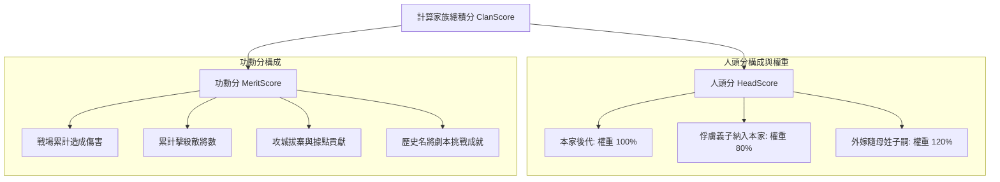
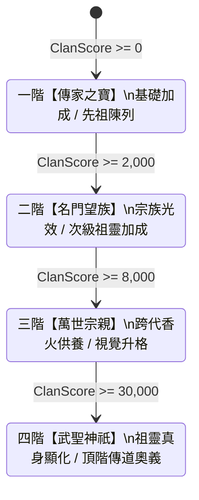

<!-- doc_id: doc_spec_0446 -->
# 世家家族積分構成與四階門閥階位晉升規格書

## 1. 核心定位與職責範圍

本規格書定義世家門閥體系中家族積分（ClanScore）的構成維度、加權計分演算法與四階世家階位晉升模型，對應 WBS **SPI-07**。
為了讓玩家在長局單機歷程中感受跨世代家族興衰，系統以完全個人存檔制（Single Save Isolation）為邊界，不採伺服端共享同姓數據，確保家族成就 100% 映射玩家自身的治家與征戰歷史。
家族積分由「人頭分（HeadScore）」與「功勳分（MeritScore）」兩大支柱合成，直接決定門閥階位與英靈神威的解鎖上限。

---

## 2. 家族積分構成演算法（ClanScore）

```text
ClanScore = HeadScore + MeritScore
```



### 2.1 人頭分加權規則（HeadScore）
人頭分以族內成員個體為基數（標準基數 $B_{\text{head}} = 100$ 分），依血緣納入路徑套用權重：
1. **本家直系嫡傳子嗣**：權重 **100%**（$+100$ 分/人）。
2. **俘虜義子轉化納入本家者**：權重 **80%**（$+80$ 分/人）。
3. **外嫁女隨母姓之後代**：權重 **120%**（$+120$ 分/人，弘揚母系門閥特殊嘉勉）。

### 2.2 功勳分計算規則（MeritScore）
功勳分直接萃取族內全體武將的生平功績帳本：
$$\text{MeritScore} = \lfloor \text{TotalDamage} \times 0.001 \rfloor + \text{TotalKills} \times 10 + \text{SiegeContr} \times 50 + \sum \text{ChallengeBonus}$$

---

## 3. 四階世家門閥等級解鎖模型

隨著家族積分攀升，世家門閥階位逐級解鎖，賦予英靈卡更強的神格顯化與傳道特權：



### 3.1 門閥階位解鎖權限矩陣
| 階位等級 | 門閥稱謂 | 晉升積分門檻 | 核心解鎖功能權限 |
|:---:|:---:|:---:|---|
| **Tier 1** | **傳家之寶** | `0` | 解鎖英靈卡基礎加成（+15 封頂），開啟英靈陳列室瀏覽。 |
| **Tier 2** | **名門望族** | `2,000` | 解鎖宗族暖光加成（+30 封頂），啟用次級祖靈被動技能。 |
| **Tier 3** | **萬世宗親** | `8,000` | 解鎖跨代香火供養（+50 封頂），英靈卡卡面獲得流金動態紋章。 |
| **Tier 4** | **武聖神祇** | `30,000` | 解鎖高階祖靈神祇顯化（+80 封頂），開放傳道介面賜予後代專屬神技。 |

---

## 4. 完全個人存檔邊界防禦

1. **零跨檔污染**：所有家族積分計算僅限於玩家當前執行個體存檔，絕對禁止透過網路通訊匯入其他存檔之同姓族人數據。
2. **質重於量防火牆（H-3）**：低資質大眾臉子嗣所貢獻之功勳具備遞減折算率，確保世家成長依賴名臣良將之卓越功績，而非無節制繁衍刷分。

---

## 5. 驗收標準與單元測試契約

1. **人頭分權重精準驗證**：
   - 家族擁有 2 位本家子嗣、1 位義子、1 位隨母姓外嫁子嗣，人頭分必須精確為 $2 \times 100 + 80 + 120 = 400$ 分。
2. **階位晉升躍遷驗證**：
   - 積分自 1,999 跨越至 2,000 時，世家狀態即刻由 Tier 1 晉升為 Tier 2，並廣播 `ClanTierPromoted` 事件。
