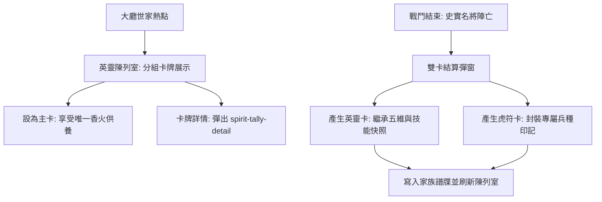

<!-- doc_id: doc_spec_0632 -->
# 世家總覽英靈陳列室與雙卡戰後結算介面規格書

> **規格代碼**：`SPI-12`
> **版本**：v1.0 (Single Source of Truth)
> **狀態**：正式定案 (Approved)
> **檔案大小限制**：嚴格 <6144 bytes

---

## 1. 系統定位與架構

本規格定義遊戲內「世家總覽（SpiritFamilyOverview）」、「英靈陳列室（AncestralHall）」以及「戰後雙卡結算（DualCardSettlement）」之介面佈局、主卡設置與狀態機契約。
補齊過往僅有顯示模型殼（`SpiritFamilyOverviewRoute.ts`）而缺乏完整 UI Spec 與交互狀態機的缺口。



---

## 2. 英靈陳列室分組與主卡設置狀態機

```typescript
export interface AncestralHallState {
  familyId: string;
  mainCardId: string | null;     // 當前供養之唯一主卡
  familyFamePool: number;        // 當前世家名聲池
  cards: SpiritCardViewItem[];   // 全部已供奉英靈卡
}

export interface SetMainCardRequest {
  targetCardId: string;
  clientTimestamp: number;
}

export interface SetMainCardResult {
  success: boolean;
  prevMainCardId: string | null;
  newMainCardId: string;
  fameBonusRate: number;         // 主卡香火吸收率 (100%)
  errorCode?: "CARD_NOT_FOUND" | "IN_BATTLE_LOCKED" | "SAME_CARD";
}
```

### 2.1 主卡唯一供養鐵律
- **一族一主卡**：每個世家同一時間僅能指定 1 張英靈卡為「當前供養主卡」。
- **收益傾斜**：季度家族名聲結算時，全部家族香火點數 100% 注入主卡成長池；副卡僅維持基礎共鳴光環，不獲得成長經驗。
- **戰鬥防鎖死**：若目標英靈卡正被出征中的武將配戴，依然允許設為主卡，但該武將戰鬥結算前數值以入場時為準。

---

## 3. 戰後雙卡結算介面（DualCardSettlement）

當史實名將於戰役中身殞時，觸發雙軌獨立產出結算彈窗：

| 產出卡項 | 卡牌類型 | 資料承載 | 介面呈現規範 |
|---|---|---|---|
| **祖靈英靈卡** | `SPIRIT_CARD` | 死亡時之終極屬性快照、固有奧義、生平功業 | 金色古卷展開動畫，展示武將生卒年與功業徽章 |
| **傳世虎符卡** | `TIGER_TALLY` | 專屬兵種適性（S/A/B/C/D）、初始星級 (1★) | 青銅符節合印動畫，提示已自動歸入國庫虎符池 |

```typescript
export interface DualCardSettlementPayload {
  fallenGeneralId: string;
  generalName: string;
  spiritCard: {
    cardId: string;
    finalStats: { lead: number; war: number; int: number; pol: number; cha: number };
    legendaryDeeds: string[];
  };
  tigerTally: {
    tallyId: string;
    troopType: string;
    aptitudeTier: string;
  };
}
```

---

## 4. UI 路由與共用彈窗契約

1. **路由跳轉**：
   - 點擊大廳熱點 `btn_spirit_family` 派發 `ROUTE_TO_SPIRIT_OVERVIEW`。
   - 點擊任一英靈卡或虎符卡，統一復用 `assets/resources/ui-spec/layouts/spirit-tally-detail-main.json` 彈窗。
2. **多語與字串**：
   - 主卡提示：`UI_SPIRIT_MAIN_CARD_ACTIVE`（「當前主奉先祖，獨享家族香火」）。
   - 結算台詞：`UI_SPIRIT_HERO_FALLEN`（「大星隕落，英魂不滅，化作祖靈護佑子孫！」）。
