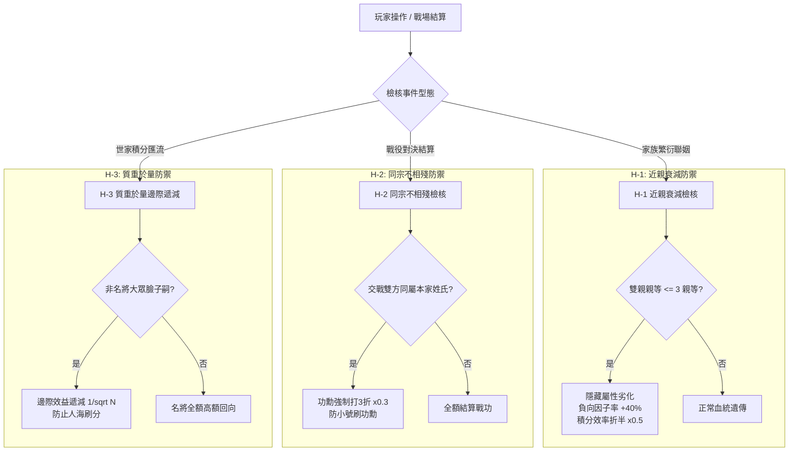

<!-- doc_id: doc_spec_0449 -->
# 世家防火牆反作弊機制與反膨脹平衡數值規格書

## 1. 核心定位與職責範圍

本規格書定義世家體系中的三大平衡防火牆規則：近親衰減（H-1）、同宗不相殘（H-2）與質重於量（H-3），對應 WBS **SPI-10**。
長局多週目環境下，為了杜絕玩家利用機制漏洞進行無成本刷分、近親聯姻堆疊極限數值，或是以同族互刷戰功快速催熟英靈神祇，系統建立純邏輯防護網。
全套規則由無副作用演算法驅動，嚴守數值平衡邊界，確保世家成長回歸正統治家與史詩征戰體驗。

---

## 2. 三大平衡防火牆狀態機

---

## 3. 防火牆詳細數值模型

### 3.1 H-1 近親衰減模型（Inbreeding Penalty）
- **判定標準**：透過血統圖譜（`BloodlineGraph.ts`）追溯，若男女雙方在三代宗族內具備共同祖先（$\text{KinshipDegree} \le 3$）：
  1. **負向因子突變機率**：由基準 5% 驟升至 **45%**（增幅 $+40\%$）。
  2. **五維潛力上限折損**：誕生子嗣之各項資質上限扣減 15%（無條件捨去）。
  3. **家族積分貢獻衰減**：該子嗣一生所獲之所有積分套用懲罰係數：
     $$\text{HeadScore}_{\text{inbreed}} = \text{HeadScore}_{\text{base}} \times 0.5$$

### 3.2 H-2 同宗不相殘模型（Intra-Clan War Dampening）
- **判定標準**：戰場攻守兩軍主將之 `familyKey` 或 `bloodlineId` 判定屬於同一宗族分支：
  $$\text{MeritScore}_{\text{battle}} = \lfloor \text{NormalMerit} \times 0.3 \rfloor$$
- **懲戒意涵**：宗族內訌視為家門不幸，擊殺與傷害折損 70%，杜絕派遣自家族人送死刷戰功之作弊行徑。

### 3.3 H-3 質重於量模型（Quality Over Quantity）
- **判定標準**：為了防止玩家藉由產出大量 C 類大眾臉低素質後裔稀釋世家品質，大眾臉子嗣套用平方根邊際衰減：
  $$\text{ClanScore}_{\text{mob}}(N) = \sum_{i=1}^{N} \frac{\text{BaseScore}}{\sqrt{i}}$$
- 名門名將（A/B 類）則不受衰減約束，每位名將均以 100% 原始高額基數完整回向世家。

---

## 4. 介面警訊與多語契約

1. **近親警告**：結緣介面中，雙方若觸發近親衰減，彈出紅色警示窗 `UI_KINSHIP_WARNING`：「同氣連枝過甚，恐致後裔孱弱，請謹慎締結！」
2. **內戰提示**：戰前編制遭遇同宗陣營時，出征按鈕下方提示金色小字 `UI_INTRA_CLAN_NOTICE`：「同姓鬩牆，此役戰功僅得三成」。

---

## 5. 驗收標準與單元測試契約

1. **三代近親判定驗證**：
   - 堂兄妹結緣生子，驗證新生子嗣之負向突變機率顯著爬升且積分係數為 0.5。
2. **同族內戰打折驗證**：
   - 趙家軍打趙家軍，原本應得 100 點戰功，戰後驗證實際發放嚴格為 30 點。
3. **名將免衰減驗證**：
   - 連續誕生 5 位史實名將，每位名將之世家回向完全無損，未觸發平方根衰減。
