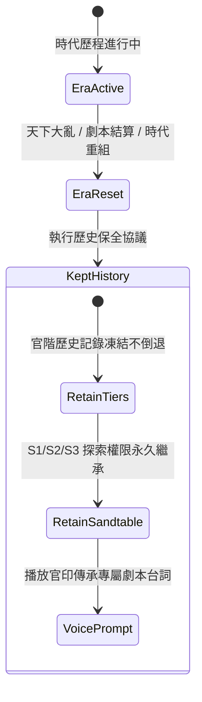

<!-- doc_id: doc_spec_0457 -->
# 世界沙盤三階段演進與天下重組歷史不倒退規格書

## 1. 核心定位與職責範圍

本規格書定義世界沙盤（World Sandtable）三階段解鎖演進模型、遠征作戰檔案（Expedition Dossier）掛載，以及天下重組/時代劇變時之「歷史不倒退」保全鐵律，對應 WBS **HALL-08**。
沙盤作為大廳幕府直通九州戰役的地圖總控，依據君主官階自局部郡守治理逐級擴張至全域天下遠征。
模組由純邏輯服務（`OfficerSnapshot.ts`）實現，確保天下大勢重置時，玩家累計達成之征服歷史與遠征特權得以永久繼承。

---

## 2. 世界沙盤三階段演進模型（S1 ~ S3）

```mermaid
flowchart TD
    OfficerPromote[官職階位晉升 Officer_Snapshot] --> TierJudge{當前官階 Tier}
    
    TierJudge -- Tier 1~2 (縣丞/縣令) --> LocalLobby[未解鎖沙盤\n僅限本城內政 (保底 Stage 1)]
    TierJudge -- Tier 3 (郡守/太守) --> StageS1[解鎖 S1 階段: 郡國經略\n開啟周邊 3 個熱點\n遠征牆 Expedition 開啟]
    TierJudge -- Tier 4 (州牧/刺史) --> StageS2[解鎖 S2 階段: 跨州會盟\n開啟 4 個熱點\n解鎖會盟公文 Alliance Docs]
    TierJudge -- Tier 5 (公卿/霸府重臣) --> StageS3[解鎖 S3 階段: 天下遠征\n開啟 5 個熱點\n開放遠征作戰檔案 Expedition Dossier\n解鎖反霸權峰會 Anti-Hegemony]
```

### 2.1 沙盤階段與特權解鎖矩陣
| 官階等級 | 代表官銜 | 沙盤代碼（`sandtableStage`） | 沙盤階段數字（`worldStage`） | 熱點數量（`hotspots`） | 專屬解鎖特權 |
|:---:|:---:|:---:|:---:|:---:|---|
| **Tier 1~2** | 縣丞、縣令 | `null` | **1**（保底退回） | 1~2 | 本縣治安與流寇防衛 |
| **Tier 3** | 太守、郡守 | **`S1`** | **1** | 3 | 郡國遠征牆（`Expedition`）開啟 |
| **Tier 4** | 州牧、刺史 | **`S2`** | **2** | 4 | 解鎖盟約公文（`allianceDocs: true`） |
| **Tier 5** | 霸府重臣、公卿 | **`S3`** | **3** | 5 | 開放遠征檔案與抗霸峰會（`antiHegemony: true`） |

---

## 3. 天下重組不倒退鐵律（Era Reset Invariant）



### 3.1 歷史解鎖保全原則
- **版圖雖變，號令不滅**：當存檔觸發「天下大亂」、「勢力重構」或「跨賽季結算」時，世界地圖版圖可能重置為諸侯割據初始狀態，但**玩家帳號累計之 `Unlock_History` 與沙盤已解鎖階段絕對不倒退**。
- **專屬語音/劇本文案契約（`OFFICER_ERA_KEPT_LINE`）**：
  > `版圖雖變，舊日官印與號令仍歸於你。`
- **晉升宣敕契約（`officerPromotionScriptLines`）**：
  > `朝議已定，今授你新官印，職權更重。官職既進，沙盤又展開更遠方的疆界。`

---

## 4. 遠征作戰檔案（Expedition Dossier）架構

- 在 **S3 階段**，大廳沙盤中央點亮專屬「遠征作戰檔案」熱點按鈕。
- 點擊展開九州諸侯戰略情資、跨州補給線規劃與抗霸權同盟會議席位，直接導流至長線攻城略地玩法。

---

## 5. 驗收標準與單元測試契約

1. **官階映射沙盤階段驗證**：
   - 官階為 Tier 3 時，`officerUnlocksOf` 回傳 `sandtableStage: 'S1'`，`hotspotCount: 3`。
   - 官階為 Tier 5 時，回傳 `sandtableStage: 'S3'`，`hotspotCount: 5`，`antiHegemonySummit: true`。
2. **保底回退防隱藏驗證**：
   - 官階為 Tier 1（未解鎖沙盤）時，`hallPlayerOf` 將 `worldStage` 安全兜底為 1，避免基礎任務牆被誤判隱藏。
3. **天下重組不倒退驗證**：
   - 模擬劇本結算事件，驗證玩家沙盤階段維持 S3 不被清零。
