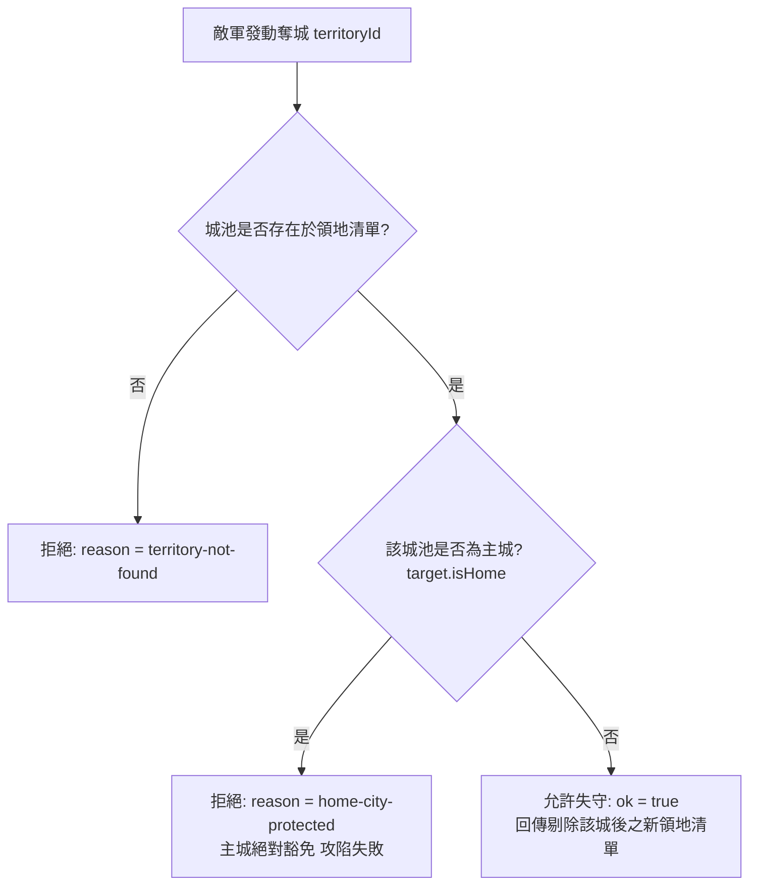

<!-- doc_id: doc_spec_0504 -->
<!-- spec_id: GOV-09 -->
# 世襲主城絕對保護與背水一戰雙倍防禦被動規格書

> 標籤：`系統規格` `領地治理` `世襲主城` `背水一戰` `GOV-09`
> 狀態：`正式生效` · 責任模組：`HereditaryKeep` · 參照：`GOV-09` / `PROG-2-0971`

---

## 1. 核心定位與設計理念

在三國割據的沙盤征戰中，若玩家因外敵多路圍攻而失去所有城池，將導致存檔直接崩潰死鎖。
為保障長線遊戲體驗，系統設計了「世襲主城保護（Hereditary Keep Protection）」與「背水一戰（Last Stand）」機制（`HereditaryKeep.ts`），遵循以下原則：
1. **主城神聖不可淪陷（Invulnerable Home City）**：玩家之祖地核心主城享有絕對系統級豁免權，任何侵略皆不可被攻陷剝奪。
2. **最低生存保障（Min Guaranteed Territory）**：確保玩家在沙盤中永久擁有至少一座城池，延續香火與政權。
3. **極限絕境反撲激勵**：當外圍所有支城全數陷落、僅存主城孤立無援時，自動啟動「背水一戰」強大被動防護。
4. **純函式與不可變狀態**：領地變更計算不修改原陣列，回傳明確結果結構與原因枚舉。

---

## 2. 主城豁免與城池陷落檢定 (attemptTerritoryLoss)

當敵軍發動攻城掠地並試圖奪取某塊領地時，系統嚴格執行所有權檢驗：



### 2.1 主城不可攻陷判定 (`canCaptureTerritory`)
$$\text{canCaptureTerritory}(T) = \neg T.\text{isHome}$$
- 若 `target.isHome === true`，函式回傳 `false`。
- 奪城嘗試立即中止，回傳 `{ ok: false, reason: 'home-city-protected' }`，敵軍攻勢被城防天險擊退。

---

## 3. 背水一戰被動觸發模型 (lastStandModifiers)

當局勢惡化至極限時，城中軍民同仇敵愾，自動解鎖背水一戰增益：

```mermaid
flowchart TD
    TerritoryIn[輸入當前領地清單 territories] --> ConditionCheck{僅剩一座城池 且 該城為主城?}
    ConditionCheck -->|是: territories.length == 1 && isHome| LastStandActive[啟動背水一戰被動<br/>defenseMultiplier: 2.0 (防禦 x 2)<br/>troopProductionBonus: 0.5 (募兵 + 50%)]
    ConditionCheck -->|否: 擁有2座以上城池| LastStandInactive[常規狀態<br/>defenseMultiplier: 1.0 (無加成)<br/>troopProductionBonus: 0.0]
```

### 3.1 核心增益常數 (LAST_STAND_MODIFIERS)
- `LAST_STAND_DEFENSE_MULTIPLIER = 2`：
  主城城防值與守城作戰防禦力倍增（$\times 2.0$），極大提升敵軍攻城難度與傷亡。
- `LAST_STAND_TROOP_PRODUCTION_BONUS = 0.5`：
  城市自然徵兵與募兵操演產能額外增加 **50%**（$+50\%$），助玩家於絕境中快速重建軍勢。

---

## 4. 邊界約束與單元測試契約

1. **唯一性保證**：
   玩家領地陣列中必須且只能存在一個標記為 `isHome: true` 的主城。
2. **多城不觸發原則**：
   若玩家除主城外仍保有一座殘破支城（`length === 2`），背水一戰被動絕不提前觸發（`defenseMultiplier = 1`）。
3. **不可變資料保證**：
   `attemptTerritoryLoss` 成功執行後，原傳入陣列保持完全不變，輸出陣列為深層複製產生之全新集合。
