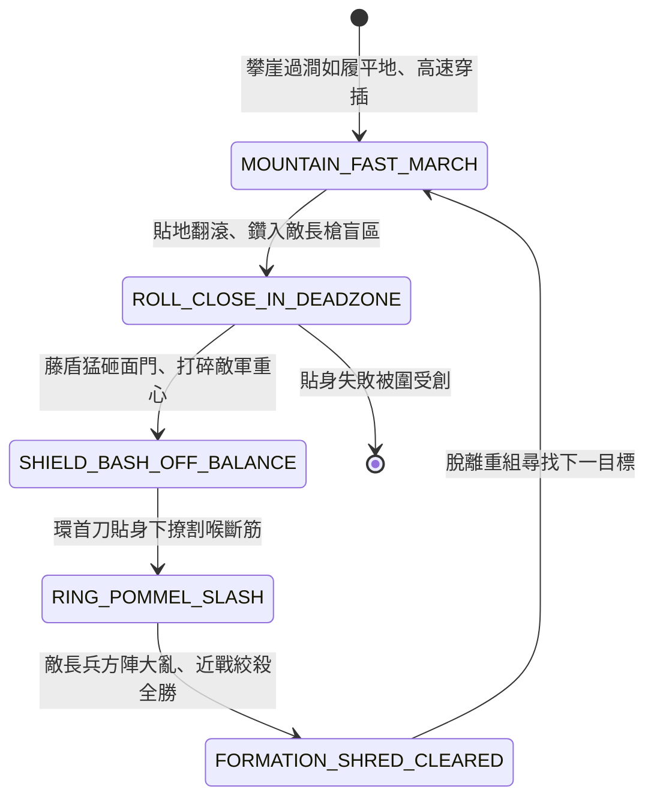

<!-- doc_id: doc_spec_0832 -->
# 3KLife 丹陽精兵山地健步善短兵刀盾貼身纏鬥狀態機規格書

## 模組基本資訊
- **模組代號**：`DANYANG-SKIRMISHER-MELEE01`
- **系統定位**：三國特種山地步兵突擊與貼身短兵纏鬥系統，負責健步如飛山地機動、翻滾貼身鑽入長兵盲區、環首刀盾死鬥破甲與敵陣肉搏絞殺之完整狀態流。
- **架構依賴**：`BattleGridSystem`、`TroopTypeMovement`、`BattleDamageEngine`、`VFXBlockRegistry`。

---

## 核心設計概念
三國天下聞名之第一精悍步兵「丹陽兵」：「丹陽山險，民多果勁，好武習戰，高山深谷，宛若平地」。丹陽精兵自幼生活於崇山峻嶺之間，筋骨強悍、敏捷過人。手持熟鐵環首刀、臂套青藤包鐵圓盾。戰場對決時，不與敵長槍大戟硬碰，而是如猿猴攀爬跳躍，利用靈活翻滾急速貼身，鑽入長槍兵之「近戰死角盲區」。刀盾並施，刀刀直取關節皮肉，乃一切重步兵長兵器方陣之天生剋星。



---

## 狀態機定義與轉換條件

### 1. `MOUNTAIN_FAST_MARCH`（山地疾進狀態）
- **進入條件**：丹陽特種精兵編制，行進於山地、丘陵、峽谷或叢林地格。
- **行為表現**：
  - 移動力 +2 格，完全免疫山地地形之「崎嶇移動力懲罰」。
  - 具備「健步無雙」被動，攀爬高地耗費行動力與平地相同。
- **轉換**：接近敵長槍、大戟部隊相鄰 1 格 -> 轉移至 `ROLL_CLOSE_IN_DEADZONE`。

### 2. `ROLL_CLOSE_IN_DEADZONE`（貼身翻滾盲區狀態）
- **行為表現**：
  - 敏捷翻滾貼近，鑽過一丈五尺長槍槍尖，直接切入槍桿與身體之間（0 距離盲區）。
  - 使敵長兵器部隊陷入「長兵難施」狀態（敵攻擊力驟降 70%）。
- **轉換**：貼身成功 -> 轉移至 `SHIELD_BASH_OFF_BALANCE`。

### 3. `SHIELD_BASH_OFF_BALANCE`（盾牌猛擊失衡狀態）
- **行為表現**：
  - 臂上圓盾猛烈撞擊敵步兵面門或胸膛，將敵軍重心擊碎。
  - 目標陷入 1 回合「失衡暈眩」，格擋率歸零。
- **轉換**：破防破衡完成（延遲 0.2 秒） -> 轉移至 `RING_POMMEL_SLASH`。

### 4. `RING_POMMEL_SLASH`（環首刀貼身割喉狀態）
- **行為表現**：
  - 環首刀短兵急速揮斬，專割甲縫、膝後韌帶與咽喉。
  - 造成無視重鎧之 500 點高頻暴擊傷害（暴擊率 65%）。
- **轉換**：長兵方陣碎裂 -> 轉移至 `FORMATION_SHRED_CLEARED`。

### 5. `FORMATION_SHRED_CLEARED`（盲區絞殺肅清狀態）
- **行為表現**：
  - 敵重步兵方陣在貼身短兵屠戮下陣型全毀，潰不成軍。
  - 丹陽兵士氣 +20 點。
- **轉換**：肅清完畢 -> 回歸 `MOUNTAIN_FAST_MARCH`。

---

## 數值公式與配置契約

```typescript
export interface DanyangSkirmisherConfig {
  unitId: string;
  mountainSpeedBonusGrids: number; // 山地移動加成
  closeInBlindZoneBonus: number;   // 盲區鑽入成功率 (0.0 ~ 1.0)
  enemySpearPenaltyRate: number;   // 敵長兵器受貼身削弱比
  shieldBashStunDurationTurns: number; // 盾擊暈眩回合
  ringBladeCritChance: number;     // 環首刀暴擊率
  ringBladePureDamage: number;     // 純貼身物理傷害
}

export const DANYANG_PRESETS: Record<string, DanyangSkirmisherConfig> = {
  DANYANG_ELITE_INFANTRY: {
    unitId: 'INF_DANYANG_01',
    mountainSpeedBonusGrids: 2,
    closeInBlindZoneBonus: 0.85,
    enemySpearPenaltyRate: 0.70,
    shieldBashStunDurationTurns: 1,
    ringBladeCritChance: 0.65,
    ringBladePureDamage: 500,
  }
};
```

---

## 單元測試與驗收標準
1. **山地零懲罰通行**：丹陽兵在陡坡與山石地格行軍，每步移動力嚴格固定消耗 1 點，無速度減損。
2. **長槍兵盲區削弱**：成功切入相鄰盲區後，長槍兵近戰反擊傷害嚴格扣減 70%。
3. **高暴擊短兵絞殺**：環首刀貼身攻擊時，暴擊率依 65% 計算，造成 500 點高暴擊打擊。
