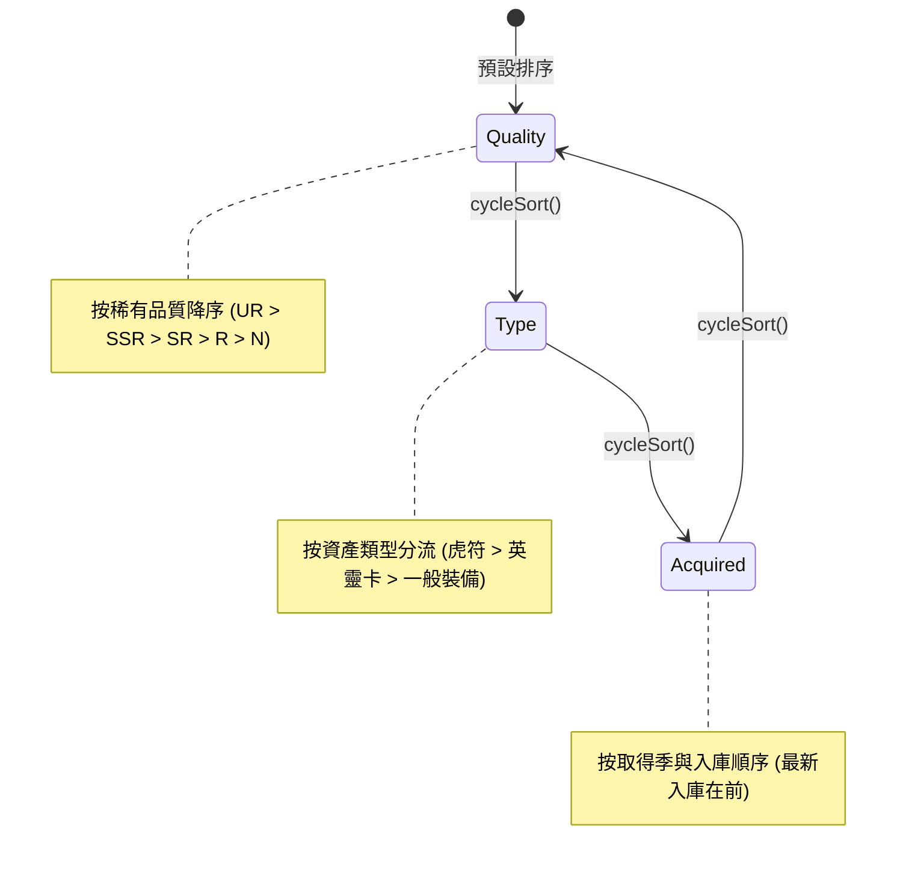

<!-- doc_id: doc_spec_0435 -->
# 主城倉庫三軸篩選排序與穩態比較演算法規格書

## 1. 核心定位與職責範圍

本規格書定義主城倉庫物品的篩選、三軸循環排序與多語系標籤呈現規則，對應 WBS **BAG-05**。
隨著玩家歷經多個賽季征戰，主城倉庫累積龐大數量的虎符、英靈卡與各式兵裝寶物。
系統提供以純演算法驅動的排序服務（`WarehouseSort.ts`），支援依「品質」、「類型」與「取得時間」三種維度進行切換，保證排序結果精確、可重播且具備穩態排序（Stable Sort）特性。

---

## 2. 三軸排序輪播鍵與優先序定義

### 2.1 排序維度枚舉（`WarehouseSortKey`）
- `quality`（品質）：依稀有階級高低排序，頂級戰力置頂。
- `type`（類型）：依重要核心資產分群顯示。
- `acquired`（取得時間）：依戰果入手先後順序展示。

---

## 3. 穩態比較演算法與權重規則

### 3.1 稀有品質排序規則（`WAREHOUSE_QUALITY_ORDER`）
品質嚴格依下列陣列索引位次比較，索引越小排名越靠前：
$$[\text{'UR'}, \text{'SSR'}, \text{'SR'}, \text{'R'}, \text{'N'}]$$
- 未知或未定義品質自動置於陣列末端。同品質時保持原始入庫穩定順序（`a.index - b.index`）。

### 3.2 資產類型分群規則（`WAREHOUSE_TYPE_ORDER`）
資產類型優先順序嚴格對齊統一物件庫設計：
1. **`TALLY`（虎符）**：排在第一優先位次。
2. **`SPIRIT_CARD`（英靈卡）**：排在第二優先位次。
3. **`OTHER`（一般裝備與道具）**：排在第三優先位次。

### 3.3 取得時間排序演算法（`acquired`）
1. **首要鍵值：取得季數（`Acquired_Season`）**：
   - 提取 `record.Attributes?.Acquired_Season`。
   - 具備有效季數者，季數大（最新賽季）排在前面（$\text{seasonB} - \text{seasonA}$）。
   - 有取得季的物件一律排在缺漏取得季物件之前。
2. **次要鍵值：原始入庫順序（最新在前）**：
   - 同季或無取得季記錄者，比較原始列表索引：$\text{b.index} - \text{a.index}$（後入庫者在統一物件庫末端，倒序排列保證最新獲得之物品呈現在最頂部）。

---

## 4. 清單呈現與標籤格式化規範

### 4.1 單列摘要文字契約（`warehouseRecordLine`）
倉庫每列條目統一格式化為繁體中文標準字串：
$$\text{Line} = \text{"[" } + \text{Quality} + \text{"] " } + \text{ItemName} + \text{CountSuffix} + \text{LockSuffix}$$
- **名稱解析順序**：
  1. 一般裝備查 `gearDefinitionOf(record.Gear_ID)?.name`。
  2. 若無則查類型通用標籤（虎符 / 英靈卡 / 裝備）。
- **數量尾綴（`CountSuffix`）**：若 `Quantity > 1`，附加 ` ×N`；否則為空。
- **鎖定尾綴（`LockSuffix`）**：若 `isLocked === true`，附加 `（已鎖定）`；否則為空。
- **範例**：`[SSR] 方天畫戟（已鎖定）`、`[SR] 丹陽兵虎符 ×1`。

### 4.2 控制器按鈕多語系契約
- 切換排序按鈕顯示文字模板：`btnWarehouseSortLabel: 排序：${WAREHOUSE_SORT_LABEL[sortKey]}`。
- 點擊按鈕調用 `cycleSort()`，控制器內部自動切換至下一個排序模式並觸發視圖局部刷新。

---

## 5. 邊界保護與驗收條件

1. **原陣列不可變性**：`sortWarehouseRecords` 接收唯讀陣列，建立 `{ record, index }` 副本進行穩態排序，絕不修改傳入陣列。
2. **空陣列與單項防禦**：當倉庫為空或僅有 1 件物品時，切換排序快速返回原陣列副本，不觸發多餘計算。
3. **單元測試驗收**：
   - 驗證品質排序：UR 必排在 SSR 之前，N 級排在最後。
   - 驗證類型排序：虎符必排在英靈卡之前，英靈卡必排在一般裝備之前。
   - 驗證同分項必維持既有索引相對順序（Stable Sort）。
