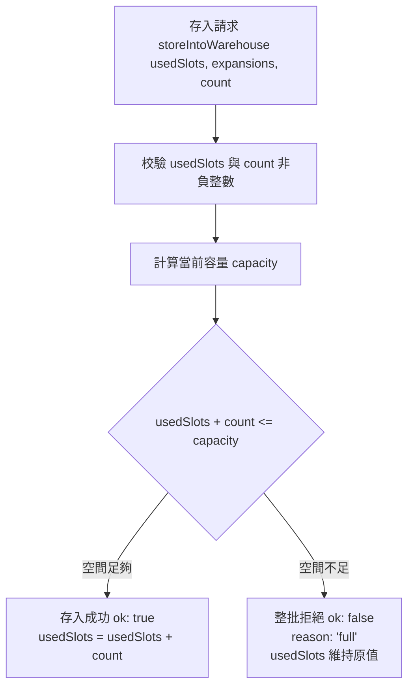

<!-- doc_id: doc_spec_0431 -->
# 主城倉庫容量模型與擴充階梯規則規格書

## 1. 核心定位與職責範圍

本規格書定義主城倉庫（Warehouse）之儲存容量計算、擴充階梯與物品存入檢核狀態機，對應 WBS **BAG-02**。
主城倉庫為玩家集中存放多餘裝備與戰略物資之後勤設施，由純邏輯無副作用服務（`WarehouseCapacity.ts`）驅動，具備純整數驗證與嚴格的交易原子性保護。
系統透過分域隔離原則，確保特定特殊資產（如虎符、英靈卡）不佔用普通倉庫格數，防止玩家倉庫容量被非裝備資產擠佔。

---

## 2. 倉庫容量計算與擴充階梯模型

### 2.1 基礎數值常數定義
- **基礎容量（`WAREHOUSE_BASE_SLOTS`）**：預設初始提供 `50` 格。
- **單次擴充格數（`WAREHOUSE_EXPAND_STEP`）**：每次升級提供 `+20` 格。
- **最大容量上限（`WAREHOUSE_MAX_SLOTS`）**：硬上限為 `200` 格。
- **最大擴充次數**：由公式推導至多可擴充 $8$ 次（$50 + 8 \times 20 = 210 \to 200$）。

### 2.2 容量計算公式（`warehouseCapacity`）
依玩家累積擴充次數（`expansions`）推導當前可用最大容量，嚴格受硬上限截斷：
$$\text{capacity} = \min(200, 50 + \text{expansions} \times 20)$$
輸入值必須為非負整數，否則拋出 `RangeError` 攔截異常。

### 2.3 可擴充性判定（`canExpandWarehouse`）
僅在當前容量小於 `200` 格時允許執行擴充操作：
$$\text{canExpand} = (\text{capacity} < 200)$$
達 200 格後，介面擴充按鈕自動切換為 Disabled 停用態，防止無效消費。

---

## 3. 物品存入原子性狀態機（`storeIntoWarehouse`）

### 3.1 零部分存入鐵律（All-or-Nothing）
- 嘗試將 $N$ 件物品存入倉庫時，若剩餘空間 $< N$，系統**直接整批拒絕（`reason: 'full'`）**，嚴禁執行「部分存入、部分退回」，確保背包與倉庫兩端資料流轉之絕對一致性。
- 函式保證純粹無副作用，不直接異動存檔或全域狀態，僅回傳最新演算結果物件（`WarehouseStoreResult`）。

---

## 4. 倉庫分域隔離與計格邊界（對齊 BAG-10）

依統一物件庫架構（`InventoryProjection.ts`），物件計入主城倉庫之規則如下：
1. **計格物件（佔用格子）**：
   - 僅一般裝備（`Item_Type: 'OTHER'`，未裝備狀態）。
   - 一般消耗品與材料（依物品堆疊規則按列佔格）。
2. **免計格物件（不佔格子）**：
   - **虎符卡（Tiger Tally）**：專屬虎符冊獨立管理（`TALLY_SLOT`），不佔倉庫格子且禁止隨意丟棄。
   - **英靈卡（Spirit Card）**：先祖譜牒獨立管理（`SPIRIT_SLOT`），不佔倉庫格數。

---

## 5. 異常保護與驗收條件

1. **型別邊界檢查**：傳入之已用格數與存入數量必須通過整數檢查（`assertCount`），負數或浮點數立即報錯。
2. **介面提示契約**：滿倉狀態下觸發存入操作，前端統一彈出多語系提示鍵值 `UI_WAREHOUSE_FULL`。
3. **驗收測試對齊**：
   - 驗證擴充 0 次為 50 格、1 次為 70 格、7 次為 190 格、8 次截斷為 200 格、9 次仍為 200 格。
   - 驗證剩餘 2 格時嘗試存入 3 件物品，回傳 `{ ok: false, reason: 'full' }` 且原格數維持不變。
