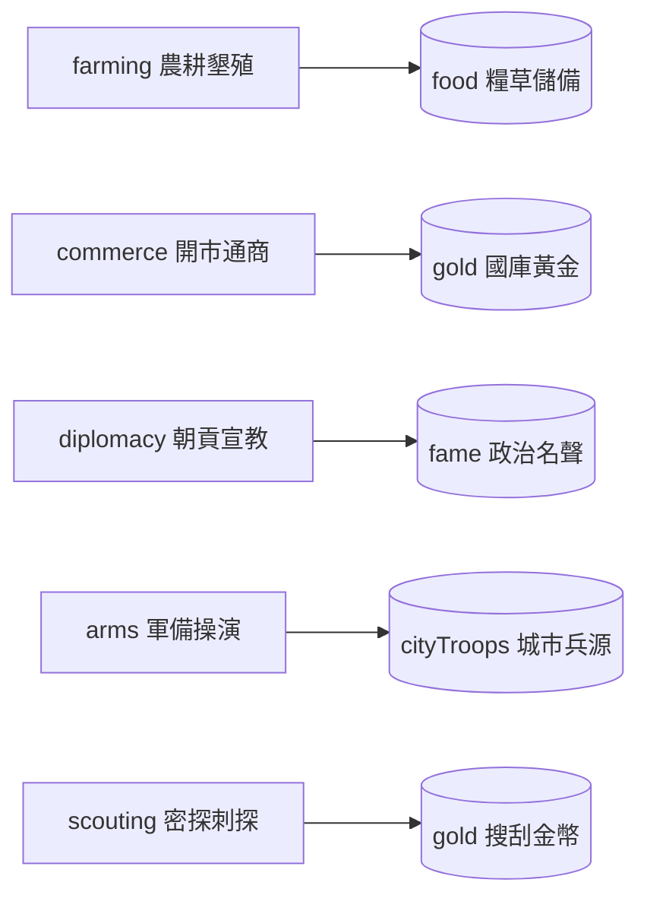

<!-- doc_id: doc_spec_0500 -->
<!-- spec_id: GOV-01 -->
# 五類領地治理任務資料模型與基礎產能表規格書

> 標籤：`系統規格` `領地治理` `內政任務` `資料模型` `GOV-01`
> 狀態：`正式生效` · 責任模組：`DomesticTasks` · 參照：`GOV-01` / `PROG-2-1159`

---

## 1. 模組定位與設計理念

太守府領地治理是玩家在三國亂世中累積糧餉、招募兵馬與擴大政治聲望的基石系統。
本規格書定義五大基礎內政任務的資料結構、資源映射與無武將指派時的保底產能表（`DomesticTasks.ts`），遵循以下原則：
1. **任務與資源精準映射**：明確劃分五大治理領域，每項任務對應一類核心戰略資產。
2. **無人留守保底機制**：在前期或武將全數出征時，領地基層官吏自動提供固定產能，避免經濟完全停擺。
3. **主屬性加權參數化**：規範各任務關聯之四維武將屬性（武、智、政、魅）與權重參數。
4. **純資料契約無副作用**：提供嚴格的 TypeScript 介面定義，與存檔和 UI 呈現完全解耦。

---

## 2. 五大治理任務定義與資源映射表 (DOMESTIC_TASK_OUTPUT)

系統常駐開放五大治理任務（`DomesticTaskId`），每季可由玩家選派執行：



### 2.1 任務清單與基礎固定產能表
當該任務**未指派任何武將**時，由地方基層鄉紳自動提供以下基礎產出（`DOMESTIC_TASK_OUTPUT`）：

| 任務識別碼 (`DomesticTaskId`) | 治理領域名稱 | 產出資源代碼 (`DomesticResource`) | 未指派固定產出量 (`amount`) | 戰略價值與用途 |
|---|---|:---:|:---:|---|
| `farming` | 農耕墾殖 | `food` (糧草) | **120** | 戰場出征部隊必備軍糧燃料 |
| `commerce` | 開市通商 | `gold` (黃金) | **100** | 招募名將、購買裝備之通用貨幣 |
| `diplomacy` | 朝貢宣教 | `fame` (名聲) | **40** | 提升官職階位、觸發天下事蹟 |
| `arms` | 軍備操演 | `cityTroops` (城市兵源) | **80** | 補充戰損、擴充出征部隊總數 |
| `scouting` | 密探刺探 | `gold` (黃金) | **30** | 探查周邊情資順帶搜刮之小額收入 |

---

## 3. 武將屬性加權參數表 (DOMESTIC_STAT_FORMULA)

當玩家選派特定武將擔任治理主管時，產能將由固定產出切換為「基礎底數 + 屬性加權加成」：

$$\text{Formula} = \text{base} + \sum (\text{stat}_k \times \text{weight}_k)$$

| 任務識別碼 (`taskId`) | 基礎底數 (`base`) | 關聯武將屬性 | 權重係數 (`weights`) | 屬性關聯性設計邏輯 |
|---|:---:|:---:|:---:|---|
| `farming` | **100** | 政治 (`pol`) | **$\times 2$** | 政治家精於修築水利、均分田畝 |
| `commerce` | **50** | 魅力 (`cha`) | **$\times 3$** | 魅力者善於招商引資、通商四海 |
| `diplomacy` | **20** | 智力 (`int`) + 魅力 (`cha`) | **$\text{int} \times 1 + \text{cha} \times 1$** | 兼具外交智謀與朝堂威儀 |
| `arms` | **80** | 武力 (`str`) | **$\times 2$** | 猛將嚴格治軍，訓練精兵 |
| `scouting` | **30** | 智力 (`int`) | **$\times 2$** | 智者洞察秋毫，情報探查迅速 |

---

## 4. 介面契約與資料結構

```typescript
export const DOMESTIC_TASK_IDS = ['farming', 'commerce', 'diplomacy', 'arms', 'scouting'] as const;
export type DomesticTaskId = typeof DOMESTIC_TASK_IDS[number];
export type DomesticResource = 'food' | 'gold' | 'fame' | 'cityTroops';

export interface DomesticStats {
    str: number;    // 武力
    int: number;    // 智力
    pol: number;    // 政治
    cha: number;    // 魅力
}

export interface DomesticOutput {
    resource: DomesticResource;
    amount: number;
}
```

- **屬性健全性防禦**：屬性值遇負數時安全夾取至 0，向下取整以確保計算確定性。
