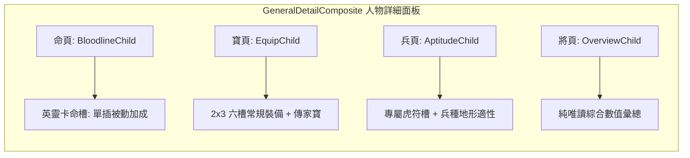

<!-- doc_id: doc_spec_0630 -->
# 人物頁命寶兵三頁裝配職責與UI分工規格書

> **規格代碼**：`EQP-12`
> **版本**：v1.0 (Single Source of Truth)
> **狀態**：正式定案 (Approved)
> **檔案大小限制**：嚴格 <6144 bytes

---

## 1. 系統定位與分工原則

本規格確立武將詳細介面（GeneralDetailComposite）中「命、寶、兵」三頁的嚴格裝配職責與資料流邊界。
徹底解決過往 `CharacterDs3EquipChild` 空殼與 `GeneralDetailAptitudeChild` 缺乏虎符槽的歷史痛點。



---

## 2. 三頁裝配職責邊界矩陣

| 面板子頁 | 專屬裝配槽位 | 允許操作 | 絕對禁止項 |
|---|---|---|---|
| **命 (Bloodline)** | **英靈命槽 (`SPIRIT_CARD`)** (1 槽) | 鑲嵌/替換英靈卡、預覽血脈技能與世代加成 | 禁止裝備武器、防具、飾品與虎符 |
| **寶 (Equip)** | **常規 6 槽 (`GEAR_6_SLOTS`)**<br>+ 傳家寶槽 (`HEIRLOOM`) | 單槽穿卸、一鍵推薦穿戴、裝備強化跳轉 | 禁止操作虎符、英靈卡或變更兵種適性 |
| **兵 (Aptitude)** | **專屬虎符槽 (`TIGER_TALLY`)** (1 槽) | 裝配/卸下虎符（拔除提示忠誠懲罰）、適性預覽 | 禁止常規裝備穿卸；Overview 禁承接虎符 |
| **將 (Overview)** | **無任何操作槽位** | 純點擊查看已裝配物資訊提示（Tooltip） | 嚴禁在總覽頁直接觸發穿卸或替換操作 |

---

## 3. UI 結構與資料綁定路徑（BindPathPolicy）

```typescript
export interface GeneralDetailTabRouting {
  generalId: string;
  activeRoute: "Overview" | "Stats" | "Bloodline" | "Tactics" | "Equip" | "Aptitude";
}

export const EQUIP_PAGE_BIND_CONFIG = {
  slotKeys: [
    "WEAPON",       // 武器槽
    "HEAD",         // 頭部防具
    "BODY",         // 衣服胸甲
    "BOOTS",        // 鞋子足具
    "ACCESSORY_A",  // 飾品一 (戒指/項鍊)
    "ACCESSORY_B",  // 飾品二 (玉珮/兵書)
  ],
  heirloomSlotKey: "HEIRLOOM", // 傳家寶槽
};

export const APTITUDE_PAGE_BIND_CONFIG = {
  tallySlotKey: "TIGER_TALLY", // 虎符槽
  aptitudeDisplays: ["INFANTRY", "CAVALRY", "ARCHER", "TACTICIAN"],
  terrainDisplays: ["PLAINS", "MOUNTAIN", "WATER", "FOREST"],
};
```

---

## 4. 裝配互斥與安全驗收標準

1. **一將一符約束**：同一枚虎符在同一時間只能被一名武將持有；若嘗試將已裝配於武將 A 的虎符移交給武將 B，系統必須彈出確認警告並在拔除時扣除武將 A 忠誠度。
2. **戰鬥鎖定校驗**：若該武將正處於出征中（`isSortie == true`），「命、寶、兵」三頁的所有裝備槽位一律呈現置灰鎖定狀態，點擊提示「部隊出征中，禁止調整裝備」。
3. **空槽 Placeholder 渲染**：未穿戴裝備之槽位必須渲染對應半透明圖示（佔位符），且點擊後自動過濾並開啟背包中對應該槽位的可穿戴清單。
