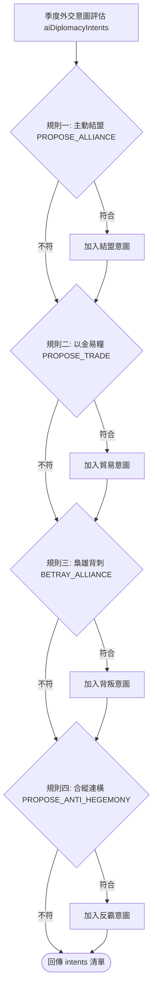

<!-- doc_id: doc_spec_0497 -->
<!-- spec_id: RAI-06 -->
# 他國AI外交決策模型與四項意圖推演演算法規格書

> 標籤：`系統規格` `他國AI` `外交決策` `意圖推演` `RAI-06`
> 狀態：`正式生效` · 責任模組：`RivalAiDiplomacy` · 參照：`RAI-06` / `PROG-2-1476`

---

## 1. 模組定位與設計理念

在三國天下大勢沙盤中，AI 國家的外交行為並非隨機觸發，而是由其君主性格、國力強弱對比以及當前邦交格局綜合驅動的理性推演。
本規格書定義他國 AI 季度外交意圖推演引擎（`RivalAiDiplomacy.ts` 之 `aiDiplomacyIntents`），遵循以下原則：
1. **多維並行評估（Parallel Decorator）**：每季針對其他特定勢力，平行檢查結盟、貿易、背叛與反霸權四類意圖，互不阻斷。
2. **性格與情勢深度綁定**：如外交通商受 `DIPLOMAT` 偏好激勵，落井下石背刺受 `WARLORD` 殘酷驅動。
3. **動態均勢與合縱連橫**：弱國遭遇超強霸權威脅時，主動尋求第三方組建反霸權同盟。
4. **純邏輯與依賴注入**：決策函式無外部狀態污染，隨機數產生器依賴注入，支援 100% 確定性單元測試。

---

## 2. 四大外交意圖判定規則 (AI_DIPLOMACY_RULES)

每季結算時，AI 勢力 `self` 對目標勢力 `other` 執行評估，判定是否產生以下一項或多項外交意圖（`DiplomacyIntent`）：

### 2.1 規則一：外交家主動結盟 (`PROPOSE_ALLIANCE`)
- **出發意圖**：建立長期聯防，互通有無。
- **必要滿足條件**：
  1. 雙方當前邦交值 $\text{relation.value} > 30$（`allianceMinRelation`，互信基礎深厚）。
  2. 我方勢力性格為 `DIPLOMAT`（外交縱橫型）。
  3. 雙方當前尚未締結盟約（`!relation.allied`）。
  4. 隨機檢定通過：$\text{random}() < 0.30$（`allianceChance = 0.3`）。

### 2.2 規則二：有餘補不足以金換糧 (`PROPOSE_TRADE`)
- **出發意圖**：透過經濟槓桿，以充裕的國庫黃金補足急需的軍糧。
- **必要滿足條件**：
  1. 雙方當前非敵對狀態：$\text{relation.value} > 0$（`tradeMinRelation`）。
  2. 我方黃金儲備充足：$\text{self.gold} > 3000$（`tradeSelfGoldOver`）。
  3. 對方糧草告急：$\text{other.food} < 3000$（`tradeOtherFoodUnder`）。
- **生成意圖**：`{ kind: 'PROPOSE_TRADE', targetId: other.id, give: 'gold', receive: 'food' }`。

### 2.3 規則三：梟雄背盟弱小背刺 (`BETRAY_ALLIANCE`)
- **出發意圖**：趁盟友虛弱發動突襲吞併，體現亂世無常。
- **必要滿足條件**：
  1. 雙方目前處於正式同盟狀態（`relation.allied === true`）。
  2. 我方勢力性格為 `WARLORD`（割據梟雄型）。
  3. 盟友軍事實力嚴重衰竭：$\text{other.troops} < \text{self.troops} \times 0.50$（`betrayWeakRatio = 0.5`）。
  4. 隨機檢定通過：$\text{random}() < 0.40$（`betrayChance = 0.4`）。
- **連鎖衝擊**：執行背叛將立即重扣邦交值 80 點（`doc_spec_0490`）。

### 2.4 規則四：合縱連橫共抗霸權 (`PROPOSE_ANTI_HEGEMONY`)
- **出發意圖**：聯合第三方抗衡軍力膨脹的超級強權。
- **必要滿足條件**：
  1. 全局最強國非我方自身，且最強國不是目標國（`!strongest.isSelf && strongest.id !== other.id`）。
  2. 最強國軍事力量達到我方 2 倍以上：$\text{strongest.troops} > \text{self.troops} \times 2.0$（`antiHegemonyTroopRatio = 2`）。
  3. 我方與目標國非敵對：$\text{relation.value} > -20$（`antiHegemonyMinRelation`）。
  4. 我方尚未與目標國締盟（`!relation.allied`）。
- **生成意圖**：`{ kind: 'PROPOSE_ANTI_HEGEMONY', targetId: other.id, againstId: strongest.id }`。

---

## 3. 單元測試契約與行為邊界

1. **性格約束**：非 `DIPLOMAT` 性格之君主絕不主動提出結盟；非 `WARLORD` 性格絕不主動背刺弱盟友。
2. **同盟防呆**：已結盟雙方絕不重複發起 `PROPOSE_ALLIANCE` 或 `PROPOSE_ANTI_HEGEMONY`。
3. **隨機性確定性重播**：在給定固定種子序列時，AI 意圖清單輸出必須 100% 穩定可重複。
