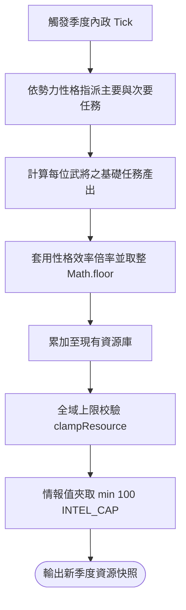

<!-- doc_id: doc_spec_0493 -->
<!-- spec_id: RAI-03 -->
# 他國AI季度內政結算產出與性格效率修正規格書

> 標籤：`系統規格` `他國AI` `內政治理` `性格效率` `RAI-03`
> 狀態：`正式生效` · 責任模組：`RivalGovernance` · 參照：`RAI-03` / `PROG-2-1474` / `PROG-2-1505`

---

## 1. 模組定位與設計理念

三國沙盤上的各大割據勢力擁有獨立的內政循環。若缺乏動態成長，AI 勢力將無法應付長年征戰的兵力與物資消耗。
本規格書定義他國 AI 季度內政結算系統（`RivalGovernance.ts`），遵循以下原則：
1. **數值驅動產出**：依據執行武將的四維屬性（武、智、政、魅）精確計算五類治理任務的產能。
2. **勢力性格效率修正**：各勢力因君主治國理念差異，在特定領域享有加成或承擔劣勢，展現鮮明差異化風格。
3. **主次要任務雙軌架構**：避免純軍備型勢力因缺乏糧草而無法出征，透過雙任務指派保證軍需平衡。
4. **共享資源上限管理**：AI 產出完全受全域 `ResourceCap` 控管，杜絕無限超額囤積資源。

---

## 2. 五大治理任務產出公式 (Task Output)

單一治理任務指派武將後，其基礎產出完全由武將對應能力決定（未套用性格加成前）：

| 任務類型 (GovernanceTaskType) | 產出資源類別 | 基礎產出公式 (`governanceTaskOutput`) | 主要影響屬性 |
|---|---|---|---|
| `FARMING` (農耕墾殖) | `food` (糧草) | **$100 + \text{pol} \times 2$** | 政治 (`pol`) |
| `COMMERCE` (開市通商) | `gold` (黃金) | **$50 + \text{cha} \times 3$** | 魅力 (`cha`) |
| `DIPLOMACY` (朝貢宣教) | `fame` (名聲) | **$20 + \text{int} + \text{cha}$** | 智力 (`int`) + 魅力 (`cha`) |
| `MILITARY` (募兵操演) | `troops` (兵力) | **$80 + \text{str} \times 2$** | 武力 (`str`) |
| `RECON` (密探刺探) | `intel` (情報) | **$30 + \text{int} \times 2$** | 智力 (`int`) |

---

## 3. 勢力性格效率加成矩陣 (GOVERNANCE_EFFICIENCY)

內政任務產能需乘上勢力專屬之效率修正值，向下取整（`Math.floor`）：

$$\text{FinalGain} = \lfloor \text{BaseOutput} \times \text{Efficiency}(\text{profile}, \text{taskType}) \rfloor$$

| 勢力性格 (NationProfile) | 農耕 (FARMING) | 商業 (COMMERCE) | 外交 (DIPLOMACY) | 軍備 (MILITARY) | 偵察 (RECON) |
|---|:---:|:---:|:---:|:---:|:---:|
| `MILITARIST` (軍備整備型) | **0.9** (-10%) | 1.0 | 1.0 | **1.2** (+20%) | 1.0 |
| `DIPLOMAT` (外交縱橫型) | 1.0 | 1.0 | **1.3** (+30%) | **0.8** (-20%) | 1.0 |
| `PASSIVE` (消極偏安型) | **1.1** (+10%) | 1.0 | 1.0 | **0.6** (-40%) | 1.0 |
| 其餘性格 (`WARLORD`, `EXPANSIONIST` 等) | 1.0 | 1.0 | 1.0 | 1.0 | 1.0 |

---

## 4. 主次任務雙軌與季度結算流程

### 4.1 主次任務指派配置 (PROG-2-1505 節奏調校)
- **主要任務 (`NATION_PRIMARY_TASK`)**：軍事性格（如 `MILITARIST`, `EXPANSIONIST`, `WARLORD`）主要執行 `MILITARY`；偏安性格（`PASSIVE`）執行 `FARMING`。
- **次要任務 (`NATION_SECONDARY_TASK`)**：軍事性格次要一律執行 `FARMING`，確保軍糧庫存穩定增長以順利通過出征門檻。

### 4.2 資源邊界與情報上限
- 所有資源結算後呼叫 `clampResource`，受勢力城池數對應之 `ResourceCap` 限制。
- 情報值獨立封頂於 `INTEL_CAP = 100`。

---

## 5. 每兩季武將招募機制 (E-7 / F-3)

1. **招募週期**：每 2 季（`season % 2 === 0`）獲得 1 次招募新武將之機會。
2. **名聲階梯與品質機率表 (`recruitQualityOdds`)**：

| 當前名聲區間 (Fame) | S 級機率 | A 級機率 | B 級機率 | C 級機率 |
|---|:---:|:---:|:---:|:---:|
| **$\text{Fame} > 1500$** | 10% | 30% | 60% | 0% |
| **$800 < \text{Fame} \le 1500$** | 0% | 20% | 70% | 10% |
| **$\text{Fame} \le 800$** | 0% | 10% | 60% | 30% |

演算法以累加閾值配合注入之亂數 `random()` 進行公平抽樣。
