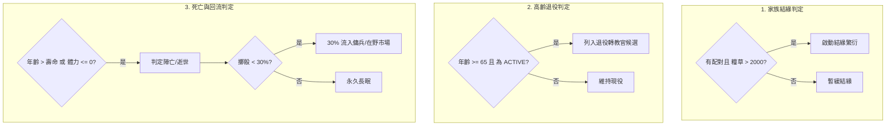
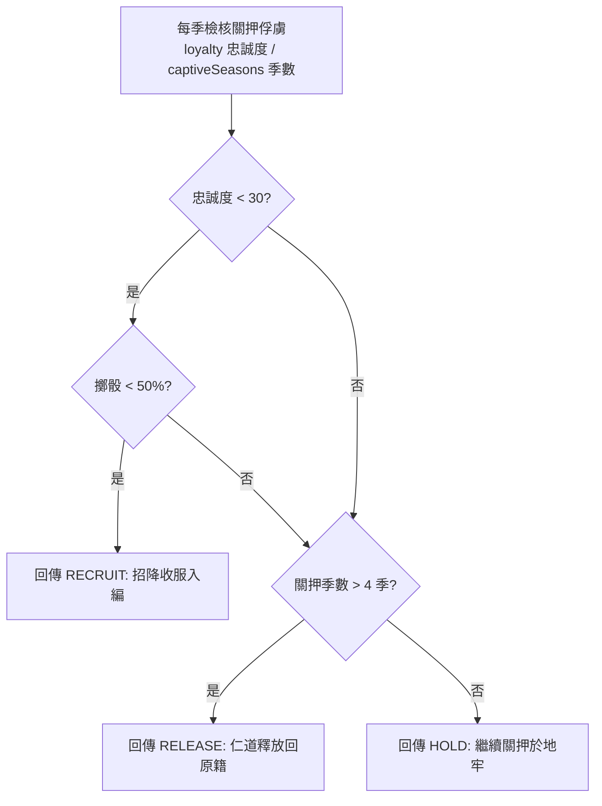

<!-- doc_id: doc_spec_0498 -->
<!-- spec_id: RAI-09 -->
# 他國AI武將經營結緣退役與俘虜三態處置規格書

> 標籤：`系統規格` `他國AI` `武將經營` `俘虜處置` `RAI-09` `RAI-08`
> 狀態：`正式生效` · 責任模組：`RivalGeneralUpkeep` · 參照：`RAI-09` / `RAI-08` / `PROG-2-1477`

---

## 1. 模組定位與設計理念

三國割據勢力若要維持長久戰力，必須妥善維持武將陣容的生老病死與戰後處置。
本規格書定義他國 AI 季度武將經營與戰後俘虜處置中樞（`RivalGeneralUpkeep.ts`），遵循以下原則：
1. **人口與血脈自然循環**：支援 AI 勢力自主結緣繁衍與高齡武將平穩退役。
2. **在野/傭兵市場回流**：名將因年邁或戰死離開勢力時，具備動態流入在野市場之循環機制，豐富世界生態。
3. **俘虜三態自動決策（Three-State Prisoner Resolution）**：針對戰後俘獲之敵將，AI 依據忠誠度與扣押時長自動執行「招降、釋放、關押」三態分流。
4. **純邏輯斷言與狀態解耦**：所有判定函式均為純函式，僅回傳決策代碼，實際名冊增刪由呼叫端統一事務執行。

---

## 2. 季度武將經營四道判定法則 (AI_GENERAL_UPKEEP_RULES)

每季結算時，AI 國家針對麾下武將陣容執行自然生態巡檢：

### 2.1 家族結緣判定 (`canAiStartBonding`)
- **規則**：存在可合法配對之男女武將（`eligiblePairCount > 0`）且當前勢力糧草儲備充足：
  $$\text{food} > 2000 \quad (\text{bondingMinFood})$$
- 確保勢力在糧餉充裕時才進行家族擴展，避免軍糧短缺。

### 2.2 退役轉教官候選 (`isRetirementCandidate`)
- **規則**：武將當前狀態為現役（`ACTIVE`）且年齡達到標準退休線：
  $$\text{age} \ge 65 \quad (\text{retireMinAge})$$
- 符合條件者列入候選清單，後續轉化為教官或宗族長老，騰出現役編制。

### 2.3 壽終與傭兵市場回流 (`isGeneralDead` / `shouldReleaseToMercenaryMarket`)
- **死亡判定**：年齡超過個人壽命上限（`age > lifespanMax`）或當前體力枯竭（`vitality <= 0`）。
- **傭兵市場回流機率 (`mercenaryMarketChance = 0.30`)**：
  武將身故或下野時，有 **30%** 機率以英靈、舊部或傭兵形態重新現身於天下在野市場，供玩家或其他勢力重新招募。

---

## 3. 戰俘三態處置演算法 (aiPrisonerDecision)

AI 勢力地牢中關押之俘虜，每季自動依忠誠度與關押時間長度判定處置去向：

### 3.1 處置決策矩陣

| 決策結果 (`AiPrisonerDecision`) | 中文意圖 | 觸發條件約束 | 後續連鎖影響 |
|---|---|---|---|
| `RECRUIT` | 招降收服 | 俘虜忠誠 $\text{loyalty} < 30$ 且 $\text{random}() < 0.50$ | 敵將感念招撫，正式轉籍加入我方陣營 |
| `RELEASE` | 仁道釋放 | 關押時間超過 4 季（$\text{captiveSeasons} > 4$） | 久勸不降後遣返原籍，提升我方名聲 |
| `HOLD` | 繼續關押 | 不符合上述兩項條件 | 繼續留置牢房，每季榨取情報與產出 |

---

## 4. 驗收標準與單元測試契約

1. **隨機數消耗保護**：
   `aiPrisonerDecision` 實施惰性擲骰，僅當 `loyalty < 30` 時才消耗傳入之 `random()` 亂數，確保未達門檻時不浪費隨機序列。
2. **邊界測試覆蓋**：
   - 忠誠度剛好為 30 時，不觸發招降擲骰；關押 4 季時維持關押，第 5 季（$> 4$）才觸發釋放。
   - 年齡 64 歲不列入退役候選，65 歲精準觸發。
