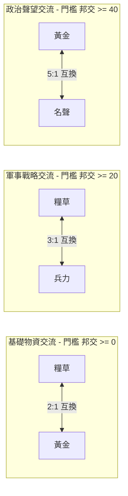
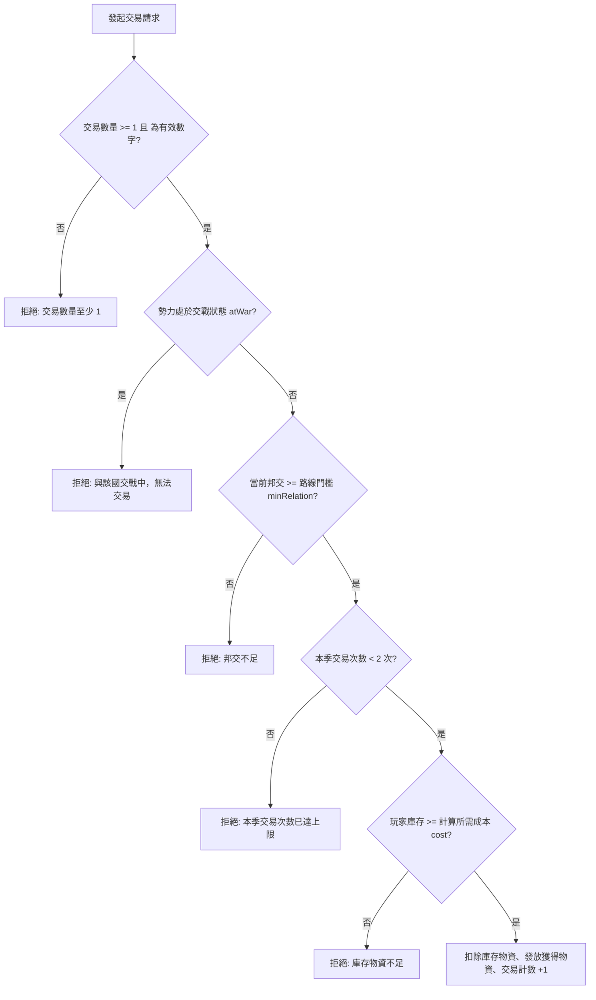

<!-- doc_id: doc_spec_0496 -->
<!-- spec_id: RAI-07 -->
# 他國AI貿易資源兌換比率與結盟優惠冷卻規格書

> 標籤：`系統規格` `他國AI` `物資貿易` `資源互換` `RAI-07`
> 狀態：`正式生效` · 責任模組：`RivalTrade` · 參照：`RAI-07` / `PROG-2-1429`

---

## 1. 模組定位與設計理念

在三國亂世中，除了武力征伐外，跨勢力物資互通是有餘補不足、平衡各類資源的重要經濟手段。
本規格書定義玩家與各大 AI 勢力間的物資貿易體系（`RivalTrade.ts`），遵循以下核心原則：
1. **多軌資源雙向兌換**：支援糧草、黃金、兵力與名聲四類關鍵戰略資源的雙向等價互換。
2. **階梯式邦交准入門檻**：越敏感核心之物資交換（如兵力與名聲），要求越高的信任基石。
3. **同盟經濟紅利**：正式結盟之友好勢力享有付費成本 8 折特權，體現外交價值。
4. **季度冷卻頻率限制**：嚴格限制每季與同一勢力之交易次數，杜絕瞬間單季無限倒賣洗資源。

---

## 2. 交易路線配置與邦交門檻表 (TRADE_ROUTES)

系統提供 6 條雙向資源兌換路線，各路線皆設有最低邦交值要求（含）：

### 2.1 交易路線參數矩陣

| 路線代碼 (`routeId`) | 付出資源 (`give`) | 換得資源 (`get`) | 基準交換比率 (`rate`) | 最低邦交門檻 (`minRelation`) |
|---|:---:|:---:|:---:|:---:|
| `foodToGold` | 糧草 | 黃金 | **2.0**（每獲得 1 金付出 2 糧） | **$\ge 0$**（非敵對即可） |
| `goldToFood` | 黃金 | 糧草 | **0.5**（每獲得 1 糧付出 0.5 金） | **$\ge 0$**（非敵對即可） |
| `foodToTroops` | 糧草 | 兵力 | **3.0**（每獲得 1 兵付出 3 糧） | **$\ge 20$**（基礎友善） |
| `troopsToFood` | 兵力 | 糧草 | **1/3**（每獲得 1 糧付出 0.333 兵） | **$\ge 20$**（基礎友善） |
| `goldToFame` | 黃金 | 名聲 | **5.0**（每獲得 1 名聲付出 5 金） | **$\ge 40$**（高度互信） |
| `fameToGold` | 名聲 | 黃金 | **0.2**（每獲得 1 金付出 0.2 名聲） | **$\ge 40$**（高度互信） |

---

## 3. 成本計算與結盟折扣演算法 (tradeCost)

當玩家要求換取 $Q$ 單位目標資源時，所需付出的代價資源計算公式如下：

$$\text{Cost} = \max\left(1, \left\lceil Q \times \text{rate} \times \text{Discount} - 10^{-9} \right\rceil\right)$$

### 3.1 結盟優惠係數 (ALLY_TRADE_DISCOUNT)
- **非盟友 (`allied: false`)**：$\text{Discount} = 1.0$。
- **正式盟友 (`allied: true`)**：$\text{Discount} = 0.8$（付出成本享 **8 折** 優惠）。
- **取整與下限規則**：
  採用無條件進位（`Math.ceil`），並扣除微小浮點誤差（$-10^{-9}$）。計算結果保底至少付出 1 單位資源。

---

## 4. 交易前置守衛與季度頻率限制 (tradeWithRival)

玩家發起交易請求時，系統依序執行以下安全檢驗：

### 4.1 核心守衛規則
1. **交戰防護**：若 `nation.atWar === true`，全面封鎖任何貿易往來。
2. **季度次數上限 (`TRADES_PER_SEASON = 2`)**：
   每季與單一國家的成功交易次數嚴格封頂為 2 次。跨入新季度時計數器自動清零。
3. **原子性物資安全**：必須確認我方存量嚴格不小於應付成本，若不足立即中斷，不產生部分扣除。
