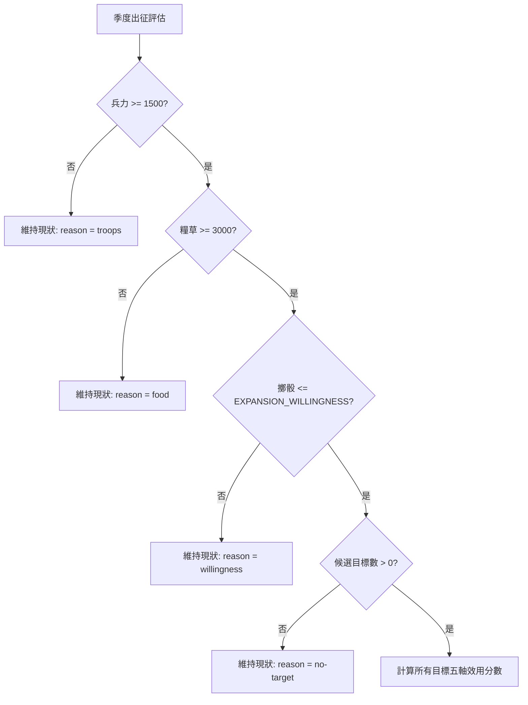

<!-- doc_id: doc_spec_0491 -->
<!-- spec_id: RAI-05 -->
# 他國AI軍事擴張決策門檻與五軸目標效用評估規格書

> 標籤：`系統規格` `他國AI` `軍事擴張` `效用函數` `RAI-05`
> 狀態：`正式生效` · 責任模組：`RivalExpansion` · 參照：`RAI-05` / `PROG-2-1473` / `PROG-2-1505`

---

## 1. 模組定位與設計理念

在三國宏觀沙盤世界中，各大 AI 勢力並非盲目發動攻擊，而是依據自身資源儲備、性格傾向與各候選目標的綜合戰略價值，實施理性且動態的擴張決策。
本規格書定義他國 AI 軍事擴張決策引擎（`RivalExpansion.ts`），遵循以下原則：
1. **資源剛性門檻（Hard Gates）**：兵力與糧草未達標準前嚴禁出征，避免 AI 陷入窮兵黷武的自我瓦解。
2. **勢力性格意願調頻**：透過各君主性格的出征意願率（Willingness），實現好戰（如 EXPANSIONIST）與保守（如 PASSIVE）的動態差異。
3. **五軸目標效用評估（Utility Evaluation）**：融合兵力差、資源豐度、歷史仇恨、邦交劣度與情報確信度五大維度，計算綜合進攻價值。
4. **純邏輯與隨機注入**：演算法無任何副作用，亂數來源由呼叫端注入，保證回放與測試之確定性。

---

## 2. 出征門檻與性格意願率

AI 於每季結算時評估出征意向，必須連續通過「資源守衛」與「意願擲骰」：

### 2.1 基礎資源門檻
- `MIN_TROOPS_FOR_ATTACK = 1500`：常備守城兵力最低要求，低於此值不出兵。
- `FOOD_FOR_CAMPAIGN = 3000`：長途出征所需最低軍糧消耗儲備。

### 2.2 勢力性格出征意願表 (EXPANSION_WILLINGNESS)
經 `PROG-2-1505` 全國 60 季模擬最佳化，各性格出征機率設定如下：

| 性格代碼 (Profile) | 中文性格 | 每季出征意願機率 | 行為特質描述 |
|---|---|:---:|---|
| `EXPANSIONIST` | 雄霸擴張型 | **0.70** | 極度渴望開疆拓土，常態出征 |
| `CAVALRY_LORD` | 鐵騎游牧型 | **0.50** | 機動性高，尋求弱點突襲掠奪 |
| `RAIDER` | 割據劫掠型 | **0.50** | 偏好打擊富庶小勢力 |
| `GUARDIAN` | 堅守重鎮型 | **0.30** | 重視本土防衛，偶有有限反擊 |
| `MILITARIST` | 軍備整備型 | **0.20** | 優先累積重裝兵力，厚積薄發 |
| `DIPLOMAT` | 外交縱橫型 | **0.20** | 依賴盟友，極少單獨發動主動侵略 |
| `WARLORD` | 割據梟雄型 | **0.10** | 伺機而動，僅在極具勝算時出兵 |
| `PASSIVE` | 消極偏安型 | **0.05** | 極少動武，固守現狀 |

---

## 3. 五軸目標效用函數 (F-2 Utility Formula)

針對所有候選目標，進攻方計算目標效用分數 $U \in [0, 1]$：

$$U = 0.30 \times \min(2, R_{mil}) + 0.20 \times \min(1, V_{res}) + 0.20 \times \min(1, H) + 0.15 \times G_{dip} + 0.15 \times \min(1, C_{int})$$

### 3.1 五大維度計算細則

| 權重 | 維度 | 變數 | 計算公式與說明 |
|:---:|---|:---:|---|
| **0.30** | 兵力對比 | $R_{mil}$ | $\text{attacker.troops} / \max(1, \text{target.troops})$，上限封頂於 2.0 |
| **0.20** | 資源價值 | $V_{res}$ | $(\text{target.food} + \text{target.gold} \times 2) / 10000$，黃金權重加倍，封頂於 1.0 |
| **0.20** | 歷史仇恨 | $H$ | $\text{target.hatred} / 100$，數值區間 $[0, 1]$ |
| **0.15** | 邦交劣度 | $G_{dip}$ | $(100 - \text{target.relation}) / 200$，邦交越惡劣進攻慾望越高 |
| **0.15** | 情報確信 | $C_{int}$ | $\text{attacker.intel} / 100$，情報越清晰決策信心越高 |

### 3.2 攻擊決策門檻 (EXPANSION_ATTACK_SCORE)
- `EXPANSION_ATTACK_SCORE = 0.75`
- 候選目標中之最高分數 $\text{bestScore} \ge 0.75$ 時，決策為 `{ kind: 'ATTACK', targetId: best.id, score: bestScore }`。
- 若所有目標效用皆低於 0.75，則決策為 `{ kind: 'HOLD', reason: 'low-score' }`。

---

## 4. 軍事任務品質與情報分段

進攻方指派之軍師或領軍武將之智力數值（`int`），決定軍事任務的產出階級與情資掌握度：

| 智力區間 | 軍事任務品質 (`militaryMissionTierOf`) | 情報分段 (`missionIntelBandOf`) | 戰場可視度與戰術修正 |
|:---:|:---:|:---:|---|
| **$\ge 90$** | `MASTER` (宗師) | **3** | 完全探明敵方佈陣、兵種克制與陷阱伏兵 |
| **$70 \sim 89$** | `ADVANCED` (精銳) | **2** | 探明敵方總兵力與主要防守將領 |
| **$50 \sim 69$** | `BASIC` (常規) | **1** | 僅得知敵方粗略防衛兵力 |
| **$< 50$** | `BASIC` (常規) | **0** | 戰場迷霧遮蔽，無法獲得前置情資 |
