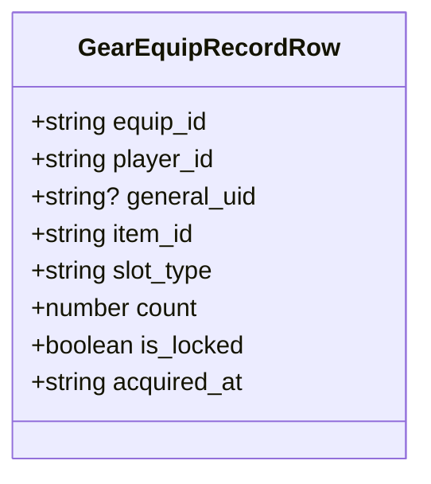
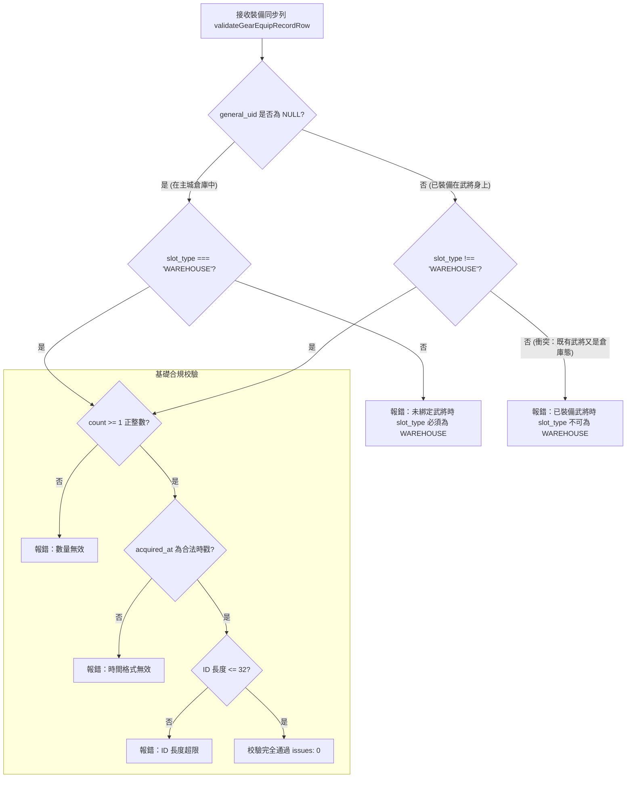

<!-- doc_id: doc_spec_0439 -->
# 伺服端裝備記錄表結構與客端同步協議規格書

## 1. 核心定位與職責範圍

本規格書定義伺服端裝備記錄資料庫資料表結構（`010_gear_equip_records.sql`）與客戶端同步資料校驗協議（`bag11-equip-row.ts`），對應 WBS **BAG-11**。
遊戲採取「本機即時回應，伺服端非同步落盤校驗」架構。
伺服端透過嚴謹的 Schema 列校驗函式（`validateGearEquipRecordRow`），確保同步上傳的裝備狀態在數值完整性、外鍵關聯性及倉庫/穿戴雙態排他性上達到 100% 合規。

---

## 2. 伺服器記錄列資料模型（`GearEquipRecordRow`）

### 2.1 欄位定義與邊界規範
| 欄位名稱 | 型別定義 | 限制條件 | 職責與業務含義 |
|---|---|---|---|
| `equip_id` | `VARCHAR(32)` | 必填，1~32 字元 | 裝備實體全域唯一識別碼 |
| `player_id` | `VARCHAR(32)` | 必填，1~32 字元 | 所屬玩家帳號 ID |
| `general_uid` | `VARCHAR(32)` | 可為 `NULL` | 穿戴此裝備之武將 UID（在倉時為 NULL） |
| `item_id` | `VARCHAR(32)` | 必填，1~32 字元 | 道具/裝備定義集中表 ID |
| `slot_type` | `VARCHAR(16)` | 必填，列舉代碼 | 當前所處槽位代碼（見 2.2 節） |
| `count` | `INTEGER` | $\ge 1$，正整數 | 物品持有數量（裝備預設為 1） |
| `is_locked` | `BOOLEAN` | 布林值 | 物品是否處於防誤售鎖定狀態 |
| `acquired_at` | `TIMESTAMP` | ISO 8601 時戳 | 物品入手時間，用於歷史排序 |

### 2.2 槽位代碼枚舉與客戶端對照（`GEAR_SLOT_TYPES`）
伺服端定義 8 種標準槽位列舉，同步時與客戶端進行嚴格對映：
- `WEAPON` $\leftrightarrow$ 武器
- `ARMOR` $\leftrightarrow$ 防具
- `ACCESSORY` $\leftrightarrow$ 飾品
- `HORSE` $\leftrightarrow$ 客戶端名馬（`MOUNT`）
- `BOOK` $\leftrightarrow$ 客戶端古書（`TOME`）
- `RELIC` $\leftrightarrow$ 客戶端傳家寶物（`TREASURE`）
- `TALLY` $\leftrightarrow$ 虎符槽位
- `WAREHOUSE` $\leftrightarrow$ 主城倉庫存放態

---

## 3. 雙態排他性一致性校驗規則（`validateGearEquipRecordRow`）

---

## 4. 同步異常與防作弊防護

1. **原子事務落盤**：客戶端批次同步裝備更迭時，伺服端在單一資料庫 Transaction 內執行校驗與落盤，若任一列驗證失敗（`issues.length > 0`），整批交易回滾。
2. **防時鐘回撥**：`acquired_at` 時戳不得超過伺服端當前時間容許容差（$+5$ 分鐘），防止本地時鐘篡改引發的時序混亂。
3. **無連線離線降級**：弱網或斷網時，客戶端本地持續快取裝備異動，重連後按操作日誌順序發起補償同步。

---

## 5. 驗收標準與單元測試契約

1. **未綁將在倉校驗**：
   - 輸入 `general_uid: null, slot_type: 'WEAPON'`，驗證必須產生校驗錯誤。
2. **已綁將出倉校驗**：
   - 輸入 `general_uid: 'G_001', slot_type: 'WAREHOUSE'`，驗證必須產生校驗錯誤。
3. **合法資料全綠驗證**：
   - 輸入 `general_uid: 'G_001', slot_type: 'WEAPON', count: 1`，驗證回傳空問題陣列（`issues.length === 0`）。
