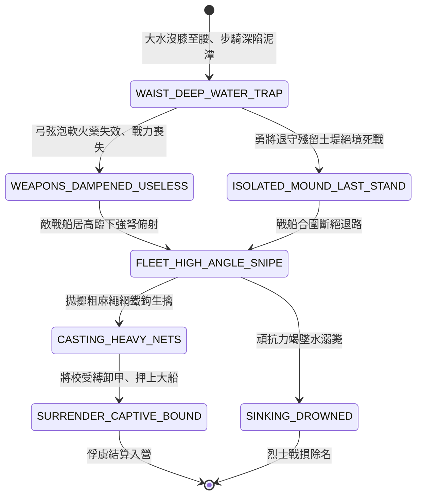

<!-- doc_id: doc_spec_0825 -->
# 3KLife 低窪平川泥沼大水被困泅水與戰船弓弩射網剿捕狀態機規格書

## 模組基本資訊
- **模組代號**：`MARSH-FLOOD-SURROUND-CAPTURE01`
- **系統定位**：三國水攻後平川澤國困局與戰船水網剿捕系統，負責重裝步騎齊腰水困、弓弩受潮失效、孤堤力戰困局與大艦居高臨下撒網俘獲之完整狀態流。
- **架構依賴**：`WaterGridSystem`、`BattleGridSystem`、`TroopTypeMovement`、`VFXBlockRegistry`。

---

## 核心設計概念
大水灌淹之後，平川化為汪洋泥沼，水深沒膝至腰。曹軍重甲精兵陷入泥濘動彈不得，戰馬深陷泥沼無法奔馳。步兵長槍大戟泡水沉重無比，角弓麻弦浸水鬆軟失去彈力，火藥引線皆濕無法擊發。殘存頑抗部隊只能退縮於殘留之土堤殘丘之上（如龐德退避堤上接戰）。進攻方大型樓船、中型艨艟與游弋走舸乘水包圍，居高臨下以強弩俯射、拋擲沉重麻網鐵鉤，展開拉網式剿捕。



---

## 狀態機定義與轉換條件

### 1. `WAIST_DEEP_WATER_TRAP`（水深沒腰受困狀態）
- **進入條件**：平原地格被洪水淹沒（水深 0.8 ~ 1.5 公尺），步騎部隊滯留其中。
- **行為表現**：
  - 移動速度強制降為 1 格/回合，每移動 1 格消耗 4 點體力。
  - 騎兵單位坐騎失足倒地，自動強制轉變為「落馬泥水步兵」。
- **轉換**：處於水浸地格超過 1 回合 -> 轉移至 `WEAPONS_DAMPENED_USELESS`。

### 2. `WEAPONS_DAMPENED_USELESS`（兵刃受潮失靈狀態）
- **行為表現**：
  - 弓弩部隊射程強制縮減為 1 格，傷害扣減 70%（弦索脫膠鬆弛）。
  - 所有火攻道具與火器機關 100% 無法使用。
- **轉換**：
  - 相鄰存在未淹沒之「殘存高堤」地格 -> 轉移至 `ISOLATED_MOUND_LAST_STAND`。
  - 敵水軍大船包圍靠攏 -> 轉移至 `FLEET_HIGH_ANGLE_SNIPE`。

### 3. `ISOLATED_MOUND_LAST_STAND`（孤堤死戰狀態）
- **行為表現**：
  - 勇將（如龐德）佔據 1 格乾燥高堤，拔刀發誓「寧為國家鬼，不為賊奴將！」。
  - 獲得「背水逆境」攻擊加成（單體近戰傷害 +40%），但無任何退路。
- **轉換**：敵軍戰艦從三面開火俯射 -> 轉移至 `FLEET_HIGH_ANGLE_SNIPE`。

### 4. `FLEET_HIGH_ANGLE_SNIPE`（戰船俯射壓制狀態）
- **行為表現**：
  - 樓船居高臨下（高度優勢 +3 階），遠程射擊命中率提升 40%。
  - 箭雨覆蓋被困部隊，每回合削扣 25% 殘餘兵力。
- **轉換**：
  - 敵軍士氣耗盡或兵力小於 20% -> 轉移至 `CASTING_HEAVY_NETS`。
  - 孤堤將領體力耗盡重傷翻落水底 -> 轉移至 `SINKING_DROWNED`。

### 5. `CASTING_HEAVY_NETS`（撒網鐵鉤捕撈狀態）
- **行為表現**：
  - 水兵拋擲加重生鐵四角魚網與長柄搭鉤，將落水將校罩住拖拽上船。
  - 俘獲成功率為 90%。
- **轉換**：捆綁收押 -> 轉移至 `SURRENDER_CAPTIVE_BOUND`。

### 6. `SURRENDER_CAPTIVE_BOUND`（解俘收押狀態）
- **行為表現**：
  - 被俘部隊移出戰鬥序列，名將被剝除重鎧押入水寨中軍大帳。
- **轉換**：戰利品與戰俘登記 -> 結束退出。

---

## 數值公式與配置契約

```typescript
export interface MarshCaptureConfig {
  marshId: string;
  waterDeepMeter: number;         // 水深 (m)
  movementPenaltyRate: number;    // 移動力削弱比
  weaponDampenAttackPenalty: number; // 弓弦受潮削弱比
  highAngleShipDamageBonus: number;// 戰艦高度差射擊加成
  netCaptureRateBase: number;     // 撒網捕獲基礎機率
  horseDrownChance: number;       // 戰馬倒斃沉沒率
}

export const MARSH_PRESETS: Record<string, MarshCaptureConfig> = {
  FANCHENG_SUBMERGED_PLAIN: {
    marshId: 'MARSH_FANCHENG_01',
    waterDeepMeter: 1.2,
    movementPenaltyRate: 0.75,
    weaponDampenAttackPenalty: 0.70,
    highAngleShipDamageBonus: 0.40,
    netCaptureRateBase: 0.90,
    horseDrownChance: 0.85,
  }
};
```

---

## 單元測試與驗收標準
1. **水浸弓弩傷害衰減**：身處水深 > 1.0m 地格之弓弩部隊，射擊傷害嚴格扣減 70% 且射程縮減為 1 格。
2. **戰船高度優勢判定**：大型樓船攻擊齊腰深水中單位時，命中率自動增加 40%，且不受一般地面反擊。
3. **撒網俘獲結算**：對士氣歸零且受困泥沼之敵部隊執行捕獲指令，90% 概率直接繳械俘獲，不觸發多餘肉搏戰損。
