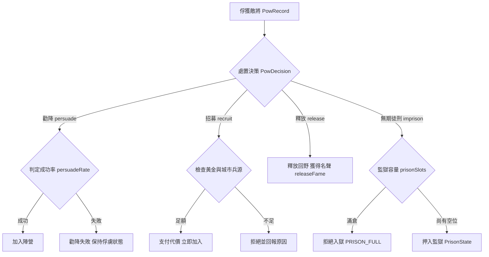

<!-- doc_id: doc_spec_0429 -->
# 俘虜無期徒刑審判與傳家寶物搜繳產出規格書

## 1. 核心定位與職責範圍

本規格書定義戰役俘獲敵將之處置決策樹，以及執行「無期徒刑（Life Imprisonment）」審判後之週期性產出機制，對應 WBS **EQP-09**。
當戰勝俘獲敵將時，玩家透過四選一處置狀態機進行裁判；選定無期徒刑者進入大牢關押，每季除了穩定貢獻情報與資源外，並有機率搜繳出敵將珍藏之傳家寶物（`ITEM_TREASURE`）。
本機制由純邏輯無副作用函式庫（`PrisonerOfWar.ts`）驅動，不依賴 Cocos 畫面層，完全支援種子決定性回放。

---

## 2. 俘虜處置四選一決策狀態機



---

## 3. 無期徒刑監獄週期產出模型

### 3.1 監獄資料結構（`PrisonEntry`）
```typescript
export interface PrisonEntry {
    readonly targetUid: string;         // 俘虜武將唯一標識
    readonly targetName: string;        // 俘虜名號
    readonly imprisonedSeason: number;  // 下獄季數
    readonly yieldPerSeason: {          // 每季固定貢獻
        readonly intel: number;         // 軍事情報點數
        readonly resource: number;      // 後勤軍糧物資
    };
}
```

### 3.2 固定資源季結算（`prisonYieldOneSeason`）
每季輪替結算時，所有關押中的囚犯產出線性累加：
$$\text{TotalIntel} = \sum_{p \in \text{prisoners}} p.\text{yieldPerSeason.intel}$$
$$\text{TotalResource} = \sum_{p \in \text{prisoners}} p.\text{yieldPerSeason.resource}$$
產出物資自動撥入玩家軍事儲備庫，受容量上限（`foodCap`）安全截斷。

---

## 4. 傳家寶物搜繳掉落機制（EQP-09）

### 4.1 掉落機率模型
關押於牢獄中之敵將在長期審問下，具備隱密私產搜繳機制：
- **掉落判定常數**：`PRISON_TREASURE_DROP_RATE = 0.05`（固定 5% 機率）。
- **獨立判定原則**：每季結算時，對大牢中每一位現存囚犯分別獨立擲骰（`random() < 0.05`）。
- **偽隨機可回放性**：擲骰函式 `random: () => number` 必須由 `GameSession` 注入確定性種子產生器，保證存檔重播時掉落名單絕對一致。

### 4.2 供款者判定與劇本文案契約
由純函式 `rollPrisonTreasureDonors` 產出本季交出傳家寶物之名單：
```typescript
export function rollPrisonTreasureDonors(
    prisoners: readonly PrisonEntry[],
    random: () => number
): PrisonEntry[] {
    return prisoners.filter(() => random() < PRISON_TREASURE_DROP_RATE);
}
```
每搜繳出一件傳家寶，系統依標準範式生成劇本文案（`prisonTreasureLine`）：
> `囚犯 ${name} 交出了一件傳家寶：${itemName}`

### 4.3 物品入庫與分流處置
搜繳獲得之物品定義為 `ITEM_TREASURE`（傳家寶物），以來源代碼 `source: 'DROP'` 原子登記至 `InventoryRecord`：
1. **武將裝備**：符合進階槽位穿戴條件，裝備後可大幅強化武將五維面板（四階品質品質加成）。
2. **府庫典當**：玩家可於百寶閣或各城交易所典當出售，換取高額黃金資金。

---

## 5. 容量上限與異常保護

1. **監獄格數硬限制**：初始容量為 `PRISON_SLOTS_INITIAL = 5`，可透過太守府升級或官職晉升擴充。已達上限時，審判「無期徒刑」立即回傳 `PRISON_FULL` 錯誤，不允許超收。
2. **未來來投機制**：被釋放（`release`）之俘虜有 5% 機率在未來季次感念德政而前來投效（`rollFutureReturns`），若模板資料遺失則安全跳過並記錄警訊，不阻斷主線循環。
3. **單檔與效能契約**：監獄結算不產生複雜閉包，單季結算時間複雜度為 $O(N)$（$N \le 20$ 為監獄容量），零 GC 記憶體壓力。
