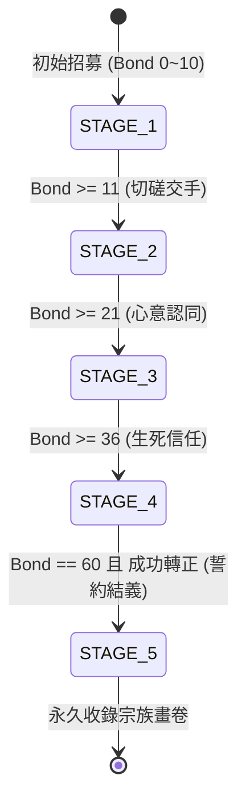

<!-- doc_id: doc_spec_0584 -->
# 傭兵五階段插畫進度好感羈絆解鎖狀態機規格書

> 標記：Single Source of Truth（單一真相來源）  
> 涵蓋工作包：`MERC-08`  
> 狀態：正式發布 / 核心邏輯規格

---

## 1. 系統定位與架構

本模組定義短期客卿 / 傭兵（Mercenary）在試用 6 日與結義過程中的「五階段敘事插畫與傳記解鎖狀態機（`Illustration_Stage`）」。透過每日好感累積（`Bond` 0 ~ 60）與實戰互動，武將逐步對玩家敞開心扉，依序解鎖 5 個階段的專屬立繪、姿態、傳記文案與心聲語音。本機制賦予傭兵試用期鮮活的情感漸進回饋，為玩家轉正割席結義提供強烈的沉浸動機。



---

## 2. 五階段進度定義與解鎖門檻（MERC-08）

### 2.1 階段門檻矩陣
傭兵插畫進度以整數 `stage`（1 ~ 5）表示，單向遞增推進：

| 階段代號 | 階段名稱 | 必備好感度 | 額外解鎖條件 | 解鎖視覺與敘事資產 |
|:---:|:---:|:---:|:---|:---|
| **STAGE_1** | 初遇萍水 | 初始（$0 \sim 10$） | 無（招募即解鎖） | 標準武將常服立繪、第一章生平簡傳 |
| **STAGE_2** | 陣前切磋 | $\ge 11$ | 至少完成 1 場共鬥 | 拔劍備戰姿態立繪、解鎖作戰特寫與語音 |
| **STAGE_3** | 心有靈犀 | $\ge 21$ | 無 | 茶席/夜宴對坐特寫、第二章私密傳記 |
| **STAGE_4** | 刎頸之託 | $\ge 36$ | 共同擊退 1 次強敵 | 戰場背水一戰染血插畫、深層心聲獨白 |
| **STAGE_5** | 金蘭結義 | $= 60$（滿額） | 完成 MERC-04 結義轉正 | 全螢幕動態誓約名畫、金蘭稱號與傳家題字 |

### 2.2 狀態機資料結構
```typescript
export type IllustrationStage = 1 | 2 | 3 | 4 | 5;

export interface IMercenaryIllustrationState {
  readonly mercenaryUid: string;
  readonly generalId: string;
  currentStage: IllustrationStage;
  readonly unlockedTimestamps: Record<IllustrationStage, number>;
}

export function evaluateIllustrationStage(
  currentBond: number,
  isPermanent: boolean,
  hasParticipatedBattle: boolean
): IllustrationStage {
  if (currentBond >= 60 && isPermanent) {
    return 5;
  }
  if (currentBond >= 36 && hasParticipatedBattle) {
    return 4;
  }
  if (currentBond >= 21) {
    return 3;
  }
  if (currentBond >= 11) {
    return 2;
  }
  return 1;
}
```

---

## 3. 轉正與退場插畫處理

1. **結義轉正（永久保留）**：
   - 轉為永久常駐武將後，所有已解鎖的插畫階段永久歸入玩家「名將畫卷（Gallery）」，隨時可在武將詳情頁切換展示立繪。
2. **到期未結義離隊**：
   - 傭兵若在未轉正情況下到期退場（`EXPIRED`），其階段插畫在玩家名冊中標記為「昔日客卿（Historical Memory）」，保留縮圖預覽與留書回憶，但不可設為出征看板。

---

## 4. 驗收與測試標準

1. **階梯解鎖測試（TC-MERC-08-01）**：
   - 驗證好感度自 0 逐步加至 60 過程中，`evaluateIllustrationStage` 精確依序返回 1 至 4 階。
2. **終階轉正鎖定測試（TC-MERC-08-02）**：
   - 驗證即使好感度達 60，若 `isPermanent === false`，進度嚴格停留在 STAGE_4；只有結義轉正後才躍升至 STAGE_5。
