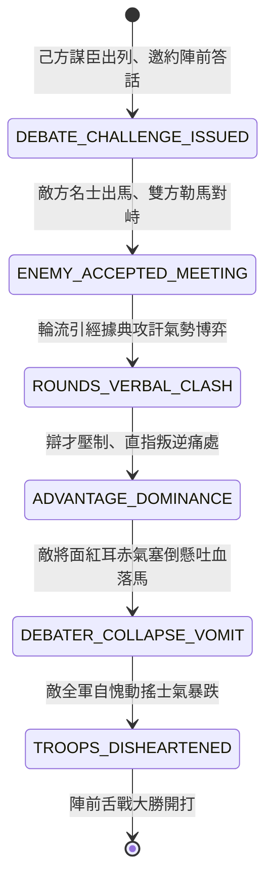

<!-- doc_id: doc_spec_0816 -->
# 3KLife 兩軍陣前舌戰儒將折衝尊俎動搖全軍戰意狀態機規格書

## 模組基本資訊
- **模組代號**：`FRONT-DEBATE-DIPLOMACY01`
- **系統定位**：三國戰場前線智謀舌戰與言辭折衝系統，負責儒將出列論道、大義名分攻防、辯論氣勢博弈、舌戰挫敗吐血落馬與敵全軍戰意動搖之完整狀態流。
- **架構依賴**：`BattleCommandController`、`MoraleSystem`、`DebateDialogueEngine`、`VFXBlockRegistry`。

---

## 核心設計概念
三國時期不僅有白刃肉搏，更有「陣前論道、折衝尊俎」之攻心極致（如諸葛亮陣前罵死司徒王朗、舌戰江東群儒）。大軍列陣未發之際，雙方名士儒將或高謀軍師可在陣前中央相見。雙方圍繞「漢室正統、王道霸道、天命民心」展開言辭博弈。若一方言辭鋒利如刀、切中要害，另一方將理屈詞窮、急火攻心吐血落馬；敵陣數萬將士聞言亦必自慚形穢，全軍士氣大跌、未戰先怯。



---

## 狀態機定義與轉換條件

### 1. `DEBATE_CHALLENGE_ISSUED`（邀約論道狀態）
- **進入條件**：戰前對峙階段，己方軍師智力 >= 88 且具備「雄辯/舌戰」特技。
- **行為表現**：
  - 軍師策馬徐徐行至兩軍中線，搖羽扇高呼邀敵主將或軍師出陣對話。
  - 雙方全軍暫停前進，進入對峙觀戰狀態。
- **轉換**：敵方派遣智力最高的軍師或文官出陣 -> 轉移至 `ENEMY_ACCEPTED_MEETING`。

### 2. `ENEMY_ACCEPTED_MEETING`（中線會面狀態）
- **行為表現**：
  - 雙方頭頂顯示「辯論氣勢計量條」（初始為 100 點）。
  - 背景音效轉入沉重古琴與肅殺戰鼓交織。
- **轉換**：開啟 3 輪言辭交鋒 -> 轉移至 `ROUNDS_VERBAL_CLASH`。

### 3. `ROUNDS_VERBAL_CLASH`（引經據典交鋒狀態）
- **行為表現**：
  - 每輪雙方依據「天命、大義、民心」三個維度出招。
  - 計算智力與政治差值：每高出 5 點，對敵方氣勢條造成 20 點削扣。
- **轉換**：
  - 敵方氣勢條跌破 30 點 -> 轉移至 `ADVANTAGE_DOMINANCE`。
  - 己方氣勢耗盡 -> 舌戰失敗回陣。

### 4. `ADVANTAGE_DOMINANCE`（言辭碾壓狀態）
- **行為表現**：
  - 己方軍師厲聲叱吒，彈出經典語音（如「斷脊之犬、狺狺狂吠」）。
  - 敵名士理屈詞窮，手顫足抖、無法作答。
- **轉換**：給予終極論辯暴擊（氣勢歸零） -> 轉移至 `DEBATER_COLLAPSE_VOMIT`。

### 5. `DEBATER_COLLAPSE_VOMIT`（氣塞落馬狀態）
- **行為表現**：
  - 敵名士急火攻心大叫一聲，口噴鮮血自馬鞍栽落身亡或陷入重度昏迷。
  - 敵軍護衛手忙腳亂上前搶回主將屍身。
- **轉換**：敵名士退場 -> 轉移至 `TROOPS_DISHEARTENED`。

### 6. `TROOPS_DISHEARTENED`（全軍戰意動搖狀態）
- **行為表現**：
  - 敵軍全軍陷入「道德愧疚與恐慌」，全隊士氣扣減 35 點。
  - 前鋒部隊攻擊力削弱 20%，防禦混亂。
- **轉換**：正式戰鬥吹響號角開打 -> 結束退出。

---

## 數值公式與配置契約

```typescript
export interface FrontDebateConfig {
  debateId: string;
  minDebaterIntelligence: number;// 最低出辯智力門檻
  baseResolvePoints: number;      // 基礎氣勢點數 (100)
  intellectGapDamageRate: number; // 智力差值傷害係數
  rebuttalCritChance: number;     // 駁斥暴擊率
  enemyArmyMoraleDrop: number;    // 敵軍士氣整體受挫值
  enemyAttackDebuffRate: number;  // 敵軍攻擊力削弱比
}

export const DEBATE_PRESETS: Record<string, FrontDebateConfig> = {
  ZHUGE_DEBATE_WANGLANG: {
    debateId: 'DEBATE_ZHUGE_01',
    minDebaterIntelligence: 90,
    baseResolvePoints: 100,
    intellectGapDamageRate: 4.0,
    rebuttalCritChance: 0.40,
    enemyArmyMoraleDrop: -35,
    enemyAttackDebuffRate: 0.20,
  }
};
```

---

## 單元測試與驗收標準
1. **舌戰氣勢削扣公式**：智力差為 15 點時，單輪交鋒基礎扣減 60 點氣勢，若觸發駁斥暴擊則直接歸零。
2. **氣絕落馬狀態轉移**：敵名士氣勢歸零瞬間，100% 觸發落馬重傷/陣亡，並從敵出戰名單除名。
3. **戰前士氣全場削弱**：敵名士倒下後，敵全軍部隊士氣即刻扣除 35 點，進入戰鬥時顯示「全軍心虛」減益。
