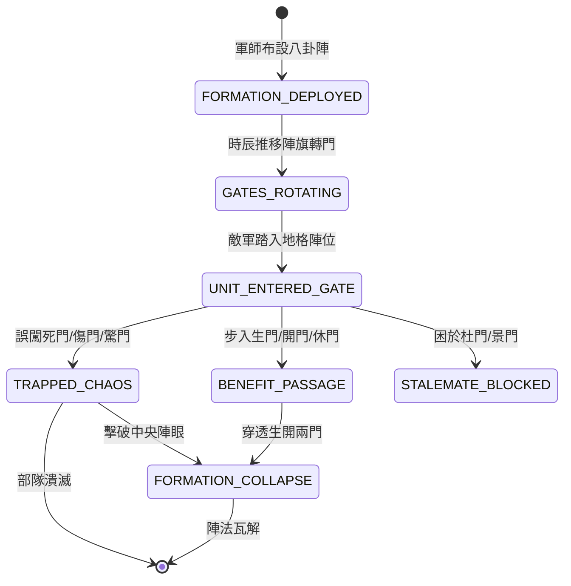

<!-- doc_id: doc_spec_0797 -->
# 3KLife 八卦陣休生傷杜景死驚開八門推演與破陣地格狀態機規格書

## 模組基本資訊
- **模組代號**：`BAGUA-EIGHT-GATES01`
- **系統定位**：三國古代奇門陣法與動態地格迷宮系統，負責八卦陣八門旋轉動態推演、入陣部隊狀態判定、陣眼破解與迷障反噬之完整生命週期。
- **架構依賴**：`BattleGridSystem`、`BattleFormationController`、`MoraleSystem`、`VFXBlockRegistry`。

---

## 核心設計概念
諸葛亮推演「八陣圖」，按奇門遁甲布列乾坤八方卦位，對應「休、生、傷、杜、景、死、驚、開」八門，隨時辰動態旋轉。入生門、開門者行動敏捷、士氣高昂；誤闖死門、傷門者天昏地暗、連環受創。破陣需自生門殺入、往開門殺出以潰破陣眼。



---

## 狀態機定義與轉換條件

### 1. `FORMATION_DEPLOYED`（陣勢布設狀態）
- **進入條件**：軍師智力 >= 88 且具備「八陣」特技，召喚 5x5 至 7x7 區域八卦陣。
- **行為表現**：中央生成「太極陣眼」親衛隊，八方初化乾坤八門。
- **轉換**：布設完成 -> 轉移至 `GATES_ROTATING`。

### 2. `GATES_ROTATING`（動態輪轉狀態）
- **行為表現**：每 3 回合順時針輪轉 45 度，地格門性與地表符印同步變換顏色（綠生、紅死、金開、紫傷）。
- **轉換**：部隊踩入陣內任一地格 -> 轉移至 `UNIT_ENTERED_GATE`。

### 3. `UNIT_ENTERED_GATE`（入門檢定狀態）
- **轉換**：
  - 踏入「生門 / 開門 / 休門」 -> 轉移至 `BENEFIT_PASSAGE`。
  - 踏入「死門 / 傷門 / 驚門」 -> 轉移至 `TRAPPED_CHAOS`。
  - 踏入「杜門 / 景門」 -> 轉移至 `STALEMATE_BLOCKED`。

### 4. `TRAPPED_CHAOS`（凶門陷伏混亂狀態）
- **行為表現**：
  - **死門**：每回合削扣當前兵力 20%，士氣每回合 -25，陷入「絕望恐慌」。
  - **傷門**：部隊移動力歸零，受 350 點真實物理破甲傷害。
  - **驚門**：部隊混亂，有 50% 機率攻擊相鄰友軍。
- **轉換**：部隊潰滅，或陣眼被擊潰 -> 轉移至退出或崩解。

### 5. `BENEFIT_PASSAGE`（吉門順通狀態）
- **行為表現**：獲得「心明」增益，免疫迷障，移動力 +2，士氣 +15。連續沿「生門 -> 陣眼 -> 開門」行進可弱化陣眼。
- **轉換**：穿透陣眼與開門 -> 轉移至 `FORMATION_COLLAPSE`。

### 6. `FORMATION_COLLAPSE`（陣法破滅狀態）
- **行為表現**：陣眼親衛隊滅亡或被正確穿透，八卦地格光柱碎裂恢復平地，施陣方軍師氣力歸零。
- **轉換**：特效消散完畢 -> 結束退出。

---

## 數值公式與配置契約

```typescript
export type BaguaGateType = 'REST' | 'LIFE' | 'HARM' | 'BLOCK' | 'VIEW' | 'DEATH' | 'TERROR' | 'OPEN';

export interface BaguaGateEffectConfig {
  gateType: BaguaGateType;
  isHarmful: boolean;
  hpLossPercent: number;          // 損血比 (0.0 ~ 0.5)
  moraleDelta: number;            // 士氣變化
  mobilityDelta: number;          // 移動力增減
  friendlyFireChance: number;     // 自殘機率
}

export const BAGUA_GATE_DATA: Record<BaguaGateType, BaguaGateEffectConfig> = {
  LIFE:   { gateType: 'LIFE',   isHarmful: false, hpLossPercent: 0.0, moraleDelta: +15, mobilityDelta: +2, friendlyFireChance: 0.0 },
  OPEN:   { gateType: 'OPEN',   isHarmful: false, hpLossPercent: 0.0, moraleDelta: +10, mobilityDelta: +1, friendlyFireChance: 0.0 },
  REST:   { gateType: 'REST',   isHarmful: false, hpLossPercent: 0.0, moraleDelta: +5,  mobilityDelta: 0,  friendlyFireChance: 0.0 },
  DEATH:  { gateType: 'DEATH',  isHarmful: true,  hpLossPercent: 0.20, moraleDelta: -25, mobilityDelta: -2, friendlyFireChance: 0.0 },
  HARM:   { gateType: 'HARM',   isHarmful: true,  hpLossPercent: 0.12, moraleDelta: -15, mobilityDelta: -3, friendlyFireChance: 0.1 },
  TERROR: { gateType: 'TERROR', isHarmful: true,  hpLossPercent: 0.05, moraleDelta: -30, mobilityDelta: -1, friendlyFireChance: 0.5 },
  BLOCK:  { gateType: 'BLOCK',  isHarmful: false, hpLossPercent: 0.0, moraleDelta: -5,  mobilityDelta: -4, friendlyFireChance: 0.0 },
  VIEW:   { gateType: 'VIEW',   isHarmful: false, hpLossPercent: 0.0, moraleDelta: 0,   mobilityDelta: 0,  friendlyFireChance: 0.0 }
};
```

---

## 單元測試與驗收標準
1. **八門旋轉週期**：每達 3 回合邊界，全場八卦地格屬性自動移轉 45 度，無跳變重疊。
2. **死門懲罰驗證**：進入死門部隊每回合削扣 20% 兵力且士氣強制 -25。
3. **生開正道破陣**：按「生門 -> 陣眼 -> 開門」軌跡移動，抵達開門時立即觸發 `FORMATION_COLLAPSE`。
