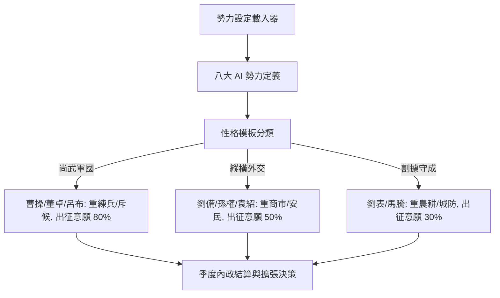

<!-- doc_id: doc_spec_0590 -->
# 八大AI勢力性格模板與內政意願偏好矩陣規格書

> 標記：Single Source of Truth（單一真相來源）  
> 涵蓋工作包：`RAI-01`、`RAI-02`  
> 狀態：正式發布 / 核心邏輯規格

---

## 1. 系統定位與架構

本模組規範天下大勢模擬引擎中「八大競爭勢力（Rival Nations）」之資料定義標準與性格行為模板。涵蓋魏、蜀、吳、袁紹、董卓、呂布、劉表、馬騰之初始領地、初始國庫資源、歷史君主台詞，以及三大性格型態（軍國、外交、守成）在五類內政任務（農耕、商市、安民、練兵、斥候）上的效率修正與出征意願率。



---

## 2. 八大勢力初始配置（RAI-01）

| 勢力 ID | 君主代表 | 性格型態 | 初始領地 | 初始資源（金/糧/兵） | 代表君主誓詞 |
|:---:|:---:|:---:|:---|:---:|:---|
| **NAT_WEI** | 曹操 | `MILITARIST` | 許昌、洛陽 | 15,000 / 20,000 / 12,000 | 「寧教我負天下人，休教天下人負我！」 |
| **NAT_SHU** | 劉備 | `DIPLOMAT` | 成都、漢中 | 10,000 / 18,000 / 8,000 | 「備雖不才，誓與天下義士共扶漢室！」 |
| **NAT_WU** | 孫權 | `DIPLOMAT` | 建業、柴桑 | 12,000 / 16,000 / 9,000 | 「江東基業，豈容他人染指！」 |
| **NAT_YUAN** | 袁紹 | `DIPLOMAT` | 鄴城、南皮 | 18,000 / 22,000 / 10,000 | 「吾袁氏四世三公，天下望歸！」 |
| **NAT_DONG** | 董卓 | `MILITARIST` | 長安、安定 | 20,000 / 12,000 / 15,000 | 「逆我者亡，順我者昌！」 |
| **NAT_LV** | 呂布 | `MILITARIST` | 下邳、小沛 | 8,000 / 8,000 / 14,000 | 「大丈夫生居天地間，豈能鬱鬱久居人下！」 |
| **NAT_LIU_B** | 劉表 | `PASSIVE` | 襄陽、江夏 | 14,000 / 15,000 / 7,000 | 「荊襄九郡，但求保境安民。」 |
| **NAT_MA** | 馬騰 | `PASSIVE` | 西涼、天水 | 6,000 / 10,000 / 11,000 | 「涼州鐵騎，威震西陲！」 |

---

## 3. 性格模板與意願偏好矩陣（RAI-02）

### 3.1 性格內政效率與出征係數矩陣
| 性格代碼 | 農耕效率 | 商市效率 | 安民效率 | 練兵效率 | 斥候效率 | 基礎出征意願率 |
|:---:|:---:|:---:|:---:|:---:|:---:|:---:|
| **MILITARIST** | $0.80$ | $0.90$ | $0.80$ | **$1.30$** | **$1.20$** | **$80\%$** |
| **DIPLOMAT** | $1.00$ | **$1.20$** | **$1.20$** | $1.00$ | $1.00$ | $50\%$ |
| **PASSIVE** | **$1.30$** | $1.00$ | $1.10$ | $0.90$ | $0.80$ | $30\%$ |

### 3.2 資料模型定義
```typescript
export type NationArchetype = 'MILITARIST' | 'DIPLOMAT' | 'PASSIVE';

export interface INationProfile {
  readonly nationId: string;
  readonly rulerName: string;
  readonly archetype: NationArchetype;
  readonly initialCities: readonly string[];
  readonly initialResources: Readonly<{
    gold: number;
    food: number;
    troops: number;
  }>;
  readonly motto: string;
  readonly taskEfficiency: Readonly<{
    farming: number;
    commerce: number;
    publicOrder: number;
    drills: number;
    scouting: number;
  }>;
  readonly sortieWillingnessRate: number;
}
```

---

## 4. 驗收與測試標準

1. **八大勢力資料完整性（TC-RAI-01-01）**：
   - 驗證 `ai-nations.json` 載入後精確包含 8 筆記錄，且君主、初始城市與誓詞無缺失。
2. **性格係數精確性（TC-RAI-02-01）**：
   - 驗證 `MILITARIST` 勢力（如曹操）練兵效率嚴格為 1.30，出征意願為 0.80；`PASSIVE` 勢力農耕效率嚴格為 1.30。
3. **出征決策邊界測試（TC-RAI-02-02）**：
   - 驗證在相同兵糧條件下，尚武勢力發動進攻的機率顯著高於守成勢力。
