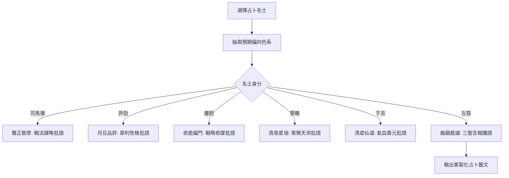

<!-- doc_id: doc_spec_0648 -->
# 六大名士預言批語風格庫與左慈含糊讖語模板規格書

> **規格代碼**：`ORAC-09`
> **版本**：v1.0 (Single Source of Truth)
> **狀態**：正式定案 (Approved)
> **檔案大小限制**：嚴格 <6144 bytes

---

## 1. 系統定位與架構

本規格為名士占卜系統（SageDivination）建立「六大歷史名士」專屬語言風格庫、因子色系插槽以及左慈含糊讖語生成模板。
補齊過往「名士台詞未資料化」缺口，營造三國名士迥異的人格魅力與玄妙氛圍。



---

## 2. 六大名士偏好色系與風格模板清單

```typescript
export interface SageOracleTemplate {
  sageId: string;
  sageName: string;
  preferredFactorColor: "BLUE" | "PINK" | "GREEN" | "WHITE" | "RED" | "PURPLE";
  templates: string[]; // 固定至少 5 組
}
```

### 2.1 各名士精選批語庫
1. **司馬徽（偏綠色戰法/治國）**：
   - 「好，好！此爻如春木逢霖，日後必得名師親傳，陣法無雙。」
   - 「水鏡觀之，此子有濟世安民之德，兵書戰策過目成誦。」
   - 「臥龍鳳雛未可知，然此子文略已具雛形，善加雕琢必成棟樑。」
   - 「行陣如弈棋，此兒目光遠大，非尋常武夫可比。」
   - 「吉兆也！乾卦居中，戰法之道深契天地之化。」
2. **許劭（偏白色特質/品格）**：
   - 「月旦品評，骨相崢嶸；剛直則易折，沈斂則長存。」
   - 「心懷大志而面容冷峻，此子若得明主，必為中流砥柱。」
   - 「有幾分猛虎氣象，卻嫌殺心過重，為人父母當嚴加訓誡。」
   - 「性格篤厚慎微，雖無驚天動地之姿，亦能守成家業。」
   - 「目光閃爍機敏，靈巧有餘而威嚴不足，奇才也。」
3. **左慈（瘋癲戲謔·三態含糊讖語）**：
   - 「似龍非龍，似蟒非蟒；飛上天是神仙，跌入潭是泥鰍，妙哉妙哉！」
   - 「福兮禍所依，禍兮福所伏；頭角崢嶸頂破天，腳底虛浮踩爛泥。」
   - 「白鶴嘴裡銜蟠桃，落在凡間變黑雕；你問好不好？貧道笑一笑！」
   - 「命硬吃得八方飯，命脆經不得清風吹；半仙半鬼，全在造化。」
   - 「貧道袖裡這條金鯉，今日游進你家宅；是成龍是做羹，老道不知也！」

---

## 3. 模板變數插槽與資料安全契約

1. **動態插槽**：模板支援 `{ChildName}`、`{FatherName}`、`{MotherName}` 等宏變數替換。
2. **左慈含糊性機制（Ambiguity Check）**：
   - 左慈占卜不給出明確「吉/凶」數值指標，UI 顯示問號光環與神秘音效，滿足特定獵奇玩家體驗。
