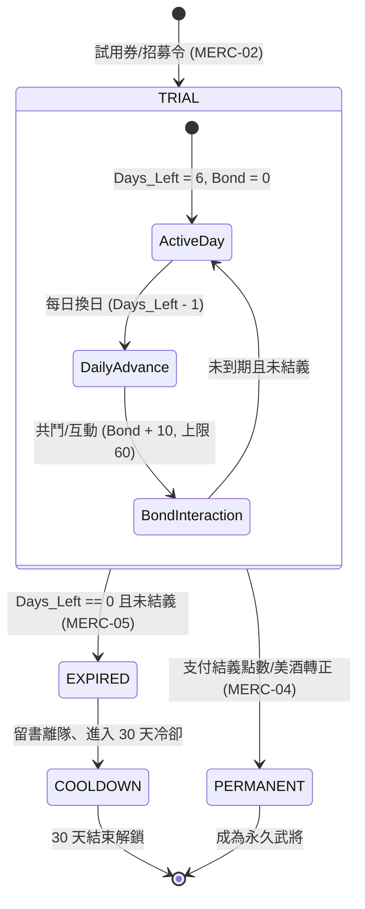

<!-- doc_id: doc_spec_0583 -->
# 六日傭兵結義好感到期退場與三十天冷卻狀態機規格書

> 標記：Single Source of Truth（單一真相來源）  
> 涵蓋工作包：`MERC-01`、`MERC-02`、`MERC-03`、`MERC-04`、`MERC-05`  
> 狀態：正式發布 / 核心邏輯規格

---

## 1. 系統定位與架構

本模組定義遊戲中「短期客卿 / 傭兵（Mercenary）」生命週期。玩家可透過試用券或酒館客卿招募，獲得為期 6 日的武將試用資格。試用期間具備 100% 原始戰力，可隨軍出征。若玩家在 6 日內累積好感度並支付「結義點數」或名酒，即可轉為永久武將；若期限屆滿未結義，傭兵將留書告別離隊，並進入 30 天客卿冷卻期（該武將 30 天內不可再次被同一玩家招募試用）。



---

## 2. 核心資料模型（MERC-01）

傭兵資料模型獨立於常駐武將，支援快照與冷卻紀錄序列化：

```typescript
export type MercenaryStatus = 'TRIAL' | 'PERMANENT' | 'EXPIRED' | 'COOLDOWN';

export interface IMercenaryRecord {
  readonly mercenaryUid: string;          // 傭兵唯一實例 ID
  readonly generalId: string;             // 關聯武將原型 ID
  status: MercenaryStatus;                // 當前狀態
  daysLeft: number;                       // 剩餘試用天數（初始 6）
  bondLevel: number;                      // 好感點數（0 ~ 60）
  readonly originalOwner?: string;        // 出借原主玩家 ID（空值表系統客卿）
  statsSnapshot: Readonly<{               // 100% 屬性快照
    str: number;
    int: number;
    lea: number;
    pol: number;
    cha: number;
    tactics: readonly string[];
  }>;
  readonly recruitedTimestamp: number;    // 招募起算時間戳（秒）
  departureTimestamp?: number;            // 離隊時間戳（秒）
  cooldownUntilTimestamp?: number;        // 冷卻解除時間戳（秒）
}
```

---

## 3. 招募與每日好感遞增（MERC-02, MERC-03）

### 3.1 招募初始化（MERC-02）
- 消耗傭兵試用券時建立實例，初始屬性 100% 鏡像武將原型。
- 初始設定：`status = 'TRIAL'`, `daysLeft = 6`, `bondLevel = 0`。

### 3.2 換日推進與好感互動（MERC-03）
- 每日 00:00 換日結算：
  1. `daysLeft = Math.max(0, daysLeft - 1)`。
  2. 若本日完成出征或互動，`bondLevel = Math.min(60, bondLevel + 10)`。
  3. 好感度單日增長上限 10 點，6 日累計最高 60 點。

---

## 4. 結義轉正與資源消耗規則（MERC-04）

試用期間若符合門檻，玩家可申請登庸轉正：

### 4.1 轉正消耗標準
結義點數扣除額依稀有度計算，SSR / UR 支援名酒替代：

| 階級 | 必備好感度 | 結義點數 | 雙軌名酒替代品 | 轉正後狀態 |
|:---:|:---:|:---:|:---|:---:|
| **R** | $\ge 20$ | 100 點 | 無 | `PERMANENT` |
| **SR** | $\ge 30$ | 300 點 | 無 | `PERMANENT` |
| **SSR** | $\ge 50$ | 600 點 | 杜康佳釀 $\times 2$ | `PERMANENT` |
| **UR** | $= 60$ | 1200 點 | 九醞春酒 $\times 3$ | `PERMANENT` |

### 4.2 快照鎖定與轉正處理
- 結義成功時扣除點數或名酒，切換為 `status = 'PERMANENT'`, `daysLeft = -1`。
- 保留試用期間獲得的等級與天賦點數無縫注入常駐武將名單。

---

## 5. 到期退場與 30 天冷卻狀態機（MERC-05）

### 5.1 離隊觸發與告別信
- 當 `daysLeft === 0` 且 `status === 'TRIAL'`：
  1. 狀態標記為 `status = 'EXPIRED'`。
  2. 系統寄發客卿留書至玩家郵箱，附贈留念禮物（好感越高越豐厚）。
  3. 從所有出征隊伍、守城隊列中強制卸載。

### 5.2 30 天冷卻鎖定（Anti-Cycling）
- 離隊當下記錄 `cooldownUntilTimestamp = departureTimestamp + 30 * 86400`。
- 狀態變更為 `status = 'COOLDOWN'`。
- 冷卻解除前，該 `generalId` 在隨機池權重歸零，防止重複輪流招募強將。

---

## 6. 純邏輯驗收與測試標準

1. **生命週期狀態機測試（TC-MERC-01）**：
   - 驗證從 `TRIAL` 經 6 天換日正確轉為 `EXPIRED` 並推進至 `COOLDOWN`。
2. **結義轉正資源檢驗（TC-MERC-02）**：
   - 驗證各階級好感或點數不足時無法轉正；條件滿足時切換為 `PERMANENT` 且不再扣天數。
3. **30 天冷卻排他檢驗（TC-MERC-03）**：
   - 傭兵離隊後檢核 `isGeneralInCooldown(generalId)` 為 `true`；超過 30 天自動解除。
