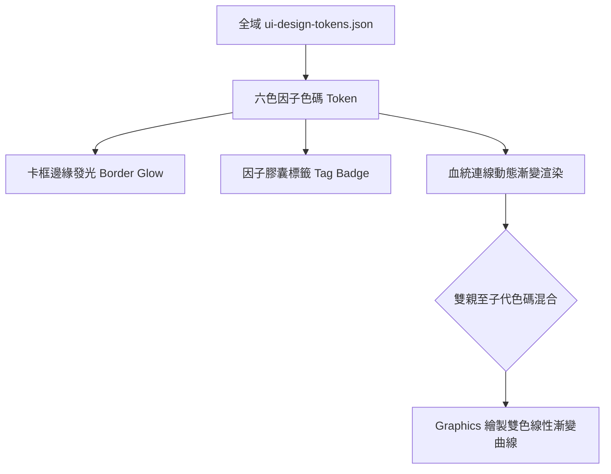

<!-- doc_id: doc_spec_0640 -->
# 六色因子全域Token整合與血統連線漸變色渲染規格書

> **規格代碼**：`BUI-06`
> **版本**：v1.0 (Single Source of Truth)
> **狀態**：正式定案 (Approved)
> **檔案大小限制**：嚴格 <6144 bytes

---

## 1. 系統定位與架構

本規格確立六色因子與專案全域 Design Token 之嚴格映射契約，並定義血統樹貝茲連線動態混色與高亮渲染機制。
徹底消除色碼硬編碼（Hardcoded Hex），統一全專案因子標籤、卡框外光圈與動態連線之視覺體驗。



---

## 2. 六色因子全域 Design Token 契約

```json
{
  "factorTokens": {
    "FACTOR_COLOR_BLUE": {
      "name": "屬性因子",
      "hex": "#3498DB",
      "glowHex": "#85C1E9",
      "semantics": "五維基本能力成長加成"
    },
    "FACTOR_COLOR_PINK": {
      "name": "適性因子",
      "hex": "#E91E63",
      "glowHex": "#F48FB1",
      "semantics": "兵種與地形戰場適應躍升"
    },
    "FACTOR_COLOR_GREEN": {
      "name": "戰法因子",
      "hex": "#2ECC71",
      "glowHex": "#A9DFBF",
      "semantics": "戰法學習 TP 折扣與混種解鎖"
    },
    "FACTOR_COLOR_WHITE": {
      "name": "特質因子",
      "hex": "#F5F5F5",
      "glowHex": "#FFFFFF",
      "semantics": "內政與被動性格天賦"
    },
    "FACTOR_COLOR_RED": {
      "name": "氣象/壽命因子",
      "hex": "#E74C3C",
      "glowHex": "#F1948A",
      "semantics": "年齡上限、精力池與體魄"
    },
    "FACTOR_COLOR_PURPLE": {
      "name": "天命因子",
      "hex": "#9B59B6",
      "glowHex": "#D2B4DE",
      "semantics": "極稀有先祖傳承與突破上限"
    }
  }
}
```

---

## 3. 血統連線動態貝茲漸變渲染規範

1. **連線幾何與端點取樣**：
   - 起點 $P_0$（祖輩節點輸出槽）、終點 $P_3$（子代節點輸入槽）。
   - 起點顏色 $C_{\text{start}}$ 取自祖輩主因子之 `hex`，終點顏色 $C_{\text{end}}$ 取自子代主因子之 `hex`。
2. **顏色漸變演算法（Linear Interpolation）**：
   - 曲線劃分為 16 段微線段，第 $t$ 步顏色為：
     $$C(t) = C_{\text{start}} \times (1 - t) + C_{\text{end}} \times t \quad (t \in [0, 1])$$
3. **未解鎖/灰鎖節點處理**：
   - 若起點或終點處於遮罩鎖定狀態（`isLocked == true`），連線強制回退為全局未激活半透明灰 `#7F8C8D4D`（Alpha 30%）。
4. **選中高亮（Focus Highlight）**：
   - 當玩家點擊選中某祖先節點時，該節點追溯至子代之所有路徑線寬由 2px 放大至 4px，並啟用 `glowHex` 呼吸發光動效。
