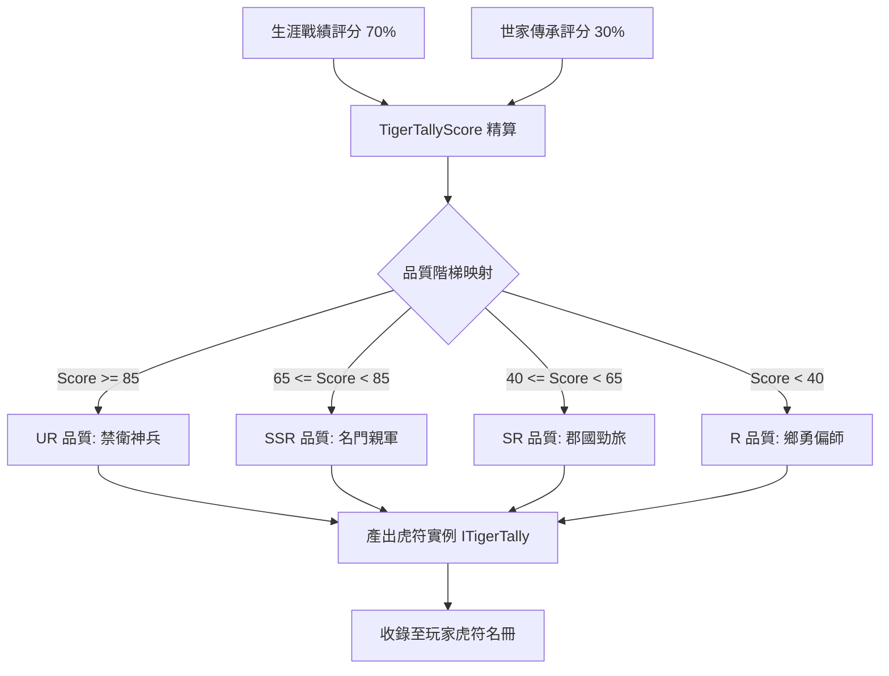

<!-- doc_id: doc_spec_0596 -->
# 兵種虎符資料模型與戰績傳承品質評分映射規格書

> 標記：Single Source of Truth（單一真相來源）  
> 涵蓋工作包：`TRP-05`、`TRP-06`  
> 狀態：正式發布 / 核心邏輯規格

---

## 1. 系統定位與架構

本模組規範遊戲中「兵種虎符（Tiger Tally）」的完整資料模型（`ITigerTally`）、玩家持有集合（`PlayerTallyCollection`），以及武將在身故或封賞時將一生戰功與門閥傳承映射為虎符初始品質之「虎符評分演算法（`TigerTallyScore`）」。虎符作為承載精銳軍團編制的核心信物，具備唯一持有性、不可丟棄性與世代傳承特性。



---

## 2. 虎符核心資料結構（TRP-05）

```typescript
export type TallyQuality = 'R' | 'SR' | 'SSR' | 'UR';

export interface ITigerTally {
  readonly tallyUid: string;           // 虎符唯一實例 ID（例如：TALLY_BING_ZHOU_001）
  readonly troopDefId: string;          // 關聯特殊兵種 ID（34 營之一）
  quality: TallyQuality;                // 虎符階階品質
  starLevel: number;                    // 當前星等（1 ~ 5 星）
  battleExp: number;                    // 當前星等累積戰鬥經驗
  equippedGeneralUid: string | null;    // 當前持有裝備之武將 UID（一將一符約束）
  readonly originalGeneralId: string;   // 創始名將原型 ID
  readonly createdTimestamp: number;    // 生成時間戳（Unix 秒）
}

export interface IPlayerTallyCollection {
  readonly playerId: string;
  tallies: ITigerTally[];
}
```

---

## 3. 虎符品質評分映射演算法（TRP-06）

虎符生成瞬間，系統綜合「武將生涯戰功評分」與「世代宗族傳承分」精算總分：

$$\text{TigerTallyScore} = \lfloor \text{BattleRecordScore} \times 0.70 + \text{LineageInheritScore} \times 0.30 \rfloor$$

### 3.1 四級品質門檻對照表
| 評分區間 | 虎符品質代碼 | 品質稱謂 | 基礎屬性乘數 | 初始星等上限 |
|:---:|:---:|:---:|:---:|:---:|
| **$\ge 85$** | `UR` | 傳奇天軍 | $\times 1.50$ | 5 星（開放突破） |
| **$65 \sim 84$** | `SSR` | 精銳王牌 | $\times 1.30$ | 5 星（開放突破） |
| **$40 \sim 64$** | `SR` | 郡國選拔 | $\times 1.15$ | 4 星（需突破符） |
| **$< 40$** | `R` | 行伍常軍 | $\times 1.00$ | 3 星（封頂不可突破） |

### 3.2 評分計算函式
```typescript
export function evaluateTigerTallyQuality(
  battleScore: number,
  lineageScore: number
): { finalScore: number; quality: TallyQuality } {
  const finalScore = Math.floor(battleScore * 0.70 + lineageScore * 0.30);
  let quality: TallyQuality = 'R';

  if (finalScore >= 85) {
    quality = 'UR';
  } else if (finalScore >= 65) {
    quality = 'SSR';
  } else if (finalScore >= 40) {
    quality = 'SR';
  }

  return { finalScore, quality };
}
```

---

## 4. 驗收與測試標準

1. **品質邊界判定測試（TC-TRP-06-01）**：
   - 驗證總分 39 返回 `R`；40 返回 `SR`；64 返回 `SR`；65 返回 `SSR`；84 返回 `SSR`；85 返回 `UR`。
2. **雙軸加權精算法（TC-TRP-06-02）**：
   - 輸入 `battleScore = 80, lineageScore = 100`，計算：$56 + 30 = 86$，檢核精確返回 `UR`。
3. **一符一將約束檢驗（TC-TRP-05-01）**：
   - 驗證虎符實例中 `equippedGeneralUid` 初始為 `null`，且同時僅允許單一武將引用。
