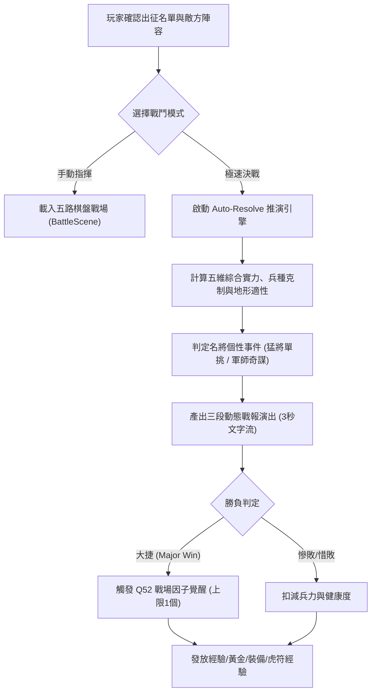

# 出征極速決戰推演演算法與武將個性單挑演出規格書

<!-- doc_id: doc_spec_1170 -->

## 一、 核心概念與單一真相來源（SSOT）

本規格書定義《三國志·漢末霸業》（3KLife）**出征極速決戰（Auto-Resolve）推演模型**、**武將個性單挑演出**與**戰場覺醒（Q52 checkAwakeningQuota）落地契約**。
旨在解決棋盤戰場節奏冗長、重複出征刷關枯燥的問題，提供「3 秒動態文字流演武」雙軌模式，兼顧輕快節奏與三國名將單挑特寫魅力。



---

## 二、 數值推演模型與單挑特寫契約

### 1. 極速決戰勝率演算法公式
戰鬥勝負由雙方總戰力比值與隨機擾動值決定：
$$\text{CombatPower} = \sum (\text{STR} \times 0.35 + \text{LEA} \times 0.35 + \text{INT} \times 0.20 + \text{CHA} \times 0.10) \times \text{AptitudeBonus} \times \text{TerrainMod}$$

- **兵種互克加成（AptitudeBonus）**：
  - 騎剋步、步剋弓、弓剋騎：克制方獲得 $+15\%$ 戰力修正，被克制方 $-10\%$。
- **地形適性係數（TerrainMod）**：
  - 擅長地形（A 級以上）：$+10\%$；拙劣地形（C 級以下）：$-10\%$。

### 2. 武將個性特寫演出觸發規則（3 秒文字戰報流）
戰報由三幕構成（前哨戰 ➔ 中盤激戰 ➔ 終局定勢），並依武將特性穿插特寫事件：

| 武將特質 | 觸發條件 | 演出特效文案 | 實質戰力影響 |
| :--- | :--- | :--- | :--- |
| **猛將單挑** | 我方主將 $\text{STR} \ge 90$（關/張/趙/呂） | **【陣前斬將】**：{猛將}策馬躍出，手起刀落將敵先鋒挑落馬下！敵軍震恐潰退！ | 勝率即時 $+25\%$，敵戰損 $+30\%$ |
| **軍師火計** | 我方軍師 $\text{INT} \ge 90$（諸葛/周瑜/郭嘉） | **【誘敵深入】**：{軍師}預伏火雷伏兵，敵軍追入狹道頓遭火海包圍！ | 我方戰損降低 $50\%$，勝率 $+20\%$ |
| **仁德感召** | 我方主將 $\text{CHA} \ge 85$（劉備） | **【義旗高揚】**：{主公}親撫士卒，鄉民義勇倒戈助陣！ | 戰後額外獲得戰俘與民心 $+10$ |

### 3. Q52 戰場覺醒判定契約（checkAwakeningQuota）
- **觸發時機**：僅在戰鬥獲得「大捷（Major Victory）」時執行。
- **硬性配額約束**：**每場戰鬥最多僅允許 1 位武將覺醒 1 個鎖定因子**。
- **判定流程**：
  ```typescript
  function checkAwakeningQuota(roster: GeneralConfig[]): AwakeningResult | null {
      // 依 EP 與出戰活躍度降序排序
      const candidate = roster.find(g => g.genes.some(gene => gene.isLocked));
      if (!candidate) return null;
      const lockedGene = candidate.genes.find(gene => gene.isLocked);
      if (lockedGene && Math.random() < 0.35) { // 35% 基礎覺醒率
          lockedGene.isLocked = false;
          return { generalId: candidate.id, geneId: lockedGene.id, geneName: lockedGene.displayName };
      }
      return null;
  }
  ```

---

## 三、 介面與表現契約

1. **出征準備介面**：增設「極速推演」切換鈕，點擊後跳過 3D/2D 棋盤載入，直接彈出演武卷軸。
2. **文字戰報演出**：採用水墨戰報卷軸，文字逐段跳動（間隔 0.8 秒，共 3 段），右上角提供「跳過演出」直達結算。
3. **覺醒浮窗**：若觸發 Q52 覺醒，彈出「【因子覺醒】鎖頭破裂」音效與金色光環。
4. **戰場「自動」鈕＝自動代打；跳過＝極速決戰**（2026-11-21 使用者裁決，PROG-2-9707）：
   - 第一次按「自動」：開啟自動代打。由 AI 沿用「委任」機制（`setDelegateEnabled(true)`，見 doc_spec_0040／DEP-11）幫玩家部署，並在每個玩家回合開始約 1 秒後自動結束回合，逐回合打到戰鬥自然結束，玩家看得到過程；倍速鈕（BtnSpeed）照常可用。結算帶原本的 cause（general／fortress／time-up 等）。
   - 沒有出征軍勢（`canDelegate()` 為 false，例如 demo 戰鬥）：仍可自動代打，只是不部署、只自動結束回合，並以 Toast 說明。
   - 自動代打中再按一次「自動」：跳過演出，沿用本規格書第二節極速決戰演算法（含首戰保證勝）直接結算，`BattleEnded` 帶 `cause: 'auto'`。
   - 想拿回控制權：按「委任」關閉（沒有出征軍勢時按委任亦同）＝同時停止自動代打，交還指揮權。
   - 文案常數（`core/systems/AutoPlay.ts`）：開啟「自動代打：由 AI 部署並逐回合交戰，再按一次自動可跳過演出」、停止「自動代打已停止，交還指揮權」、跳過「跳過演出，極速決戰結算」。
   - 不改任何戰場核心規則與數值；舊行為（第一次按下即極速結算）已廢止。
5. **極速決戰可用條件與每日次數**（2026-11-22 使用者裁決，PROG-2-9709；判定在 `core/systems/QuickResolveGate.ts`，數值在 `data/quick-resolve-config.json`）：
   - **整軍戰力**：極速決戰以整支出征部隊計戰力，不只算已上場的部隊。戰力 = 主將 + 存活部隊 + 城寨 + **預備兵力 × `reservePowerPerTroop`**（預備兵力＝出征帳本還沒派上場的兵，含虎符要用的兵力；大廳出征時整支部隊都是預備）。敵方沒有帳本，改資料驅動：關卡 JSON 可填 `enemyReserve`（兵數），沒填用 `quick-resolve-config.json` 的 `defaultEnemyReserve`（預設 3000；舊欄位 `enemyReserveTroops` 向下相容），實際值 ＝ max(0, enemyReserve − 敵方已上場兵數)，上場的兵已算在場上單位戰力裡，不重複計。`reservePowerPerTroop` 維持 0.06（總PM 2026-11-22 裁決）。
   - **關卡條件**（`encounters.json` 的 `allowQuickResolve`）：`after-clear`（預設，沒標就是它：沒打贏過不可用，打贏過才可用）／`always`（`true` 也算，明確標了才永遠可用）／`never`。劇情關、Boss 關、年終守城在 encounters.json 都已明確標註。守城戰（`battleKind: defense`，或主將為守方）與單挑（`battleKind: duel`，或戰場內單挑進行中）**永遠不可用**，不看關卡資料。勝利紀錄：一般關卡沿用 `clearedStageIds`，天下征鋒 Boss 關另記於存檔 `quickResolve.bossCleared`。
   - **每日次數**：每日免費 `dailyFreeUses`（預設 3）次；用完後每次耗 `writCostPerUse`（預設 1）張「軍令狀」（`ITEM_QUICK_RESOLVE_WRIT`，走物品庫存框架；第一版不販售，取得管道走獎勵框架 reward.claim，grantKey 冪等：首次通關 Boss 關 ×1（`quickResolveWrit:bossFirstClear:<stageId>`）、年終守城勝利 ×2（`quickResolveWrit:yearEndDefense:<year>`）、每季第一場戰鬥勝利 ×1（`quickResolveWrit:seasonFirstWin:<year>-<season>`），套件 `BUNDLE_QUICK_RESOLVE_WRIT_*` 在 reward-config.json）。免費次數與軍令狀皆不足則不可用。換日沿用登入日高水位（UTC+8，同 `DailyFreeEnroll`）：今天嚴格晚於紀錄日才歸零，時鐘回撥不重置。存檔欄位 `quickResolve { day, used, bossCleared }`。
   - **不可用的表現**：出征選擇視窗的「極速決戰」鈕灰掉，內文寫原因與今日次數（「首次挑戰須親自指揮」「守城戰無法極速決戰」「單挑無法極速決戰」「今日免費次數已用完，且沒有軍令狀」）；戰場內「自動代打中再按自動」同一套條件，不可用時不跳過，改以 Toast 與戰報提示原因並維持自動代打。
   - **結算**：計次在實際結算前（偵查詢問按返回的取消不計次）；`BattleEnded` 帶 `cause: 'auto'`；首戰保證勝改判時，戰報終局那行換成「援軍及時趕到，我軍反敗為勝」，不再先寫「我軍不支」。

---

## 四、 驗收測試案例（TC）

- **TC-AUTOBATTLE-01（猛將單挑高勝率特寫）**：
  - *前置條件*：指派關羽（STR 97）出征實力相當之敵軍。
  - *操作步驟*：點擊「極速決戰」。
  - *預期輸出*：3 秒內戰報出現【陣前斬將】特寫，戰鬥判定獲勝。
- **TC-AUTOBATTLE-02（Q52 覺醒上限防呆）**：
  - *前置條件*：出征 3 名武將身上均有鎖定因子。
  - *操作步驟*：連續進行極速出征直至獲勝。
  - *預期輸出*：單次結算至多解鎖 1 位武將之 1 個因子，絕無同時解鎖 2 個以上之現象。

- **TC-AUTOBATTLE-03（自動鈕＝自動代打，PROG-2-9707）**：
  - *操作步驟*：戰場按一次「自動」，觀察數回合；再按一次「自動」。
  - *預期輸出*：第一次按後 AI 部署並每回合自動結束回合、戰報出現開啟文案；第二次按後直接結算，結算說明為極速決戰（cause `auto`）；若改按「委任」則自動結束回合停止。

- **TC-AUTOBATTLE-04（整軍戰力與勝負，PROG-2-9709）**：
  - *前置條件*：我方主將與敵方主將戰力相當，我方出征帳本有大量未部署兵力、場上尚未部署任何部隊。
  - *操作步驟*：戰場內開自動代打後再按一次「自動」。
  - *預期輸出*：我方戰力含預備兵力，不再因「場上沒有部隊」必輸；結算 cause 為 `auto`，勝利時結算文案不含失敗用語。
- **TC-AUTOBATTLE-05（可用條件，PROG-2-9709）**：
  - *前置條件*：分別準備首次挑戰的劇情關、打贏過的劇情關、守城戰、單挑。
  - *操作步驟*：開啟出征選擇視窗；戰場內自動代打中再按一次「自動」。
  - *預期輸出*：首次劇情關與守城、單挑的「極速決戰」鈕灰掉並顯示對應原因，戰場內不跳過而是提示原因；打贏過的劇情關可用。
- **TC-AUTOBATTLE-06（每日次數與軍令狀，PROG-2-9709）**：
  - *前置條件*：今日免費次數 3 次，背包軍令狀 1 張。
  - *操作步驟*：連續極速決戰 5 次，換日後再一次。
  - *預期輸出*：前 3 次免費、第 4 次耗 1 張軍令狀、第 5 次按鈕灰掉並說明沒有軍令狀；換日後免費次數恢復為 3 次；時鐘回撥不重置。
