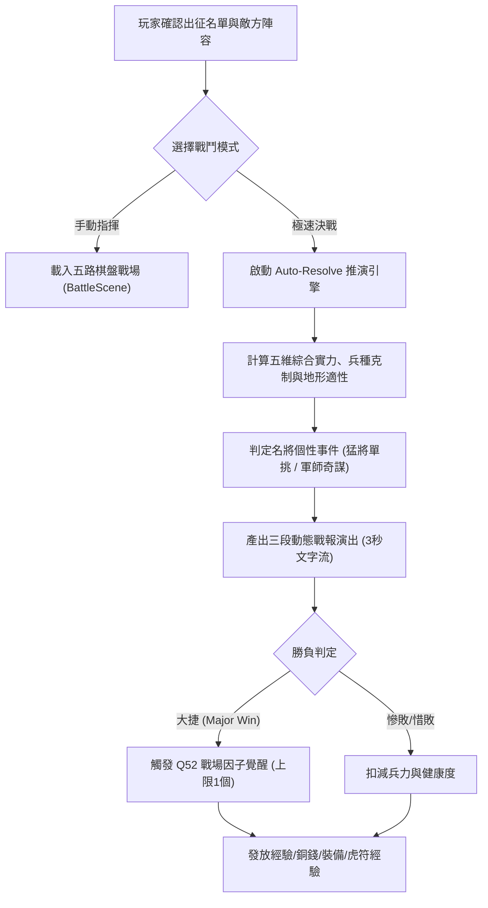

# 出征極速決戰推演演算法與武將個性單挑演出規格書

<!-- doc_id: doc_spec_1170 -->

## 一、 核心概念與單一真相來源（SSOT）

本規格書定義《三國志·漢末霸業》（3KLife）**出征極速決戰（Auto-Resolve）推演模型**、**武將個性單挑演出**與**戰場覺醒（Q52 checkAwakeningQuota）落地契約**。
旨在解決棋盤戰場節奏冗長、重複出征刷關枯燥的問題，提供「3 秒動態文字流演武」雙軌模式，兼顧輕快節奏與三國名將單挑特寫魅力。



---

## 二、 數值推演模型與單挑特寫契約

### 1. 極速決戰勝率演算法公式
戰鬥勝負由雙方總戰力比值與隨機擾動值決定：
$$\text{CombatPower} = \sum (\text{STR} \times 0.35 + \text{LEA} \times 0.35 + \text{INT} \times 0.20 + \text{CHA} \times 0.10) \times \text{AptitudeBonus} \times \text{TerrainMod}$$

- **兵種互克加成（AptitudeBonus）**：
  - 騎剋步、步剋弓、弓剋騎：克制方獲得 $+15\%$ 戰力修正，被克制方 $-10\%$。
- **地形適性係數（TerrainMod）**：
  - 擅長地形（A 級以上）：$+10\%$；拙劣地形（C 級以下）：$-10\%$。

### 2. 武將個性特寫演出觸發規則（3 秒文字戰報流）
戰報由三幕構成（前哨戰 ➔ 中盤激戰 ➔ 終局定勢），並依武將特性穿插特寫事件：

| 武將特質 | 觸發條件 | 演出特效文案 | 實質戰力影響 |
| :--- | :--- | :--- | :--- |
| **猛將單挑** | 我方主將 $\text{STR} \ge 90$（關/張/趙/呂） | **【陣前斬將】**：{猛將}策馬躍出，手起刀落將敵先鋒挑落馬下！敵軍震恐潰退！ | 勝率即時 $+25\%$，敵戰損 $+30\%$ |
| **軍師火計** | 我方軍師 $\text{INT} \ge 90$（諸葛/周瑜/郭嘉） | **【誘敵深入】**：{軍師}預伏火雷伏兵，敵軍追入狹道頓遭火海包圍！ | 我方戰損降低 $50\%$，勝率 $+20\%$ |
| **仁德感召** | 我方主將 $\text{CHA} \ge 85$（劉備） | **【義旗高揚】**：{主公}親撫士卒，鄉民義勇倒戈助陣！ | 戰後額外獲得戰俘與民心 $+10$ |

### 3. Q52 戰場覺醒判定契約（checkAwakeningQuota）
- **觸發時機**：僅在戰鬥獲得「大捷（Major Victory）」時執行。
- **硬性配額約束**：**每場戰鬥最多僅允許 1 位武將覺醒 1 個鎖定因子**。
- **判定流程**：
  ```typescript
  function checkAwakeningQuota(roster: GeneralConfig[]): AwakeningResult | null {
      // 依 EP 與出戰活躍度降序排序
      const candidate = roster.find(g => g.genes.some(gene => gene.isLocked));
      if (!candidate) return null;
      const lockedGene = candidate.genes.find(gene => gene.isLocked);
      if (lockedGene && Math.random() < 0.35) { // 35% 基礎覺醒率
          lockedGene.isLocked = false;
          return { generalId: candidate.id, geneId: lockedGene.id, geneName: lockedGene.displayName };
      }
      return null;
  }
  ```

---

## 三、 介面與表現契約

1. **出征準備介面**：增設「極速推演」切換鈕，點擊後跳過 3D/2D 棋盤載入，直接彈出演武卷軸。
2. **文字戰報演出**：採用水墨戰報卷軸，文字逐段跳動（間隔 0.8 秒，共 3 段），右上角提供「跳過演出」直達結算。
3. **覺醒浮窗**：若觸發 Q52 覺醒，彈出「【因子覺醒】鎖頭破裂」音效與金色光環。

---

## 四、 驗收測試案例（TC）

- **TC-AUTOBATTLE-01（猛將單挑高勝率特寫）**：
  - *前置條件*：指派關羽（STR 97）出征實力相當之敵軍。
  - *操作步驟*：點擊「極速決戰」。
  - *預期輸出*：3 秒內戰報出現【陣前斬將】特寫，戰鬥判定獲勝。
- **TC-AUTOBATTLE-02（Q52 覺醒上限防呆）**：
  - *前置條件*：出征 3 名武將身上均有鎖定因子。
  - *操作步驟*：連續進行極速出征直至獲勝。
  - *預期輸出*：單次結算至多解鎖 1 位武將之 1 個因子，絕無同時解鎖 2 個以上之現象。
