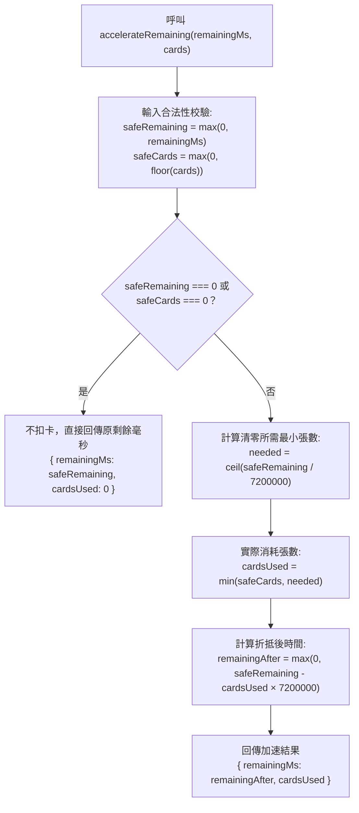

<!-- doc_id: doc_spec_0410 -->
# 加速卡縮期機制與商店定價數值規格書

> 本規格書為 3KLife 系統加速卡（`ITEM_WISH_SPEED_CARD`）時間縮減演算法、商店定價與消耗防溢出機制之唯一真相來源（Single Source of Truth）。
> 相關實作對齊：`assets/scripts/core/systems/AccelerateCard.ts`、`WishPool.ts`、`MonthlyCard.ts`。

---

## 1. 系統定位與設計理念

1. **純邏輯時間加速仲裁（Decoupled Timer Speed-Up）**：
   - 加速卡模組不直接操作計時器、畫面刷新或全域存檔，僅接受「當前剩餘時長（毫秒）」與「投入張數」，回傳計算後的剩餘時間與「實際消耗張數」。
   - Unity 概念對照：相當於獨立的 `TimeAcceleratorEngine`，計算結果交由呼叫端（如 `WishPool`）更新結束時間，道具扣除則委託背包系統（`PlayerInventory`）執行。
2. **防溢出與不浪費保護（No-Waste Principle）**：
   - 當剩餘等待時間不足以消耗投入的全部加速卡時，演算法僅扣除「恰好滿足縮短至 0」所需的最小整數張數，多餘的卡片不予消耗並全數保留給玩家。
   - 剩餘時間設有 $\ge 0$ 下限保底，絕對不會因加速產生負數時間或倒流。

---

## 2. 核心數值與定價模型

| 參數常數項 | 數值 / 設定 | 單位 | 說明 |
|---|:---:|:---:|---|
| `ACCELERATE_CARD_HOURS` | **2** | 小時 | 每張加速卡固定折抵之等待時數 |
| `ACCELERATE_CARD_MS` | **7,200,000** | 毫秒 | 單張加速卡折抵之毫秒數（$2 \times 3,600 \times 1,000$） |
| `ACCELERATE_CARD_PRICE_SPIRIT` | **5** | 精元 (`gem`) | 百寶閣商城單張常規販售價格 |
| `MONTHLY_CARD_DAILY_SPEED_CARDS` | **1** | 張 | 月卡特權每日登入免費贈送額度 |

---

## 3. 加速折算演算法（accelerateRemaining）



### 3.1 清零所需張數計算（needed）
$$\text{needed} = \left\lceil \frac{\text{safeRemaining}}{\text{ACCELERATE\_CARD\_MS}} \right\rceil$$

### 3.2 實際消耗張數（cardsUsed）
$$\text{cardsUsed} = \min\left(\text{safeCards}, \text{needed}\right)$$

### 3.3 折減後剩餘時間（remainingAfter）
$$\text{remainingAfter} = \max\left(0, \text{safeRemaining} - \text{cardsUsed} \times \text{ACCELERATE\_CARD\_MS}\right)$$

---

## 4. 介面型別契約

```typescript
export const ACCELERATE_CARD_HOURS = 2;
export const ACCELERATE_CARD_MS = ACCELERATE_CARD_HOURS * 60 * 60 * 1000;
export const ACCELERATE_CARD_PRICE_SPIRIT = 5;

export interface AccelerateResult {
    /** 加速後的剩餘毫秒，不低於 0 */
    readonly remainingMs: number;
    /** 實際消耗的加速卡張數（防浪費截斷） */
    readonly cardsUsed: number;
}

/**
 * 用 cards 張加速卡縮短 remainingMs 剩餘時間。
 * 非有限數或非正數視為 0；卡數取整數向下；剩餘時間為 0 時不消耗任何卡。
 */
export function accelerateRemaining(remainingMs: number, cards: number): AccelerateResult;
```

---

## 5. 整合與驗收規範

1. **許願池聯動驗證**：
   - 當許願項目剩餘 3 小時（10,800,000 ms）且玩家投入 5 張加速卡時：
     - 清零需 $\lceil 3 / 2 \rceil = 2$ 張。
     - 實際消耗 `cardsUsed = 2`，返還未用 3 張。
     - 剩餘時間 `remainingMs = 0`，許願項目立即轉為熟成可提領狀態。
2. **邊界條件保護**：
   - 傳入 `NaN`、`Infinity`、負數或 0 毫秒時，`cardsUsed` 必為 0。
