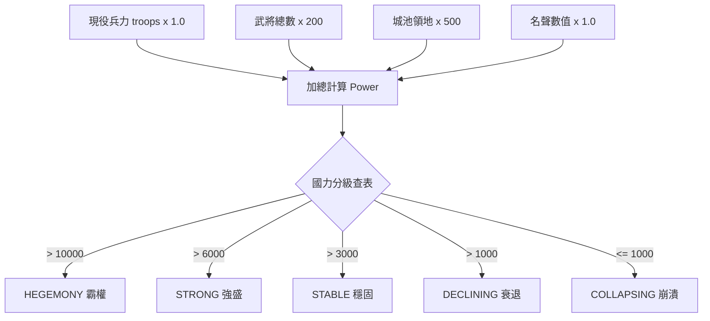

<!-- doc_id: doc_spec_0494 -->
<!-- spec_id: RAI-11 -->
# 勢力興衰國力五級評估與霸權崩潰連鎖效果規格書

> 標籤：`系統規格` `他國AI` `勢力興衰` `國力評級` `RAI-11`
> 狀態：`正式生效` · 責任模組：`RivalRiseFall` · 參照：`RAI-11` / `PROG-2-1475`

---

## 1. 模組定位與設計理念

在三國動態世界中，各割據勢力並非靜止不變。因戰事勝負、領土吞吐與武將歸附，勢力國力將經歷興盛、鼎盛、衰退乃至崩潰的自然生命週期。
本規格書定義勢力興衰評估系統（`RivalRiseFall.ts`），遵循以下原則：
1. **多維四軸綜合國力公式**：整合現役兵力、武將規模、領土城池與君主名聲，客觀反映總體戰略實力。
2. **五級強弱階梯分段**：確立五大鮮明的國力等級（Standing），消除模糊狀態。
3. **極端狀態連鎖效果**：針對過強之「霸權」與瀕死之「崩潰」賦予嚴格的系統回饋，避免強者恆強或死而不僵。
4. **年度週期性節奏評估**：固定每 4 季（1 年）進行一次全局核算，確保世界節奏張弛有度。

---

## 2. 國力評分計算模型 (nationPowerScore)

每年結算時，系統為各勢力計算當前綜合國力分數 $\text{Power}$：

$$\text{Power} = \text{troops} + (\text{generalCount} \times 200) + (\text{territories} \times 500) + \text{fame}$$

### 2.1 權重參數定義 (NATION_POWER_WEIGHT)
- `perGeneral = 200`：單一武將的人才價值等同 200 點戰力儲備。
- `perTerritory = 500`：單一座城池提供賦稅、防禦與戰略腹地，折合 500 點國力。

---

## 3. 國力五級階梯與門檻表 (NATION_STANDING_THRESHOLDS)

國力判定採嚴格大於門檻判定（由高至低依序比對）：

| 等級代碼 (NationStanding) | 中文等級 | 國力門檻要求 | 象徵意義與地緣政治地位 |
|---|---|:---:|---|
| `HEGEMONY` | 霸權 | $> 10000$ | 稱霸中原，具備吞併天下實力的超一流強權 |
| `STRONG` | 強盛 | $> 6000$ | 雄霸一方，兵精糧足的區域大勢力 |
| `STABLE` | 穩固 | $> 3000$ | 守土有餘，具備自我造血能力的穩定州郡 |
| `DECLINING` | 衰退 | $> 1000$ | 人才凋零或失地受挫，戰略轉向收縮防禦 |
| `COLLAPSING` | 崩潰 | $\le 1000$ | 風雨飄搖，政權瀕臨瓦解的殘破末期 |

---

## 4. 極端等級專屬連鎖效果 (NATION_STANDING_EFFECTS)

常態等級（STRONG / STABLE / DECLINING）無額外系統修正，極端等級啟動特定機制：

### 4.1 霸權等級連鎖制約 (HEGEMONY)
- **敵對值每季遞增 (`hostilityPerSeason = 10`)**：
  天下其餘勢力對該霸權勢力的敵意每季自動 $+10$。群雄對其高度戒備，貿易難度劇增，並高機率觸發聯軍討伐。

### 4.2 崩潰等級連鎖破滅 (COLLAPSING)
- **武將叛逃率加成 (`defectionRateBonus = +0.20`)**：
  該勢力下屬武將忠誠度大幅動搖，每季叛逃或轉投明主的機率額外提升 20%。
- **鄰國入侵機率加成 (`invasionChanceBonus = +0.50`)**：
  周圍鄰近勢力在評估擴張時，判定該勢力為軟弱肥羊，進攻發動率額外增加 50%，加速勢力整併。

---

## 5. 評估週期與驗收標準

1. **評估週期**：
   - 呼叫 `shouldEvaluateStanding(season)`，僅在 `season % 4 === 0` 時執行年度國力重新定級。
2. **邊界驗收契約**：
   - 國力剛好等於 10000 時，歸類為 `STRONG`（非 `HEGEMONY`）。
   - 國力剛好等於 1000 時，歸類為 `COLLAPSING`（非 `DECLINING`）。
   - 霸權勢力每季產生的額外敵對數值，不可受防禦型性格豁免。
