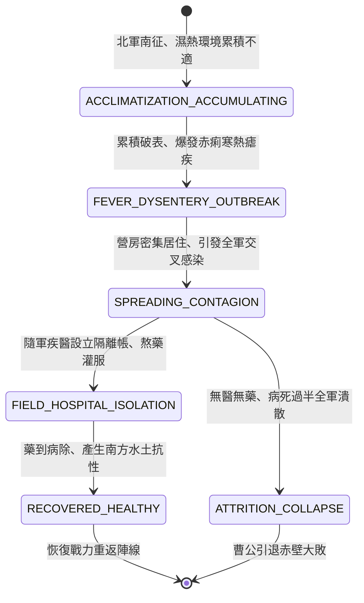

<!-- doc_id: doc_spec_0822 -->
# 3KLife 北方大軍南下水土不服赤痢瘧疾蔓延與隨軍疾醫隔離狀態機規格書

## 模組基本資訊
- **模組代號**：`ACCLIMATIZATION-EPIDEMIC01`
- **系統定位**：三國地域環境氣候適應與行軍疫病爆發系統，負責北方士卒南征水土不服累積、赤痢瘧疾交叉感染、非戰鬥減員與隨軍疾醫隔離帳熬藥救治之完整狀態流。
- **架構依賴**：`BattleGridSystem`、`MoraleSystem`、`TroopSanitationEngine`、`VFXBlockRegistry`。

---

## 核心設計概念
赤壁之戰與南征之際，北方曹魏大軍「不服水土，必生疾疫」。久居乾燥寒冷之北方士卒，南下荊襄江東，面對連綿陰雨、溽熱潮濕、江水重金屬與蚊蟲肆虐。行軍越久，體內濕毒累積越深。先發為「水土不服」（食慾不振、四肢無力），繼而引發惡性「赤痢腹瀉」與忽冷忽熱之「瘧疾」。若無隨軍疾醫搭建隔離營帳、分發雄黃雄柏散與大鍋甘草黃連湯，軍中病卒將呈幾何級數蔓延，不戰自潰。



---

## 狀態機定義與轉換條件

### 1. `ACCLIMATIZATION_ACCUMULATING`（濕毒累積狀態）
- **進入條件**：北方兵種（冀州、兗州、幽州、涼州）跨越淮河長江以南行軍。
- **行為表現**：
  - 每行軍 1 回合，「水土不服度」增加 5 點（雨季每回合 +10 點）。
  - 士氣每回合 -2 點，近戰命中率下降 10%。
- **轉換**：水土不服度達到 60 點 -> 轉移至 `FEVER_DYSENTERY_OUTBREAK`。

### 2. `FEVER_DYSENTERY_OUTBREAK`（瘧疾赤痢爆發狀態）
- **行為表現**：
  - 士卒面黃肌瘦，發熱寒顫與劇烈腹瀉，移動力強制扣除 2 格。
  - 攻擊力與防禦力削弱 45%，每回合產生 5% 非戰鬥戰損減員。
- **轉換**：處於同一營寨超過 1 回合 -> 轉移至 `SPREADING_CONTAGION`。

### 3. `SPREADING_CONTAGION`（疫病蔓延傳染狀態）
- **行為表現**：
  - 疫病向相鄰 2 格內所有部隊傳染，感染率達 75%。
  - 全軍哀鴻遍野，士氣強制扣除 30 點。
- **轉換**：
  - 主帥下令指派「隨軍疾醫」搭建醫帳 -> 轉移至 `FIELD_HOSPITAL_ISOLATION`。
  - 未指派疾醫超過 3 回合 -> 轉移至 `ATTRITION_COLLAPSE`。

### 4. `FIELD_HOSPITAL_ISOLATION`（隔離救治狀態）
- **行為表現**：
  - 疾醫搭建黃布隔離帳，將患病士卒集中隔離，切斷營區傳染鏈。
  - 支起大鐵鍋熬煮「甘草黃連解毒湯」，每回合治癒 35% 染疫士兵。
- **轉換**：全隊治癒進度達到 100% -> 轉移至 `RECOVERED_HEALTHY`。

### 5. `RECOVERED_HEALTHY`（痊癒生抗體狀態）
- **行為表現**：
  - 疾病標籤清除，全隊獲得「南方水土抗性」，後續水土不服累積速率降低 80%。
  - 戰力完全復原。
- **轉換**：歸建歸陣 -> 結束退出。

### 6. `ATTRITION_COLLAPSE`（病卒過半雪崩狀態）
- **行為表現**：
  - 非戰鬥減員超過 50%，戰馬倒斃，死屍遍野。
  - 部隊無法作戰，強制判定敗退撤軍。
- **轉換**：全軍後撤北歸 -> 結束退出。

---

## 數值公式與配置契約

```typescript
export interface AcclimatizationEpidemicConfig {
  systemId: string;
  acclimatizationRateDrySeason: number;// 旱季每日不服累積值
  acclimatizationRateRainySeason: number;// 雨季每日不服累積值
  epidemicTriggerThreshold: number;   // 觸發疫病爆發閾值 (60)
  combatPenaltyPercent: number;       // 患病攻防削弱比 (0.0 ~ 1.0)
  contagionSpreadRadiusGrid: number;  // 營區交叉感染半徑
  physicianCureSpeedPerTurn: number;  // 疾醫每回合治癒比
}

export const EPIDEMIC_PRESETS: Record<string, AcclimatizationEpidemicConfig> = {
  CHIBI_NORTHERN_ARMY_EPIDEMIC: {
    systemId: 'EPI_CHIBI_01',
    acclimatizationRateDrySeason: 5,
    acclimatizationRateRainySeason: 10,
    epidemicTriggerThreshold: 60,
    combatPenaltyPercent: 0.45,
    contagionSpreadRadiusGrid: 2,
    physicianCureSpeedPerTurn: 0.35,
  }
};
```

---

## 單元測試與驗收標準
1. **雨季累積翻倍**：在南方水網雨季行軍時，北方部隊每回合確實累積 10 點水土不服度，6 回合精確觸發赤痢爆發。
2. **疾醫隔離阻斷感染**：設立 `FIELD_HOSPITAL_ISOLATION` 後，相鄰格健康部隊之感染率立即歸零，不再受蔓延波及。
3. **痊癒抗性保護**：經疾醫救治康復之部隊，水土不服累積速度下降 80%，長江流域作戰不再頻繁病發。
