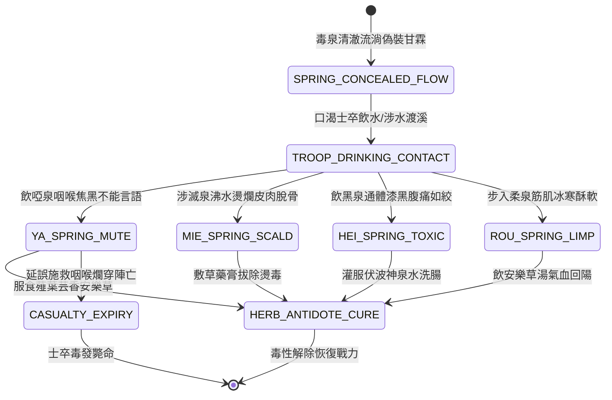

<!-- doc_id: doc_spec_0821 -->
# 3KLife 南中四番毒泉啞泉滅泉黑泉柔泉毒性反應與解毒狀態機規格書

## 模組基本資訊
- **模組代號**：`FOUR-POISON-SPRINGS01`
- **系統定位**：三國南征極端地理環境與毒泉生化機制系統，負責四番毒泉判定、薤葉芸香解毒與伏波泉引水之生命週期。
- **架構依賴**：`BattleGridSystem`、`TroopTypeMovement`、`MoraleSystem`、`VFXBlockRegistry`。

---

## 核心設計概念
諸葛亮南征面對「四番毒泉」：啞泉飲之失音焦爛、滅泉水沸燙脫皮肉、黑泉水苦透骨手足皆黑、柔泉奇寒酥軟倒地。破局關鍵在於尋得「薤葉芸香」口含避毒方能安然行軍。



---

## 狀態機定義與轉換條件

### 1. `SPRING_CONCEALED_FLOW`（毒泉流淌狀態）
- **進入條件**：南中地圖特定溪流泉眼地格生成。
- **行為表現**：水質清澈見底散發泉香，欺瞞值 85%（部隊口渴高機率飲水）。
- **轉換**：部隊接觸地格 -> 轉移至 `TROOP_DRINKING_CONTACT`。

### 2. `TROOP_DRINKING_CONTACT`（接觸判定狀態）
- **轉換**：
  - 誤飲啞泉 -> 轉移至 `YA_SPRING_MUTE`。
  - 踏入滅泉 -> 轉移至 `MIE_SPRING_SCALD`。
  - 誤飲黑泉 -> 轉移至 `HEI_SPRING_TOXIC`。
  - 踏入柔泉 -> 轉移至 `ROU_SPRING_LIMP`。

### 3. 各毒泉病態反應
- **`YA_SPRING_MUTE`（啞泉焦咽）**：無法傳令，指令延遲 +2 回合，每回合扣血 5%。
- **`MIE_SPRING_SCALD`（滅泉滾沸）**：水沸燙腿，移速降為 1，受 350 點灼燙傷害。
- **`HEI_SPRING_TOXIC`（黑泉劇毒）**：手足漆黑，攻防扣除 60%，每回合扣血 10%。
- **`ROU_SPRING_LIMP`（柔泉骨軟）**：奇寒透骨癱倒無法反擊，持續 2 回合。
- **轉換**：
  - 使用「薤葉芸香/安樂草」 -> 轉移至 `HERB_ANTIDOTE_CURE`。
  - 連續 3 回合未獲解毒 -> 轉移至 `CASUALTY_EXPIRY`。

### 4. `HERB_ANTIDOTE_CURE`（解毒康復狀態）
- **行為表現**：吞服安樂草汁或神泉水，毒素排出，負面狀態清除，生命值恢復至 80%。
- **轉換**：康復完畢 -> 結束退出。

---

## 數值公式與配置契約

```typescript
export type PoisonSpringType = 'YA_MUTE' | 'MIE_SCALD' | 'HEI_TOXIC' | 'ROU_LIMP';

export interface PoisonSpringConfig {
  springType: PoisonSpringType;
  deceptionDeceitRate: number;    // 泉水甘美欺瞞率
  damagePerTurnRate: number;      // 每回合損血比
  commandMuteTurns: number;       // 啞泉號令啞火回合
  scaldingMobilityDrop: number;   // 滅泉移速扣除格數
  paralysisDurationTurns: number; // 柔泉麻痺持續回合
  antidoteItemRequired: string;   // 解毒必備道具 (薤葉芸香)
}

export const POISON_SPRING_DATA: Record<PoisonSpringType, PoisonSpringConfig> = {
  YA_MUTE:   { springType: 'YA_MUTE',   deceptionDeceitRate: 0.85, damagePerTurnRate: 0.05, commandMuteTurns: 3, scaldingMobilityDrop: 0, paralysisDurationTurns: 0, antidoteItemRequired: 'HERB_YUNXIANG' },
  MIE_SCALD: { springType: 'MIE_SCALD', deceptionDeceitRate: 0.70, damagePerTurnRate: 0.12, commandMuteTurns: 0, scaldingMobilityDrop: 3, paralysisDurationTurns: 0, antidoteItemRequired: 'HERB_YUNXIANG' },
  HEI_TOXIC: { springType: 'HEI_TOXIC', deceptionDeceitRate: 0.80, damagePerTurnRate: 0.10, commandMuteTurns: 0, scaldingMobilityDrop: 1, paralysisDurationTurns: 0, antidoteItemRequired: 'HERB_YUNXIANG' },
  ROU_LIMP:  { springType: 'ROU_LIMP',  deceptionDeceitRate: 0.75, damagePerTurnRate: 0.04, commandMuteTurns: 0, scaldingMobilityDrop: 4, paralysisDurationTurns: 2, antidoteItemRequired: 'HERB_YUNXIANG' }
};
```

---

## 單元測試與驗收標準
1. **啞泉號令封鎖**：飲用啞泉後，部隊 3 回合內無法響應主將技能。
2. **預服芸香免疫**：裝備「薤葉芸香」部隊行經毒泉，減益觸發率 100% 降為 0。
3. **未解毒致死判定**：黑泉中毒單位未施救時，第 3 回合結束部隊生命歸零除名。
