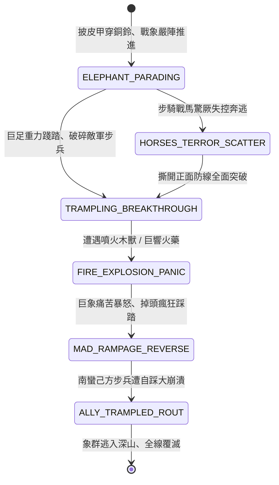

<!-- doc_id: doc_spec_0819 -->
# 3KLife 南蠻戰象披甲踐踏驚散戰馬與火球巨響受驚狂暴逆踩狀態機規格書

## 模組基本資訊
- **模組代號**：`WAR-ELEPHANT-RAMPAGE01`
- **系統定位**：三國南蠻重型戰象兵團與狂暴反噬狀態系統，負責生牛皮鎧甲披掛、象踏破陣、敵軍戰馬驚厥潰散、懼火受驚逆向踐踏己方陣列之完整狀態流。
- **架構依賴**：`BattleGridSystem`、`TroopTypeMovement`、`MoraleSystem`、`VFXBlockRegistry`。

---

## 核心設計概念
三國南中之戰孟獲與木鹿大王驅使龐大「戰象軍團」。巨象全身覆蓋厚實生牛皮甲與銅鈴，象背架設高大木質戰棚，載有蠻族毒箭弩手。戰象衝鋒時大地震顫，中原戰馬從未見過如此龐然巨物，聞其氣味吼聲即刻四蹄發軟、不戰自潰。然而戰象皮糙肉厚卻生性膽怯怕火畏聲。諸葛亮特造「木刻假獸木櫃」，內藏硫磺火藥噴吐烈火，伴隨鑼鼓巨響。巨象受大驚嚇後瞬間失控狂暴，掉頭向後狂奔，反而將南蠻後續步兵踏為肉泥。



---

## 狀態機定義與轉換條件

### 1. `ELEPHANT_PARADING`（戰象列陣推進狀態）
- **進入條件**：南蠻主將召喚「披甲戰象隊伍」（每隊 6 隻巨象，象背搭載射手）。
- **行為表現**：
  - 體積佔用 2x2 地格，具備 3500 點超高耐久與 70% 遠程減傷。
  - 散發「遠古巨獸威壓」氣場（周遭 3 格）。
- **轉換**：
  - 接觸中原常規騎兵部隊 -> 轉移至 `HORSES_TERROR_SCATTER`。
  - 正面撞擊敵步兵方陣 -> 轉移至 `TRAMPLING_BREAKTHROUGH`。

### 2. `HORSES_TERROR_SCATTER`（驚散戰馬狀態）
- **行為表現**：
  - 敵常規戰馬聞其氣味強制陷入「驚厥受駭」，失控打轉並向後奔逃 3 格。
  - 騎兵衝鋒加成徹底歸零，無法發起有效突擊。
- **轉換**：騎兵潰散後繼續進逼 -> 轉移至 `TRAMPLING_BREAKTHROUGH`。

### 3. `TRAMPLING_BREAKTHROUGH`（重力踐踏破陣狀態）
- **行為表現**：
  - 象蹄踩踏與長鼻橫掃，造成每秒 600 點範圍真實鈍擊傷害。
  - 步兵陣型直接破裂，部隊被踩扁或挑飛，士氣暴跌 40 點。
- **轉換**：
  - 遭遇噴火機關、火球投石或密集雷鳴火藥 -> 轉移至 `FIRE_EXPLOSION_PANIC`。
  - 敵防線徹底粉碎 -> 維持推進。

### 4. `FIRE_EXPLOSION_PANIC`（懼火受驚狀態）
- **行為表現**：
  - 烈火燒灼象皮，火藥巨響震穿耳膜。
  - 戰象發出淒厲長鳴，雙足人立，象背蠻兵被甩落跌死。
- **轉換**：失控狂暴（0.2 秒延遲） -> 轉移至 `MAD_RAMPAGE_REVERSE`。

### 5. `MAD_RAMPAGE_REVERSE`（瘋狂逆向踩踏狀態）
- **行為表現**：
  - 戰象徹底喪失指揮，掉頭 180 度向己方後陣瘋狂衝撞奔逃。
  - 移動速度暴增 100%，不分敵我全面碾壓。
- **轉換**：衝撞己方南蠻後衛步兵部隊 -> 轉移至 `ALLY_TRAMPLED_ROUT`。

### 6. `ALLY_TRAMPLED_ROUT`（反噬自踩大崩潰狀態）
- **行為表現**：
  - 南蠻己方步兵遭到己方戰象巨足碾碎，傷亡慘重（損失 50% 以上兵力）。
  - 南蠻全軍陷入「神獸反噬恐懼」，全軍全線大潰逃。
- **轉換**：象群狂奔逃出戰場邊界 -> 結束退出。

---

## 數值公式與配置契約

```typescript
export interface WarElephantConfig {
  elephantId: string;
  elephantMaxHp: number;           // 戰象生命值
  trampleDamageRadiusGrid: number; // 踐踏傷害半徑
  horsePanicRadiusGrid: number;    // 戰馬驚厥感知半徑
  firePanicThresholdDamage: number;// 觸發狂暴火傷閾值
  reverseRampageSpeedBonus: number;// 逆向狂暴移速加成
  allyCrushDamageMultiplier: number;// 踐踏己方傷害倍率
}

export const WAR_ELEPHANT_PRESETS: Record<string, WarElephantConfig> = {
  NANMAN_ARMORED_MAMMOTH: {
    elephantId: 'ELEPHANT_NANMAN_01',
    elephantMaxHp: 3500,
    trampleDamageRadiusGrid: 2,
    horsePanicRadiusGrid: 3,
    firePanicThresholdDamage: 150,
    reverseRampageSpeedBonus: 2,
    allyCrushDamageMultiplier: 1.8,
  }
};
```

---

## 單元測試與驗收標準
1. **中原戰馬聞氣即驚**：騎兵進入戰象 3 格範圍內，100% 觸發「驚厥受駭」並強制後退 3 格，無法實施正面近戰。
2. **火攻受驚狂暴反噬**：戰象承受超過 150 點火焰傷害時，狀態機精確轉移至 `MAD_RAMPAGE_REVERSE`，轉舵 180 度反向踐踏。
3. **己方自踩大雪崩**：狂暴戰象衝撞南蠻友軍時，依 1.8 倍傷害結算踐踏，南蠻部隊士氣即刻扣除 50 點。
