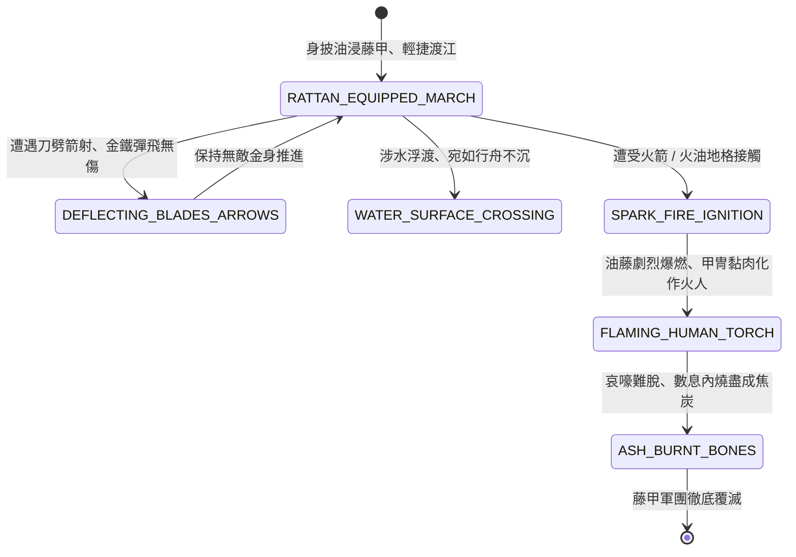

<!-- doc_id: doc_spec_0818 -->
# 3KLife 南蠻藤甲兵油浸乾藤刀箭不入與遇火遇熱焦骨狀態機規格書

## 模組基本資訊
- **模組代號**：`RATTAN-ARMOR-VULNERABILITY01`
- **系統定位**：三國南蠻特種異族步兵裝甲與極端元素生剋系統，負責油浸藤甲編織、刀槍箭矢絕對防禦、涉水浮渡、遇火爆燃與全軍火焚覆滅之完整狀態流。
- **架構依賴**：`BattleGridSystem`、`TroopTypeMovement`、`FireSpreadEngine`、`VFXBlockRegistry`。

---

## 核心設計概念
諸葛亮南征孟獲時遭遇烏戈國主兀突骨之「藤甲軍」。其甲採取山澗深藤，浸在油中半年方取出曬乾，曬乾復浸，凡十餘次，編造成甲。其優勢有二：一是輕巧能浮，渡水不沉；二是堅韌至極，刀劍皆不能入，強弩射之反彈。然而孔明深知「物理極致必有相剋」：藤甲久浸膏油且乾燥，遇微火即劇烈自燃，烈火黏附肌膚無法脫卸。誘至盤蛇谷火攻，萬千藤甲瞬間化為火人，全軍覆滅。



---

## 狀態機定義與轉換條件

### 1. `RATTAN_EQUIPPED_MARCH`（藤甲行軍狀態）
- **進入條件**：南蠻特種烏戈國部隊編制，自帶「油浸生藤甲」裝備。
- **行為表現**：
  - 負重極輕，山地與叢林移動力 +2 格。
  - 對常規物理鈍擊、穿刺、劈砍具備極高減免。
- **轉換**：
  - 遭遇一般刀劍或弓弩箭雨打擊 -> 轉移至 `DEFLECTING_BLADES_ARROWS`。
  - 進入深水或河流地格 -> 轉移至 `WATER_SURFACE_CROSSING`。
  - 遭受火箭、火油、霹靂車火球射擊 -> 轉移至 `SPARK_FIRE_IGNITION`。

### 2. `DEFLECTING_BLADES_ARROWS`（彈刀破矢防禦狀態）
- **行為表現**：
  - 常規物理傷害減免 85%；箭矢射中發出梆梆金石聲彈飛落地。
  - 部隊士氣極度旺盛，無視壓制效果。
- **轉換**：傷害判定完畢 -> 回歸 `RATTAN_EQUIPPED_MARCH`。

### 3. `WATER_SURFACE_CROSSING`（浮水浮渡狀態）
- **行為表現**：
  - 藤甲自帶巨大浮力，部隊涉水如踏浮木，無需走舸即能橫渡大江大河。
  - 水中移速不減，完全免疫溺水判定。
- **轉換**：登陸上岸 -> 回歸 `RATTAN_EQUIPPED_MARCH`。

### 4. `SPARK_FIRE_IGNITION`（遇火爆燃狀態）
- **行為表現**：
  - 只要沾染 1 點火焰傷害，油藤甲即刻產生「連環爆燃」（著火率 100%）。
  - 油脂受熱沸騰，深陷肌膚，士卒無法在戰鬥中解開繩結脫卸。
- **轉換**：爆燃擴散（0.3 秒） -> 轉移至 `FLAMING_HUMAN_TORCH`。

### 5. `FLAMING_HUMAN_TORCH`（火人灼燒崩潰狀態）
- **行為表現**：
  - 全隊每秒扣減最大生命值 35%，陷入無法控制的哀嚎狂奔。
  - 觸碰相鄰藤甲友軍時產生「火人傳染」，引燃整隊。
- **轉換**：生命值歸零 -> 轉移至 `ASH_BURNT_BONES`。

### 6. `ASH_BURNT_BONES`（焦骨覆滅狀態）
- **行為表現**：
  - 藤甲化為飛灰，士卒燒為焦炭，部隊全滅除名。
  - 戰場留下一片白煙與刺鼻油焦味。
- **轉換**：結算完成 -> 結束退出。

---

## 數值公式與配置契約

```typescript
export interface RattanArmorConfig {
  armorId: string;
  physicalDamageReductionRate: number; // 物理傷害減免比 (0.0 ~ 1.0)
  arrowReflectChance: number;           // 箭矢彈飛率
  waterBuoyancyImmunity: boolean;       // 水中浮力溺水免疫
  fireDamageTakenMultiplier: number;    // 火焰易傷倍率 (3.0 ~ 5.0)
  humanTorchContagionRate: number;      // 火人互相傳染機率
}

export const RATTAN_PRESETS: Record<string, RattanArmorConfig> = {
  WUGUO_RATTAN_INFANTRY: {
    armorId: 'ARMOR_RATTAN_01',
    physicalDamageReductionRate: 0.85,
    arrowReflectChance: 0.90,
    waterBuoyancyImmunity: true,
    fireDamageTakenMultiplier: 4.5,
    humanTorchContagionRate: 0.80,
  }
};
```

---

## 單元測試與驗收標準
1. **刀箭減免與彈飛**：神射營火箭以外之常規箭雨命中藤甲兵，90% 箭矢彈飛，物理傷害嚴格減免 85%。
2. **水上浮渡自由行軍**：藤甲兵進入深水地格無需乘坐舟船，移動力不扣減且絕不觸發溺亡。
3. **火焰四點五倍暴燃**：受到火焰攻擊時，傷害乘上 4.5 倍且每秒扣除 35% 最大生命，100% 觸發火人傳染。
