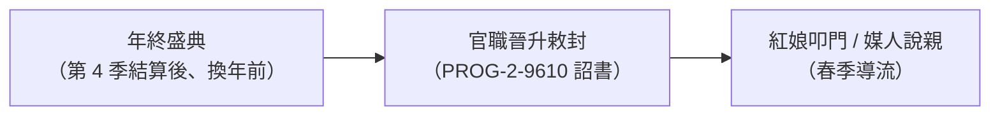

<!-- doc_id: doc_spec_1285 -->
# 史境天下風雲榜與年終頒獎典禮系統規格書（分片索引） — 5–8 年終頒獎典禮互動劇本、雙主持與君王 3D 投影、大合照快照背景與歷年風雲史冊、擴充榜範例（私塾人氣名師）

> 這是 `史境天下風雲榜與年終頒獎典禮系統規格書.md` 的「5–8」分片。完整索引見 `docs/遊戲規格文件/系統規格書/史境天下風雲榜與年終頒獎典禮系統規格書.md`。

## 5. 年終頒獎典禮互動劇本與雙主持傳承

每年 Q4 年終結算（守城戰之後、換年之前）**固定必定舉辦頒獎典禮**。整個典禮完全走共用劇情底座 `STY-M`（`doc_spec_1188` `ceremony` 模組），嚴守「**先結算名次與發獎、後播放演出**」硬規定，演出走共用劇情（演出）框架；跳過機制與觸發時機尚待使用者裁決（見 §8.1 Q1、Q2），無論採何方案皆須先結算發獎、不得丟失任何獎勵或名冊寫入。

### 5.1 雙主持人動態傳承機制
- **第 2 年起**：固定由「**上一年度紅顏表演魅力榜第 1 名女性角色** ＋ **上一年度最佳新人王**」聯袂站在司儀台主持大典！
  - 兩人依據性格組合觸發專屬開場互捧／吐槽台詞（例：去年奪冠的豪氣女將吐槽今年穿太正式的新人王）。
  - 典禮尾聲公布本屆「紅顏榜首」與「新人王」時，主持人會現場把司儀棒交給這兩位新任冠軍，預告明年換他們登台！
- **第 1 年創始屆特例（Q-CER1）**：第 1 年無「上屆得主」，由頭盔 AI 客服「**史小境**」搭配全漢朝最大 KOL「**司馬徽**」（只回一個字「好」的經典梗）聯手主持，於結尾把麥克風交棒給第一屆雙冠王。

### 5.2 君王勢力全息投影觀禮（世界觀包裝：3D 投影；技術實作：立繪全息濾鏡）
- **世界觀包裝**：天下所有存活勢力君王（含曹操、劉備、孫權等諸侯）於典禮開場時以「3D 全息投影」跨網際連線入場觀禮（**PM 提案，非使用者要求**）。
- **技術實作（對齊 11/22 總 PM 裁決 Q1:A）**：
  - **不建立 3D 模型**，避免巨幅手機效能負擔與高昂美術製作成本。
  - 直接複用既有 2D 武將立繪與小人資產，掛載半透明全息 Shader 濾鏡（青藍微光、掃描線微波、微弱數位雜訊跳動與浮動文字標籤 `[魏] 曹操 全息連線中`）。
- **互動彈幕吐槽**：當某榜冠軍揭曉時，在座相關君王投影頭頂會冒出趣味氣泡彈幕（例：玩家奪冠時，敵國曹操投影冒出「…此子斷不可留！」；若屬其陣營則冒出「孤之千里駒也！」）。

### 5.3 逐步公開獎項劇本流程（`CeremonyScriptAssembler`）
劇本組裝器不寫死固定項目，而是讀取當屆啟用的 `activeBoards`（按 `ceremonyOrder` 排序）動態組裝 `StoryCue[]`：
1. **序幕**：載入金殿大廳背景 ➔ 諸侯全息立繪依序上線 ➔ 雙主持人（史小境＋司馬徽，或上屆雙冠王）登台開場。
2. **逐榜揭曉迴圈**：對每個啟用榜單依序播放：
   - 公布前 10 名入圍名單、分數、**與去年名次異動（`▲+N` / `▼-N` / `—` / `NEW`）**。
   - 聚光燈定格於第 1 名，彈出**評審團／頭號粉絲武將備註原因**。
   - 冠軍發表 1 句符合其 `Mind` 性格的得獎感言（玩家自家上榜時額外播放世家賀彩特效）。
3. **壓軸大合照（Stage 4）**：全體入圍武將＋雙主持＋諸侯投影合框留念。

## 6. 大合照快照變現場背景與「歷年風雲史冊」

### 6.1 大合照構圖與存檔輕量化（對齊 11/22 總 PM 裁決 Q2:B）
- **雙層梯形構圖（嚴控記憶體）**：
  - **前排焦點（半身立繪）**：雙主持人（2 人）＋ 本屆啟用榜單之冠軍們（4～5 人）＋ 玩家家族入圍者代表。
  - **後排與兩側（精緻小人 / 全息頭像）**：各國君王全息投影 ＋ 其餘前 10 名入圍武將（去重後約 30～40 人整齊分層站位）。
- **拍照當下定格成現場背景（僅執行期畫面，不存檔）**：
  - 主持人倒數「3、2、1、笑一個！」觸發快門音效與白光過場，Cocos `RenderTexture` 瞬間將當前合成舞台快照定格為**現場大背景圖**（典禮謝幕對話期間全程使用這張大合照當背景，玩家可自由點擊查看站位人員名牌）。
  - **本機快照分享**：僅供玩家在客戶端手動點擊「保存相簿／分享圖片」時，單次導出真實 PNG 至手機相簿，**存檔中絕不保留任何 PNG/JPEG 二進位圖檔或 Base64 字串**。
- **存檔架構（純資料即時組裝，走伺服器 API）**：
  - 存檔只存輕量站位構圖資料結構 `CeremonyPhotoBackdropDto`（年份、陣型 ID、主持人武將 ID、各榜冠軍 ID 與前/後排武將 ID 清單與表情姿態）。
  - 「定格合影／紀念展示圖」不是存圖：每次重新打開歷年風雲史冊時，由前端引擎 100% 依 DTO（ID、年份、獎項、評分快照）查閱時即時抓取最新資產拼裝重現，節省 99.8% 存檔傳輸體積與儲存空間。

### 6.2 歷年得獎名冊永久查詢（`annualCeremonyArchive`）
- 自第 2 年起，玩家隨時可從大廳／世家總覽進入「**史境風雲史冊**」頁面：
  - 自由切換「第 1 屆 ～ 當前年份」任意一屆，查閱該屆所有榜單前 10 名、分數、當年名次異動、評審／粉絲短評與當年雙主持，並直接以該屆大合照 DTO 作為頁面背景。
  - **生涯殿堂統計**：每名武將詳情／傳記頁自動彙總「生涯共奪冠 X 次、入圍前十 Y 次」，即使該武將日後退役或逝世，歷年名冊仍保留其當年受獎風采。

## 7. 排名異動與資料驅動評語規則

- **上年異動計算**：存檔僅保留「去年各榜前 100 名」（`prevTop100Ranks: Record<string, Record<string, number>>`）。今年進前 10 者：
  - 去年亦在百名內：顯示 `▲ +N`（名次上升）、`▼ -N`（名次下降）或 `—`（持平）。
  - 去年不在百名內或今年剛出道：顯示 `NEW`。
- **前 10 名因果證據評語（無 LLM）**：
  - 由各 Provider 的 `buildEvidence()` 從 `AnnualGeneralLedger` 取出該將「貢獻佔比最高之 1 項事蹟＋具體數字＋關聯對象 ID」（如：`最高對手：呂布(2.4x)`、`代表劇目：鳳儀亭`、`頭號粉絲：張飛(68票)`、`得意門生：趙統(S級)`），再交由語料模板組裝。

## 8. 擴充榜單範例：私塾人氣名師榜（驗證可插拔架構）

依據 `doc_spec_1280`（《武將私塾補習班系統規格書》），在世武將可下班後開私塾並採稀疏儲存紀錄學生友誼與滿堂次數。若未來版本要新增第 6 榜「**私塾人氣名師榜（`boardId: "private_tutor"`）**」：
1. **私塾結算記帳**：每期私塾結業或友誼增長時，呼叫 `ledger.addMetric(teacherId, 'tutor.popularScore', feeAndEvalPoints, { bestStudentId, classCount })`（引用 `doc_spec_1280` AI 私塾確定性生成與稀疏儲存機制）。
2. **新增 Provider**：建立 `PrivateTutorRankingProvider.ts` 實作 `IRankingBoardProvider`（只約 35 行），從指標讀取 `tutor.popularScore` 與最活躍同學 `bestStudentId` 作為證據，註冊進 `RankingBoardRegistry`。
3. **JSON 新增設定**：於 `annual-ranking-config.json` 的 `boards[]` 加入 `{ "boardId": "private_tutor", "ceremonyOrder": 6, "enabledWhen": { "minYear": 2 }, "evaluatorKey": "private_tutor", ... }`。
4. **零改動驗證**：核心引擎、`CeremonyScriptAssembler`、存檔 `annualCeremonyArchive.boards` Map 與 UI 史冊頁籤**全部不改一行程式碼**，第 2 年典禮就會自動多出第 6 個頒獎環節！

## 8.1 使用者裁決結果與大廳進場隊列順序（已定案）

本系統規格之關鍵議題已由使用者正式裁決，全面採納推薦方案並寫入正文規範：

- **Q1 觸發時機（定案 A）**：
  - **時機**：第 4 季（冬季）各項治理與戰事結算完畢、進入新春換年之前，系統自動彈出年終盛典入場導流。
  - **流程**：玩家觀看（或跳過）完整典禮並領取獎勵與名冊後，遊戲時鐘才正式切換至新的一年（第 1 季春）。
- **Q2 跳過機制（定案 A）**：
  - **快進與跳過**：支援「一鍵跳過完整典禮」與「點擊加速逐榜揭曉」，完全遵循共用框架 `STY-M` 規範（先伺服器結算完成後再播放演出）。
  - **保全與回放**：跳過不會遺漏任何獎項發放，歷年合照 DTO 與排名名冊照常寫入存檔；玩家事後可隨時在「歷年風雲史冊」中重新回放典禮演出。
- **Q3 榮譽徽章與名冊美術風格（定案 A，遵循 Q-W8）**：
  - **風格**：古典漢風絲絹金帛卷軸 ＋ 現代全息微光掃描線（古今融合風），生動呼應主角是頭盔穿越來的未來少年（不死不老）。
  - **數值屬性**：純榮譽成就與紀念意義，**不附加任何戰鬥或內政數值加成**。
  - **美術資產**：初期實作先以佔位圖接入，正式精美資產由總 PM 另行指派專屬美術繪製。

### 8.2 大廳進場彈窗隊列順序（Lobby Guide Queue）

為避免跨年度與換季時多重事件彈窗互相重疊遮蔽，大廳進場彈窗隊列順序嚴格固定如下：

1. **第一優先：年終盛典**（總結過去一年功績，發放年終大獎與榮譽徽章）。
2. **第二優先：官職晉升詔書**（新春伊始若功績晉升，朝廷敕封賜爵）。
3. **第三優先：紅娘叩門 / 媒人來訪**（春季開年若未達配偶上限，媒人登門提親）。
- 隊列由統一的 `LobbyGuideQueue` 管理，各彈窗依序關閉後才喚出下一項，確保玩家體驗清晰流暢。

