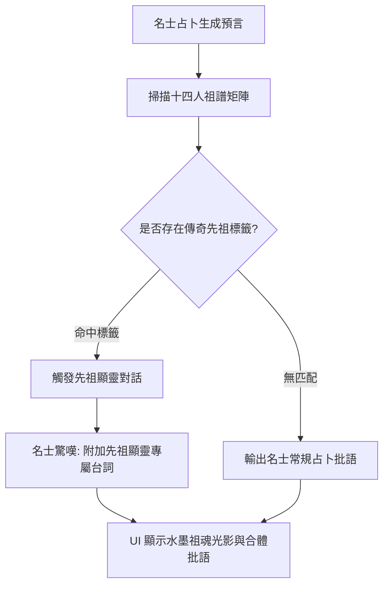

<!-- doc_id: doc_spec_0647 -->
# 名士占卜祖輩顯靈台詞觸發與血脈標籤匹配規格書

> **規格代碼**：`ORAC-08`
> **版本**：v1.0 (Single Source of Truth)
> **狀態**：正式定案 (Approved)
> **檔案大小限制**：嚴格 <6144 bytes

---

## 1. 系統定位與架構

本規格定義玩家於名士館進行求籤占卜時，祖譜十四人傳奇標籤觸發「先祖顯靈（Ancestor Epiphany）」特殊對話與視覺特效之契約。
**核心原則（Single Source of Truth）**：
- 顯靈事件為純敘事沉浸增強，**絕對不篡改名士占卜的底層準確率與因子抽樣機率**。
- 嚴格透過十四人祖譜矩陣進行標籤匹配，精準對照三代先祖榮耀。



---

## 2. 傳奇先祖標籤與顯靈台詞矩陣

```typescript
export interface AncestorEpiphanyDef {
  tagKey: string;
  ancestorTitle: string;
  triggerChance: number; // 命中時觸發顯靈機率 (通常為 1.0)
  reactionLine: string;  // 名士驚呼文案
  spiritVoiceLine: string; // 先祖虛影低語
}

export const ANCESTOR_EPIPHANY_REGISTRY: Record<string, AncestorEpiphanyDef> = {
  TAG_DRAGON_HEART: {
    tagKey: "TAG_DRAGON_HEART",
    ancestorTitle: "常山真龍",
    triggerChance: 1.0,
    reactionLine: "卦象忽生龍吟之聲！此子血脈深處，竟得常山長坂之烈氣庇佑！",
    spiritVoiceLine: "匹馬單槍安在哉，子孫莫墜吾家風！",
  },
  TAG_GOD_TACTIC: {
    tagKey: "TAG_GOD_TACTIC",
    ancestorTitle: "神算軍師",
    triggerChance: 1.0,
    reactionLine: "八卦靈爻自轉不息！祖輩算無遺策，此兒日後必掌萬軍機樞！",
    spiritVoiceLine: "錦囊妙計藏天機，明燭長留伴後人。",
  },
  TAG_PEERLESS_MIGHT: {
    tagKey: "TAG_PEERLESS_MIGHT",
    ancestorTitle: "蓋世無雙",
    triggerChance: 1.0,
    reactionLine: "凶煞與霸氣沖霄而起！先祖戰神之魂未散，殺伐之器也！",
    spiritVoiceLine: "縱橫天下誰可當，唯勇唯烈破千軍！",
  },
  TAG_EMPEROR_LINEAGE: {
    tagKey: "TAG_EMPEROR_LINEAGE",
    ancestorTitle: "漢室宗親",
    triggerChance: 1.0,
    reactionLine: "黃道紫微隱現卦台！大漢四百年宗潢之脈，猶有餘火存續！",
    spiritVoiceLine: "仁義未絕興漢業，繼志述事莫辭勞。",
  },
};
```

---

## 3. 匹配演算與 UI 展示契約

1. **掃描演算法**：
   - 走訪十四人祖譜矩陣中的所有有效先祖節點（排除空白虛擬節點）。
   - 若同時命中多個傳奇標籤，依優先級 `EMPEROR_LINEAGE > PEERLESS_MIGHT > GOD_TACTIC > DRAGON_HEART` 僅觸發最高優先級 1 條顯靈，防止對話刷屏。
2. **UI 視覺表現**：
   - 預言彈窗中央浮現半透明青銅祖紋拓印，伴隨一聲水墨鐘鳴。
   - 名士對話氣泡上方追加金色專屬標籤 `【先祖顯靈】`，文案字型呈現行楷特效。
