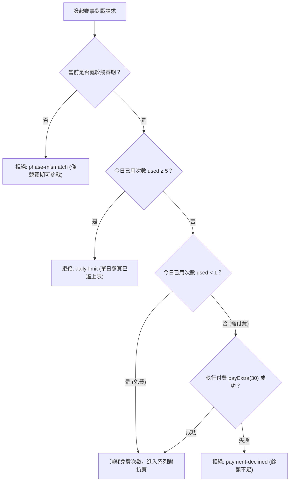

<!-- doc_id: doc_spec_0411 -->
# 名將挑戰賽BOSS挑戰券與額外報名經濟規格書

> 本規格書為 3KLife 名將挑戰賽賽事報名次數、付費額外參賽門票與季節 BOSS 挑戰券經濟模型之唯一真相來源（Single Source of Truth）。
> 相關實作對齊：`assets/scripts/core/systems/TournamentLocal.ts`、`TournamentSeason.ts`。

---

## 1. 系統定位與賽事經濟結構

1. **循環型競技經濟體系**：
   - 名將挑戰賽以 14 天為一週期，劃分培育期（前 7 天）與競賽期（後 7 天）。
   - 經濟回圈由兩大子軌構成：
     - **天梯對戰經濟軌**：每日免費參戰 + 額外付費次數，推動段位積分晉升。
     - **季節 BOSS 挑戰券軌（`ECO-12`）**：每日定量贈送挑戰門票，挑戰季節 BOSS 並獲取特殊裝備或稱號。
2. **純邏輯解耦契約**：
   - 賽事狀態由 `TournamentState` 純資料結構維護，不依賴 UI 元件。
   - 扣款發貨均經由高階呼叫端（如 `payExtra` 回呼）仲裁，失敗即攔截並保護玩家資產。

---

## 2. 賽事入場經濟規則（Tournament Entry Economy）

| 參數常數項 | 數值 / 設定 | 說明 |
|---|:---:|---|
| `dailyFreeEntries` | **1 次** | 每日重置之免費參賽次數（UTC+8 自然日切日） |
| `extraEntryCost` | **30 精元** | 免費次數用盡後，每次額外參戰所需支付金額 |
| `maxDailyEntries` | **5 次** | 單日累計參賽總上限（1 次免費 + 最多 4 次額外付費） |

### 2.1 參賽流程判定


---

## 3. 季節 BOSS 挑戰券子經濟（Boss Ticket Economy）

### 3.1 每日自動配發機制（grantDailyBossTicket）
- **發放頻率**：每日切日首次存取時自動配發 **1 張** BOSS 挑戰券。
- **持有上限（`BOSS_TICKET_MAX_HOLD`）**：
  $$\text{BOSS\_TICKET\_MAX\_HOLD} = 3 \text{ 張}$$
  - 若當前持有量已達 3 張，當日配發日戳記（`bossTicketDay`）仍會更新為當天，但票券不再累加（防爆倉機制）。

### 3.2 門票消耗機制（spendBossTicket）
- 發起季節 BOSS 戰役前，強制扣除 1 張挑戰券：
  $$\text{bossTickets}' = \text{bossTickets} - 1$$
- 若當前持有量 $\le 0$，函式回傳 `{ ok: false, state }`，拒絕開啟戰鬥。

### 3.3 商城加購與獎勵擴充（addBossTickets）
- 透過百寶閣加購、季末結算或活動獎勵取得門票時，呼叫 `addBossTickets(state, count)`：
  - 數量必須為正整數（$count \in \mathbb{Z}^+$）。
  - 活動獎勵與直接付費購買**不受**每日持有上限 3 張約束，允許溢出堆疊。

---

## 4. 介面契約與資料正規化

```typescript
export const TOURNAMENT_LOCAL_CONFIG = {
    dailyFreeEntries: 1,
    extraEntryCost: 30,
    maxDailyEntries: 5,
    // ...
} as const;

export const BOSS_TICKET_MAX_HOLD = 3;

export interface TournamentState {
    // ...
    bossTickets?: number;
    bossTicketDay?: number;
}

export function grantDailyBossTicket(state: Readonly<TournamentState>, nowMs: number): TournamentState;
export function addBossTickets(state: Readonly<TournamentState>, count: number): TournamentState;
export function spendBossTicket(state: Readonly<TournamentState>): { ok: boolean; state: TournamentState };
```
