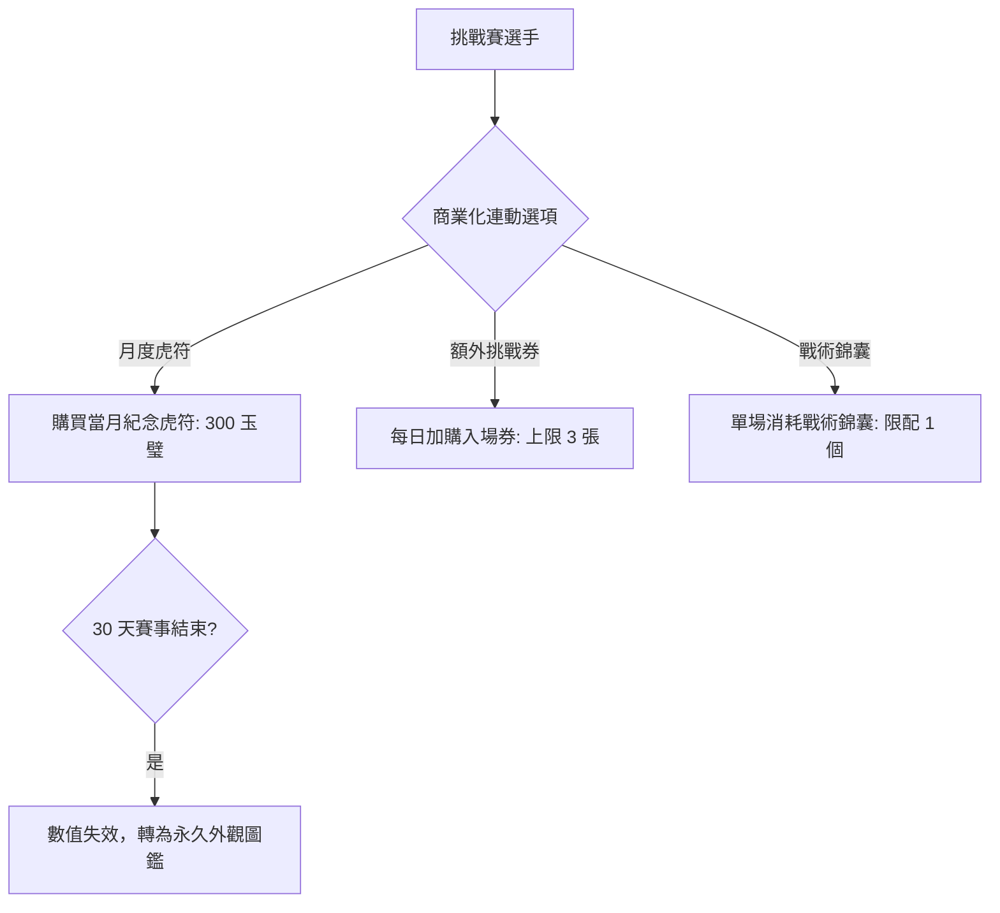

<!-- doc_id: doc_spec_0636 -->
# 名將挑戰賽月度場景虎符限時販售與入場券經濟平衡規格書

> **規格代碼**：`TRN-16`
> **版本**：v1.0 (Single Source of Truth)
> **狀態**：正式定案 (Approved)
> **檔案大小限制**：嚴格 <6144 bytes

---

## 1. 系統定位與商業化邊界裁決

本規格定義名將挑戰賽中月度場景虎符、輔助錦囊與挑戰券加購之商業化連動規則與平衡限制。
**歷史爭議裁決（Single Source of Truth）**：
- 解開過往商業化封鎖，恪守天梯公平原則：月度虎符數值加成嚴格限定於當月主題賽事，且效期結束後自動轉化為無戰力加成之純外觀紀念物。
- 挑戰券加購設置每日硬上限，嚴禁課金玩家無限次重複挑戰洗榜。



---

## 2. 月度紀念虎符與場景道具模型

```typescript
export interface MonthlyThemeTally {
  tallyId: string;
  themeMonth: number;           // 1~12 月主題
  name: string;
  themeBonusMultiplier: number; // 僅於當月主題賽事生效: 1.10 (+10%)
  validDays: number;            // 效期: 30 天
  gemPrice: number;             // 定價: 300 玉璧
}

export interface ChallengeTicketEconomy {
  dailyFreeTickets: number;     // 每日免費發放: 3 張
  maxPaidTicketsPerDay: number; // 每日加購上限: 3 張
  ladderPrices: number[];       // 階梯價格: [50, 100, 150] 玉璧
}

export const TOURNAMENT_ECONOMY_CONFIG: ChallengeTicketEconomy = {
  dailyFreeTickets: 3,
  maxPaidTicketsPerDay: 3,
  ladderPrices: [50, 100, 150],
};
```

---

## 3. 防洗榜與天梯平衡安全防火牆

1. **加購硬邊界**：每日免費加加購總參賽次數上限為 $3 + 3 = 6$ 次，避免課金差距破壞平民玩家體驗。
2. **賽後清算回退（Sunset Fallback）**：
   - 當月月度場景賽結算日 24:00 觸發。
   - 所有已售出之月度紀念虎符之 `themeBonusMultiplier` 永久歸零（$1.00$）。
   - 保留專屬青銅銘刻特效與收藏稱號，轉為 `COLLECTIBLE_RECORD` 存入玩家功業館。
