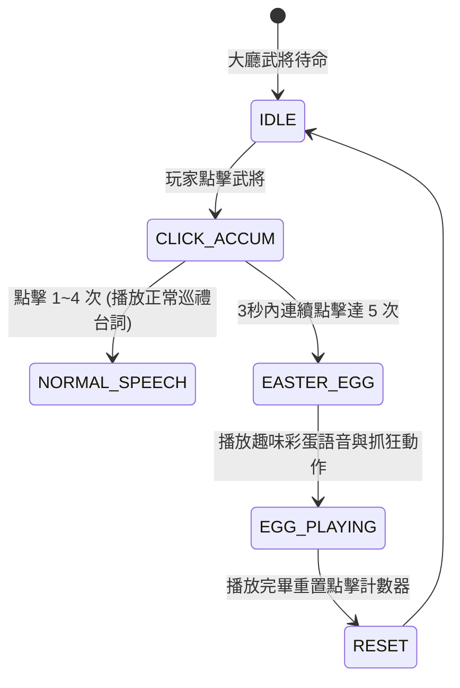

# 名將趣味台詞彩蛋庫與休閒情境觸發規格書

<!-- doc_id: doc_spec_0624 -->

> 本規格書依據 WBS `COPY-05`（趣味台詞彩蛋庫與使用規則：個人語音/彩蛋）制定，為武將休閒互動與趣味彩蛋文案之單一真相來源（Single Source of Truth）。
> 核心約束：無副作用純邏輯架構、嚴格隔離主線戰場（禁主線污染）、大廳連續點擊防誤觸狀態機、幽默人設立體化、全繁體中文台灣慣用術語。

---

## 1. 業務定位與嚴格隔離原則

為確保三國史詩正劇之莊重沉浸感，名將之幽默趣味台詞嚴格受限於非戰鬥之休閒彩蛋場景：
1. **嚴禁主線污染**：在主線戰役、開場宿命選秀、出征部署與生死決戰中，一律強制走正式古典台詞（`doc_spec_0622`），**絕對禁止播放趣味台詞**。
2. **許可觸發場景**：
   - 大廳點位武將：連續快速點擊 5 次（Poke 狂暴狀態）。
   - 戰役大捷慶祝酒宴：點選舉杯敬酒時。
   - 幕府休閒節慶時段：夜間燈火漫步時。



---

## 2. 名將與紅顏趣味彩蛋文案庫

| 武將／角色 | 彩蛋代碼 | 趣味情境描述 | 趣味台詞內容 |
|---|---|---|---|
| 張飛 | `EGG_ZHANG_FEI` | 醉酒找矛 | 「欸？俺的丈八蛇矛呢？方才明明拿去架著烤羊腿了……主公莫催，俺找找！」 |
| 魏延 | `EGG_WEI_YAN` | 反骨碎念 | 「整天說我後腦勺長得反骨……這明明是骨骼驚奇！子午谷之計到底批不批嘛！」 |
| 夏侯惇 | `EGG_XIAHOU_DUN` | 盲侯尋眼罩 | 「盲侯盲侯……誰把某家的黑眼罩藏起來了？孟德！是不是你拿去捉弄人了？」 |
| 張郃 | `EGG_ZHANG_HE` | 強迫症推演 | 「這棋子怎能偏了半寸！奇正相生講求的是對稱美感，重擺！通通給我重擺！」 |
| 孫策 | `EGG_SUN_CE` | 抱怨公瑾 | 「公瑾那傢伙成天在耳邊唸叨，比我老娘還囉嗦！主公，咱們溜出城去打獵吧？」 |
| 甘寧 | `EGG_GAN_NING` | 數銅鈴鐺 | 「一二三四……鈴鐺怎麼又少了一個？準是又被長江裡的大魚給咬走了，晦氣！」 |
| 貂蟬 | `EGG_DIAO_CHAN` | 梳妝吐槽 | 「每日早朝都要頂著這沉甸甸的鳳冠，使君，你何時才肯給妾身放個假呀？」 |

---

## 3. 資料模型與連續點擊狀態機

```typescript
export interface IPokeClickState {
    readonly characterId: string;
    readonly clickCount: number;
    readonly lastClickTime: number;
}

export interface IPokeEvaluationResult {
    readonly nextState: IPokeClickState;
    readonly triggerEasterEgg: boolean;
    readonly speechLine: string | null;
}

export const EASTER_EGG_MAP: Readonly<Record<string, string>> = {
    HERO_ZHANG_FEI: '欸？俺的丈八蛇矛呢？方才明明拿去架著烤羊腿了……主公莫催，俺找找！',
    HERO_WEI_YAN: '整天說我後腦勺長得反骨……這明明是骨骼驚奇！子午谷之計到底批不批嘛！',
    HERO_XIAHOU_DUN: '盲侯盲侯……誰把某家的黑眼罩藏起來了？孟德！是不是你拿去捉弄人了？',
    HERO_ZHANG_HE: '這棋子怎能偏了半寸！奇正相生講求的是對稱美感，重擺！通通給我重擺！',
    HERO_SUN_CE: '公瑾那傢伙成天在耳邊唸叨，比我老娘還囉嗦！主公，咱們溜出城去打獵吧？',
    HERO_GAN_NING: '一二三四……鈴鐺怎麼又少了一個？準是又被長江裡的大魚給咬走了，晦氣！',
    SUP_DIAO_CHAN: '每日早朝都要頂著這沉甸甸的鳳冠，使君，你何時才肯給妾身放個假呀？',
};

export function handleCharacterPoke(
    currentState: IPokeClickState,
    clickTime: number
): IPokeEvaluationResult {
    const isWithinCombo = (clickTime - currentState.lastClickTime) <= 3000;
    const newCount = isWithinCombo ? currentState.clickCount + 1 : 1;

    if (newCount >= 5) {
        return {
            nextState: { characterId: currentState.characterId, clickCount: 0, lastClickTime: clickTime },
            triggerEasterEgg: true,
            speechLine: EASTER_EGG_MAP[currentState.characterId] ?? '主公請自重，莫再戳了！',
        };
    }

    return {
        nextState: { characterId: currentState.characterId, clickCount: newCount, lastClickTime: clickTime },
        triggerEasterEgg: false,
        speechLine: null,
    };
}
```

---

## 4. 驗收測試案例（Test Cases）

| 測試編號 | 測試情境 | 輸入條件 | 預期輸出 |
|---|---|---|---|
| `TC-EGG-01` | 連續點擊 5 次觸發彩蛋 | 3秒內點擊張飛 5 次 | `triggerEasterEgg=true`, 播放烤羊腿彩蛋台詞 |
| `TC-EGG-02` | 間隔超過 3 秒計數重置 | 點擊 2 次後等待 4 秒再點 | `clickCount` 重置為 1，不觸發彩蛋 |
| `TC-EGG-03` | 觸發後計數器歸零 | 觸發彩蛋後再點第 6 次 | `clickCount=1`，避免彩蛋持續洗頻 |
| `TC-EGG-04` | 戰場場景強制封印 | 戰鬥場景傳入彩蛋請求 | 阻斷攔截，強制回退為戰場戰吼 |
