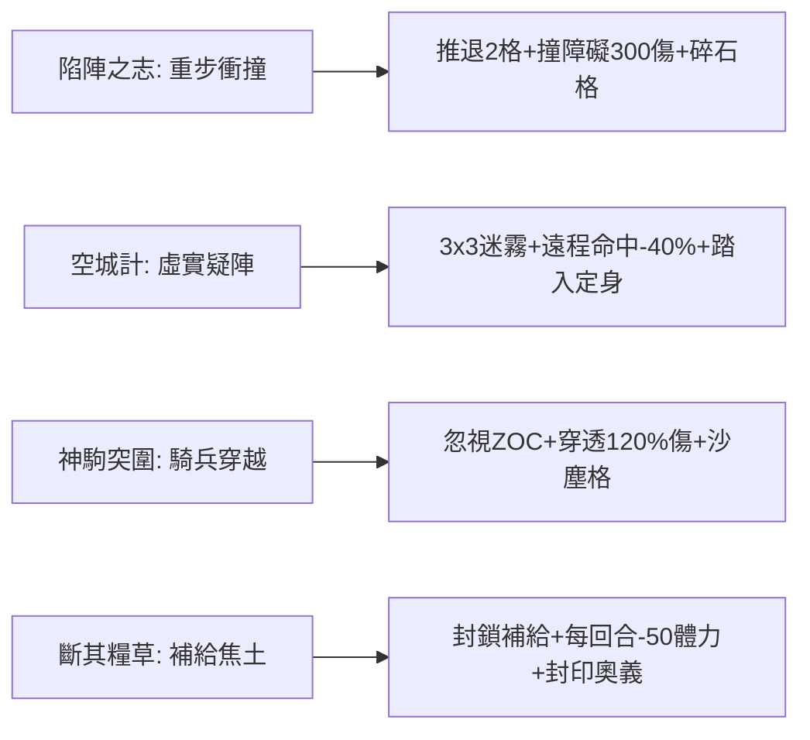

# 四類技能原型格子映射與戰場動態觸發規格書

<!-- doc_id: doc_spec_0614 -->

> 本規格書依據 WBS `FORM-12`（四類技能原型格子映射：陷陣之志/空城計/神駒突圍/斷其糧草）制定，為戰場格子技能原型與環境互動之單一真相來源（Single Source of Truth）。
> 核心約束：無副作用純邏輯架構、四大原型地格動態轉化、ZOC 阻擋與位移穿越精算、全繁體中文台灣慣用術語。

---

## 1. 業務定位與四大原型

為強化棋盤戰場深度，戰術技能直接與地格狀態（Tile State）及區域控制（ZOC）交互。四大經典技能原型規範如下：



### 1.1 詳細規則
1. **陷陣之志（Camp Assault）**：近戰重步兵衝鋒，強推目標擊退 2 格。若撞擊阻擋格（山體、城牆、單位），位移中斷並承受額外 300 點碰撞傷害，原地生成「碎石地格（`TILE_RUBBLE`）」（移動消耗 $+1$）。
2. **空城計（Empty Fort Stratagem）**：智力領先 15 點以上可發動，將周圍 $3 \times 3$ 區域轉化為持續 2 回合之「疑陣迷霧（`TILE_MIST`）」。敵方射入命中率 $-40\%$；首位踏入敵軍強制停止移動並定身。
3. **神駒突圍（Divine Steed Breakout）**：騎兵專屬，忽視敵軍 ZOC 阻擋，直線穿透 3 格。沿途敵軍承受 $120\%$ 傷害，路徑留下 1 回合「奔騰沙塵（`TILE_DUST`）」（友軍移動力 $+1$）。
4. **斷其糧草（Sever Supply Line）**：指定敵後補給格轉為「焦土（`TILE_SCORCHED`）」持續 3 回合，停留敵軍每回合扣 50 體力且無法調用 SP。

---

## 2. 資料模型與純邏輯介面

```typescript
export interface IGridCoord { readonly x: number; readonly y: number; }
export type PrototypeType = 'CAMP_ASSAULT' | 'EMPTY_FORT' | 'STEED_BREAKOUT' | 'SEVER_SUPPLY';

export interface ITacticExecutionRequest {
    readonly prototype: PrototypeType;
    readonly casterPos: IGridCoord;
    readonly targetPos: IGridCoord;
}

export interface ITacticGridEffect {
    readonly affectedTiles: readonly IGridCoord[];
    readonly tileModifierType: string;
    readonly durationTurns: number;
    readonly knockbackTarget?: IGridCoord;
}

export function resolvePrototypeGridEffect(req: ITacticExecutionRequest): ITacticGridEffect {
    switch (req.prototype) {
        case 'CAMP_ASSAULT': {
            const dx = Math.sign(req.targetPos.x - req.casterPos.x);
            const dy = Math.sign(req.targetPos.y - req.casterPos.y);
            return {
                affectedTiles: [req.targetPos],
                tileModifierType: 'TILE_RUBBLE',
                durationTurns: 2,
                knockbackTarget: { x: req.targetPos.x + dx * 2, y: req.targetPos.y + dy * 2 },
            };
        }
        case 'EMPTY_FORT': {
            const tiles: IGridCoord[] = [];
            for (let dx = -1; dx <= 1; dx++) {
                for (let dy = -1; dy <= 1; dy++) {
                    tiles.push({ x: req.casterPos.x + dx, y: req.casterPos.y + dy });
                }
            }
            return { affectedTiles: tiles, tileModifierType: 'TILE_MIST', durationTurns: 2 };
        }
        case 'STEED_BREAKOUT': {
            const dx = Math.sign(req.targetPos.x - req.casterPos.x);
            const path: IGridCoord[] = [
                { x: req.casterPos.x + dx, y: req.casterPos.y },
                { x: req.casterPos.x + dx * 2, y: req.casterPos.y },
                { x: req.casterPos.x + dx * 3, y: req.casterPos.y },
            ];
            return { affectedTiles: path, tileModifierType: 'TILE_DUST', durationTurns: 1 };
        }
        case 'SEVER_SUPPLY': {
            return { affectedTiles: [req.targetPos], tileModifierType: 'TILE_SCORCHED', durationTurns: 3 };
        }
    }
}
```

---

## 3. 驗收測試案例（Test Cases）

| 測試編號 | 測試情境 | 輸入條件 | 預期輸出 |
|---|---|---|---|
| `TC-PROTO-01` | 陷陣之志擊退與碎石生成 | 目標在 (3,2)，施法在 (2,2) | 擊退目標至 (5,2)，原目標格生成 `TILE_RUBBLE` |
| `TC-PROTO-02` | 空城計 3x3 迷霧陣展開 | 施法者在 (4,2) | 產生 9 個地格之 `TILE_MIST`，持續 2 回合 |
| `TC-PROTO-03` | 神駒突圍穿透路徑沙塵 | 施法在 (1,1)，直線衝鋒 | 產生 (2,1), (3,1), (4,1) 三格 `TILE_DUST` |
| `TC-PROTO-04` | 斷其糧草焦土持續 3 回合 | 鎖定目標大營 (7,2) | (7,2) 轉化為 `TILE_SCORCHED`，持續 3 回合 |
